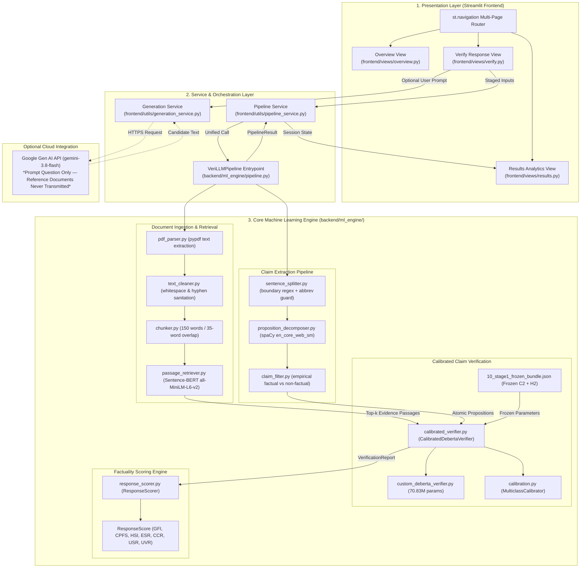

# VeriLLM: Architectural Specification & System Design

**Version:** 1.0.0 (Production Release)  
**Date:** November 2026  
**Status:** Authoritative Architectural Source of Truth  
**Target Platform:** Local-First Python / Streamlit Architecture on Windows / Linux / macOS

---

## 1. Architectural Overview & Design Philosophy

**VeriLLM** (*Verification of Large Language Models*) is an engineering and research framework for detecting, quantifying, and analyzing factual inconsistencies in Large Language Model (LLM) responses.

The system is architected around four core design principles:

1. **Local-First Data Sovereignty:**
   Reference documents ingested into VeriLLM are parsed, indexed, chunked, and verified strictly within local system memory on the host CPU. No proprietary documents or enterprise knowledge bases are transmitted to external third-party cloud APIs.
2. **Independent, Model-Agnostic Verification:**
   VeriLLM rejects the circular and uncalibrated "LLM-as-a-Judge" paradigm. Candidate responses are evaluated against reference evidence using an independent cross-encoder neural network (`cross-encoder/nli-deberta-v3-xsmall`, 70.83M parameters) fine-tuned on the RAGTruth benchmark.
3. **Calibrated Multi-Class Decisions ($C2$):**
   Raw neural network probabilities are post-hoc calibrated using L2-regularized prior-bias transformation and temperature scaling ($C2$), resolving severe overconfidence on minority failure modes ($\approx 3.8\%$ contradiction rate) without altering backbone neural weights.
4. **Epistemic Abstention & Traceability:**
   When evidence is absent or similarity falls below a pre-registered floor ($\tau_{\text{floor}} = 0.20$), the system explicitly abstains by assigning `UNVERIFIABLE` rather than forcing an ungrounded guess. Every claim verdict retains exact character-level offsets and citation context.

---

## 2. End-to-End System Architecture

The implemented architecture cleanly separates into three operational tiers: the **Presentation Tier**, the **Service & Orchestration Tier**, and the **Core ML Engine Tier**.



---

## 3. Component Breakdown & Responsibilities

### 3.1 Presentation Tier (`frontend/`)
- **`app.py`:** Application entrypoint. Configures the Streamlit page layout (`wide`, dark theme), initial sidebar status badges, and establishes the reactive view routing via `st.navigation`.
- **`views/overview.py`:** Executive introduction, system architecture documentation, dual-mode operational guide, and empirical model benchmark profile.
- **`views/verify.py`:** Interactive verification workspace. Provides dual verification tabs:
  - *Tab 1: Manual Verification:* Upload PDF/TXT or paste text; provide question prompt and candidate response manually.
  - *Tab 2: Live Gemini Verification:* Upload reference document, provide prompt question, request live candidate generation from Gemini, edit candidate text, and execute local verification.
  - Controls document staging, file validation cards, and verification regime selection (`Direct Context` vs. `Dense Retrieval`).
- **`views/results.py`:** Analytics dashboard rendering KPI cards ($GFI$, $CPFS$, $HSI$, execution time), Altair category distribution bar charts, calibrated posterior probability breakdowns, metric interpretation guides, claim inspection cards with citation context, and raw JSON export.
- **`components/header.py`:** Consistent page headers, badges, and sidebar metadata footer.
- **`utils/styles.py`:** Custom CSS injection enforcing modern dark-theme SaaS design patterns.

### 3.2 Service & Orchestration Tier
- **`frontend/utils/pipeline_service.py`:** Bridges UI inputs into backend execution. Validates staged file bytes, direct text strings, and candidate responses, invoking `VeriLLMPipeline.verify()`.
- **`frontend/utils/generation_service.py`:** Adapter client wrapping optional live generation. Manages API availability checks, bounded retry backoff, and error degradation notices.
- **`backend/ml_engine/pipeline.py` (`VeriLLMPipeline`):** Canonical pipeline orchestrator. Unifies:
  1. Document ingestion and format validation.
  2. Proposition extraction and non-factual filtering.
  3. Evidence formulation (direct chunking vs. SBERT indexing).
  4. Calibrated neural verification.
  5. Response-level factuality scoring and invariant verification.

### 3.3 Document Processing & Evidence Retrieval (`backend/ml_engine/evidence_retriever/`)
- **`pdf_parser.py`:** Parses digital PDF streams using `pypdf.PdfReader`, tracking page numbers and validating file signatures (`%PDF`).
- **`text_cleaner.py`:** Cleans excessive whitespace, non-breaking spaces, hyphenated word breaks, and ASCII control characters.
- **`chunker.py` (`SlidingWindowChunker`):** Segments documents into 150-word passages with a 35-word stride overlap ($S = 115$ words), preserving character spans and page metadata.
- **`passage_retriever.py` (`PassageRetriever`):** Indexes passages using `sentence-transformers/all-MiniLM-L6-v2` (384-dimensional embeddings, L2 normalized). Computes cosine similarity against proposition queries, returning top-$k$ ($k=3$) passages. Calls `clear_index()` to release tensor memory upon query completion.

### 3.4 Claim Extraction Subsystem (`backend/ml_engine/claim_extractor/`)
- **`sentence_splitter.py`:** Regex-based sentence boundary segmentation with 28 abbreviation guards (e.g., `Dr.`, `U.S.`, `approx.`, `e.g.`, `i.e.`) preserving exact response character spans (`start_char`, `end_char`).
- **`proposition_decomposer.py`:** spaCy dependency grammar analysis (`en_core_web_sm`). Decomposes coordinate clauses, unwraps relative clauses, resolves pronominal coreferences, and converts rhetorical questions into testable propositions.
- **`claim_filter.py`:** Classifies propositions into *empirical factual claims* vs. *non-factual discourse* (subjective opinions, conversational pleasantries, and meta-text). Non-factual claims are assigned `NON_FACTUAL` and bypassed around neural inference.

### 3.5 Calibrated Verification Engine (`backend/ml_engine/claim_verifier/`)
- **`custom_deberta_verifier.py`:** Executes cross-encoder inference using the fine-tuned 70.83M parameter DeBERTa-v3 checkpoint (`backend/models/verillm_deberta/`), predicting raw 3-class logits for $[\texttt{CONTRADICTED}, \texttt{SUPPORTED\_PROXY}, \texttt{UNSUPPORTED}]$.
  - **Two-Tier Model Resolution:**
    1. *Tier 1 (Local First):* Inspects the default local model directory (`backend/models/verillm_deberta/`). If all four required artifacts (`config.json`, `model.safetensors`, `tokenizer.json`, `tokenizer_config.json`) exist with non-zero size, the model loads directly from the local filesystem with zero network activity.
    2. *Tier 2 (Automatic Fallback Download):* If the default directory is missing or incomplete, the module downloads the four required artifacts from the public Hugging Face repository [`Rabbit-Bull/verillm-deberta`](https://huggingface.co/Rabbit-Bull/verillm-deberta) pinned to immutable Git revision `71259e48c794e89f92075ddf848813c93327461c`, caching them in `backend/models/verillm_deberta/`.
  - **Artifact Validation & Loading:** Post-download or post-resolution, all four required files are validated for presence and non-zero size before initializing `AutoTokenizer` and `AutoModelForSequenceClassification` from local files.
  - **Offline-Mode Gating:** If offline execution is requested via `HF_HUB_OFFLINE=1` or `TRANSFORMERS_OFFLINE=1` and required artifacts are missing, automatic network downloads are blocked and an informative `RuntimeError` is raised advising local placement.
  - **Custom Model Path Isolation:** If an explicit custom `model_path` is provided by the caller, it is validated strictly as a local directory; custom paths never trigger automatic Hub downloads.
- **`calibrated_verifier.py` (`CalibratedDebertaVerifier`):** Production verifier enforcing frozen calibration parameters from `10_stage1_frozen_bundle.json`.
  - Reconstructs centered logits from raw model probabilities.
  - Applies $C2$ affine transformation: $\hat{\mathbf{z}} = \frac{\tilde{\mathbf{z}}}{T} + \mathbf{b}$.
  - Computes calibrated posterior $\hat{\mathbf{p}}_{\text{cal}} = \sigma_{\text{SM}}(\hat{\mathbf{z}})$.
  - Applies $H2$ decision policy priority order:
    1. If $\hat{p}_{\text{contra}} \ge \tau_{\text{contra}} \implies \texttt{CONTRADICTED}$
    2. Else if $\hat{p}_{\text{sup}} \ge \tau_{\text{sup}} \implies \texttt{SUPPORTED}$
    3. Else $\implies \texttt{UNSUPPORTED}$
  - Enforces epistemic abstention in retrieval mode: if evidence is missing or similarity $< \tau_{\text{floor}} = 0.20 \implies \texttt{UNVERIFIABLE}$.

### 3.6 Scoring Engine (`backend/ml_engine/scorer/`)
- **`response_scorer.py` (`ResponseScorer`):** Computes response-level factuality metrics over $N_{\text{factual}}$ empirical propositions:
  - Evidence Support Rate ($ESR = \frac{N_{\text{sup}}}{N_{\text{factual}}} \times 100\%$)
  - Confirmed Contradiction Rate ($CCR = \frac{N_{\text{contra}}}{N_{\text{factual}}} \times 100\%$)
  - Unsupported Rate ($USR = \frac{N_{\text{unsup}}}{N_{\text{factual}}} \times 100\%$)
  - Unverifiable Rate ($UVR = \frac{N_{\text{unver}}}{N_{\text{factual}}} \times 100\%$)
  - Grounded Factuality Index ($GFI = ESR$)
  - Contradiction-Penalized Factuality Score ($CPFS = \max\left(0.0, \frac{N_{\text{sup}} - 2.0 \cdot N_{\text{contra}}}{N_{\text{factual}}}\right) \times 100\%$)
  - Hallucination Severity Index ($HSI = CCR$)
- **Conservation Invariant:** Verifies that $ESR + CCR + USR + UVR \equiv 100.00\%$ ($\pm 0.05\%$ rounding tolerance). Non-factual claims are excluded from the denominator.

### 3.7 Optional External Generation Provider (`backend/ml_engine/llm_generator/`)
- **`client.py`:** Encapsulated provider adapter wrapping the official Google Gen AI SDK (`google-genai>=1.0.0`) for `gemini-3.8-flash`.
- **Fault-Tolerant Retries:** Implements bounded exponential backoff (up to 2 retries) on HTTP 503 `UNAVAILABLE` errors.
- **Graceful Degradation:** When upstream Google preview endpoints experience high demand, catches the error and signals the Streamlit UI to guide the user to the 100% operational Manual Verification workflow.

---

## 4. Dual Operational Regimes

VeriLLM accommodates varying document lengths through two distinct operational regimes:

| Architectural Dimension | Direct Context Regime (`direct`) | Dense Retrieval Regime (`retrieval`) |
| :--- | :--- | :--- |
| **Target Document Scope** | Concise texts ($\le 350$ words, single pages, memos) | Multi-page documents ($> 350$ words, manuals, reports) |
| **Evidence Formulation** | Full document text formatted as a single premise | Document chunked into 150-word passages; top-3 retrieved |
| **Retrieval Overhead** | Zero embedding overhead (bypasses SBERT) | Embedding generation + cosine similarity ranking |
| **Calibration Temperature ($T$)** | **`1.76959203`** | **`2.50411010`** |
| **Calibration Bias ($\mathbf{b}$)** | **`[-0.66788442, 0.71171648, -0.04383205]`** | **`[-0.72845197, 1.22831149, -0.49985952]`** |
| **Support Threshold ($\tau_{\text{sup}}$)** | **`0.70`** | **`0.70`** |
| **Contradiction Threshold ($\tau_{\text{contra}}$)** | **`0.35`** | **`0.30`** |
| **Similarity Floor ($\tau_{\text{floor}}$)** | `0.00` (Unconstrained coverage) | **`0.20`** (Defensive epistemic abstention) |
| **Abstention Behavior** | Not triggered (all propositions evaluated) | Propositions with $\text{sim} < 0.20$ marked `UNVERIFIABLE` |

---

## 5. Architectural Corrections from Initial Plans

During the evolution of VeriLLM from early preliminary concept notes into a production-grade system, several planned architectural layers were superseded by modern, self-contained alternatives:

1. **Streamlit Substituted for React/Vite:**
   - *Planned:* Standalone React + Vite single-page application communicating over HTTP REST.
   - *Delivered:* Native Streamlit multipage application (`st.navigation`, `st.Page`).
   - *Rationale:* Eliminates Node.js runtime overhead, eliminates cross-origin latency, and allows direct Python in-memory tensor passing between UI and ML components.
2. **In-Memory Pipeline Substituted for FastAPI/Uvicorn:**
   - *Planned:* Asynchronous FastAPI microservice backend with JSON REST endpoints.
   - *Delivered:* In-process `VeriLLMPipeline` service layer.
   - *Rationale:* Direct Python function invocation provides sub-millisecond dispatch, eliminates JSON serialization/deserialization bottlenecks, and enables pure offline CPU execution without binding network ports.
3. **Session-State Architecture Substituted for MongoDB Atlas:**
   - *Planned:* Remote MongoDB Atlas database cluster for persistent analysis storage.
   - *Delivered:* Stateless, in-memory Streamlit session state (`st.session_state`) with on-demand JSON payload export.
   - *Rationale:* Preserves absolute data sovereignty (zero cloud database connectivity required) and ensures the application runs out-of-the-box in restricted enterprise environments.
4. **Focused Single-Model Verification Substituted for Heterogeneous Ensembles:**
   - *Planned:* Complex voting ensembles across MiniCheck, RoBERTa-large, and HHEM.
   - *Delivered:* High-efficiency, fine-tuned `DeBERTa-v3-xsmall` cross-encoder paired with $C2$ probability calibration.
   - *Rationale:* Outperformed heavy ensembles on Val-Lock holdout testing while reducing RAM consumption from $> 6\text{ GB}$ to $< 1.2\text{ GB}$.

---

## 6. Security and Data Sovereignty Boundary

```text
+-------------------------------------------------------------------------------+
|                           LOCAL HOST CPU TRUST BOUNDARY                       |
|                                                                               |
|  [ Reference Document ] ---> [ Local Ingestion & Text Extraction (pypdf) ]    |
|                                         |                                     |
|                                         v                                     |
|                              [ Sliding-Window Chunker ]                       |
|                                         |                                     |
|                                         v                                     |
|                              [ SBERT Embedding Index ]                        |
|                                         |                                     |
|  [ Candidate AI Response ] -> [ spaCy Proposition Decomposer ]                |
|                                         |                                     |
|                                         v                                     |
|                              [ Calibrated DeBERTa Verifier ]                  |
|                                         |                                     |
|                                         v                                     |
|                              [ Response Scorer & Metrics ]                    |
|                                         |                                     |
|                                         v                                     |
|                              [ Streamlit Results View ]                       |
+-------------------------------------------------------------------------------+
                                          |
            (Optional User Prompt Question ONLY — Zero Document Text)
                                          |
                                          v  HTTPS (TLS 1.3)
                       +-------------------------------------+
                       |   Google Gen AI API (Gemini Cloud)  |
                       |    *Candidate Generation Only*      |
                       +-------------------------------------+
```

- **Reference Documents:** 100% processed and stored within local RAM. Never transmitted externally.
- **Verification Logic:** 100% executed on local CPU hardware. Never delegates evaluation to cloud models.
- **Optional API Usage:** Only user question prompts are transmitted when explicitly invoking Tab 2 (Live Gemini Verification). The core verification engine remains fully functional offline.
