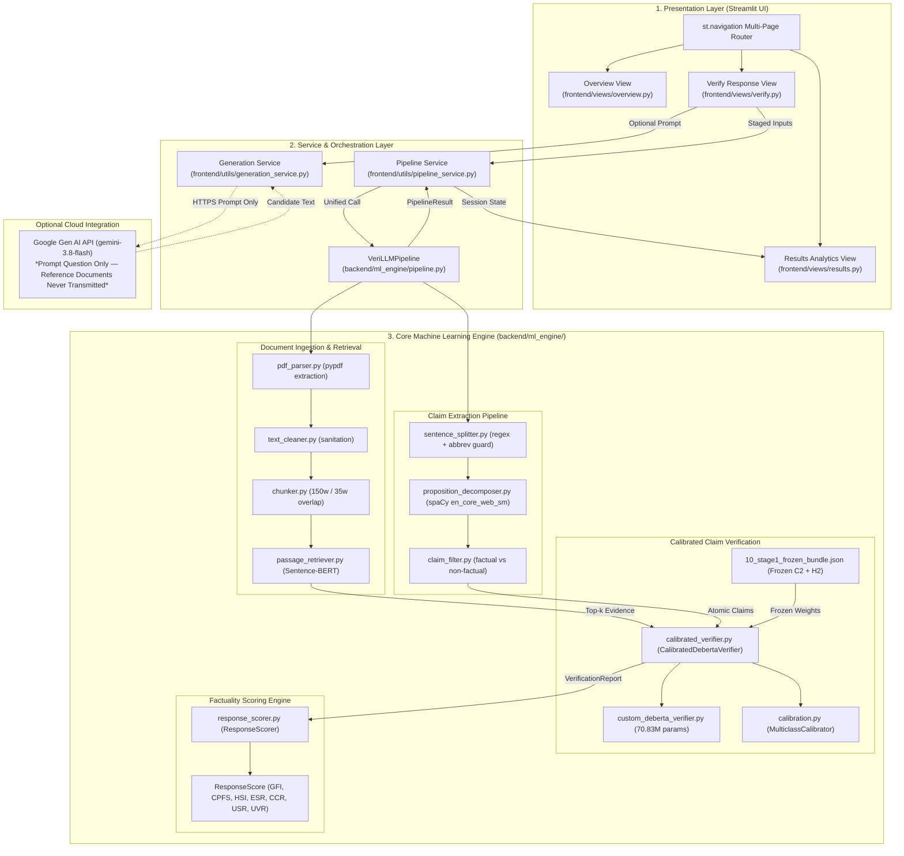

# VeriLLM
### A Hybrid, Model-Agnostic Framework for Fine-Grained LLM Hallucination Detection, Quantification and Root Cause Analysis

[](https://www.python.org/downloads/)
[](https://streamlit.io/)
[](https://pytorch.org/)
[](https://huggingface.co/)
[](LICENSE)
[]()
[]()

**VeriLLM** is an engineering and research framework for detecting, quantifying, and analyzing factual hallucinations in Large Language Model (LLM) responses through document-grounded proposition verification.

Rather than relying on another generative LLM as an uncalibrated, self-preferential judge, VeriLLM decomposes generated responses into atomic truth-conditional propositions, retrieves relevant evidence from reference documents, and evaluates factual consistency using a fine-tuned cross-encoder (`cross-encoder/nli-deberta-v3-xsmall`, 70.83M parameters) paired with regularized prior-bias probability calibration ($C2$) and defensive epistemic abstention ($\tau_{\text{floor}} = 0.20$).

The entire core verification pipeline executes **100% locally on standard host CPUs** ($100\text{--}250\text{ ms}$ per proposition, $< 1.2\text{ GB}$ RAM), guaranteeing organizational data sovereignty for sensitive healthcare, financial, legal, and engineering documentation.

---

## Table of Contents

- [Motivation & Problem Statement](#motivation--problem-statement)
- [Key Features](#key-features)
- [System Architecture](#system-architecture)
- [Verification Categories](#verification-categories)
- [Scoring Metrics & Mathematical Invariants](#scoring-metrics--mathematical-invariants)
- [Machine Learning Backbone & Calibration](#machine-learning-backbone--calibration)
- [Experimental Results](#experimental-results)
- [Technology Stack](#technology-stack)
- [Installation & Getting Started](#installation--getting-started)
- [Running the Application](#running-the-application)
- [Automated Regression Suite](#automated-regression-suite)
- [Repository Structure](#repository-structure)
- [Privacy & Security Boundary](#privacy--security-boundary)
- [Known Limitations](#known-limitations)
- [Documentation & Research Deliverables](#documentation--research-deliverables)

---

## Motivation & Problem Statement

Autoregressive Large Language Models maximize statistical token likelihood rather than empirical or logical truth. As foundation models scale, they generate syntactically fluent, authoritative text that routinely contains factual fabrications—conflicting with provided source materials, inventing plausible-sounding claims, or extrapolating beyond available evidence.

In Retrieval-Augmented Generation (RAG) pipelines, grounding failures manifest across three common failure modes:
1. **Contradictory Hallucinations:** Direct contradictions of reference facts.
2. **Ungrounded Extrapolations:** Plausible assertions not corroborated by reference evidence.
3. **Retrieval Misses & Forced Guesses:** Failures where missing evidence causes models to guess rather than express uncertainty.

VeriLLM solves this by combining fine-grained syntactic proposition decomposition, dense semantic passage retrieval, multi-class neural inference, post-hoc probability calibration, and selective epistemic abstention.

---

## Key Features

- **Local-First Data Sovereignty:** Ingested reference documents (PDFs, plain text) are parsed, chunked, embedded, and verified strictly within local system memory on the host CPU. Zero document text is sent to third-party cloud APIs.
- **Dual Operational Regimes:**
  - *Direct Context Regime:* For concise documents ($\le 350$ words). Evaluates propositions against the full document text directly.
  - *Dense Evidence Retrieval Regime:* For multi-page documents. Segments text into 150-word sliding passages (35-word overlap) and retrieves top-$k$ evidence using Sentence-BERT (`all-MiniLM-L6-v2`).
- **5-Way Classification Framework:** Categorizes assertions into `SUPPORTED`, `CONTRADICTED`, `UNSUPPORTED`, `UNVERIFIABLE`, and `NON_FACTUAL`.
- **$C2$ Multi-Class Probability Calibration:** Applies L2-regularized prior-bias transformation and temperature scaling to resolve severe overconfidence on minority failure modes ($\approx 3.8\%$ contradiction rate) using frozen parameters.
- **Defensive Epistemic Abstention:** Employs similarity-floor gating ($\tau_{\text{floor}} = 0.20$) in retrieval mode, marking claims as `UNVERIFIABLE` when evidence is missing and slashing quantification error by $69.3\%$.
- **Conservation-Constrained Scoring:** Response factuality satisfies an exact sum invariant ($ESR + CCR + USR + UVR \equiv 100.00\%$), deriving the Grounded Factuality Index ($GFI$) and Contradiction-Penalized Factuality Score ($CPFS$).
- **Reactive Streamlit Interface:** Modern dark-theme web dashboard featuring executive KPI cards, Altair distribution charts, calibrated posterior probability bars, and proposition-level citation inspection cards.

---

## System Architecture

VeriLLM is structured as a decoupled, three-tier local application:



---

## Verification Categories

VeriLLM assigns every decomposed proposition to one of five mutually exclusive operational categories:

| Category | Description | Decision Criteria ($H2$ Strategy) |
| :--- | :--- | :--- |
| **`SUPPORTED`** | Proposition is directly confirmed by reference evidence. | $\hat{p}_{\text{contra}} < \tau_{\text{contra}}$ AND $\hat{p}_{\text{sup}} \ge \tau_{\text{sup}}$ AND passed evidence floor. |
| **`CONTRADICTED`** | Proposition directly conflicts with reference evidence. | $\hat{p}_{\text{contra}} \ge \tau_{\text{contra}}$ (Highest priority decision rule). |
| **`UNSUPPORTED`** | Reference document mentions entities but lacks corroborating proof. | $\hat{p}_{\text{contra}} < \tau_{\text{contra}}$ AND $\hat{p}_{\text{sup}} < \tau_{\text{sup}}$ (Defaults to unsupported). |
| **`UNVERIFIABLE`** | Evidence is missing or semantic similarity is below safety floor. | Retrieval mode only: $\text{len}(\text{chunks}) == 0$ OR $\text{sim}_{\max} < \tau_{\text{floor}} = 0.20$. |
| **`NON_FACTUAL`** | Conversational greeting, pleasantry, or subjective opinion. | Tagged `is_factual = False` by syntactic claim filter. |

---

## Scoring Metrics & Mathematical Invariants

Response factuality is quantified over $N_{\text{factual}}$ empirical claims through mutually exclusive rates:

1. **Evidence Support Rate ($ESR$):** $ESR = \left(\frac{N_{\text{supported}}}{N_{\text{factual}}}\right) \times 100\%$
2. **Confirmed Contradiction Rate ($CCR$):** $CCR = \left(\frac{N_{\text{contradicted}}}{N_{\text{factual}}}\right) \times 100\%$
3. **Unsupported Rate ($USR$):** $USR = \left(\frac{N_{\text{unsupported}}}{N_{\text{factual}}}\right) \times 100\%$
4. **Unverifiable Rate ($UVR$):** $UVR = \left(\frac{N_{\text{unverifiable}}}{N_{\text{factual}}}\right) \times 100\%$

### Mathematical Invariants:
- **Conservation Law:** $ESR + CCR + USR + UVR \equiv 100.00\% \quad (\pm 0.05\% \text{ rounding tolerance})$
- **Grounded Factuality Index ($GFI$):** $GFI = ESR$
- **Contradiction-Penalized Factuality Score ($CPFS$):**
  $$CPFS = \max\left(0.0, \frac{N_{\text{supported}} - 2.0 \cdot N_{\text{contradicted}}}{N_{\text{factual}}}\right) \times 100\%$$
- **Hallucination Severity Index ($HSI$):** $HSI = CCR$
- **Denominator Handling:** Non-factual greetings and opinions are excluded from $N_{\text{factual}}$. If $N_{\text{factual}} = 0$, all indices are assigned `None` (`N/A`) rather than dividing by zero.

---

## Machine Learning Backbone & Calibration

### Model Architecture
- **Backbone:** `cross-encoder/nli-deberta-v3-xsmall` (He et al., 2023).
- **Hugging Face Model:** [`Rabbit-Bull/verillm-deberta`](https://huggingface.co/Rabbit-Bull/verillm-deberta) (Pinned revision: `71259e48c794e89f92075ddf848813c93327461c`).
- **Parameters:** **$70,831,107$** ($\approx 70.83\text{M}$ parameters). Disk storage: **$283\text{ MB}$** (`model.safetensors`).
- **Disentangled Attention:** Represents words using separate content and relative position vectors, coupled with an enhanced mask decoder.
- **Fine-Tuning:** Trained on the **RAGTruth** benchmark with inverse-frequency cross-entropy loss weights ($w_{\text{contra}} = 8.707$, $w_{\text{sup}} = 0.426$, $w_{\text{unsup}} = 1.861$) to prevent minority-class collapse. Checkpoint frozen at Epoch 1 (peak validation Macro-F1 = 70.99%).

### Authoritative Frozen Calibration Parameters (`10_stage1_frozen_bundle.json`)
The production verifier strictly enforces frozen parameters from Stage 1:

| Parameter / Dimension | Direct Context Regime (`direct`) | Dense Retrieval Regime (`retrieval`) |
| :--- | :---: | :---: |
| **Calibration Method** | $C2$ (L2 Prior-Bias + Temp) | $C2$ (L2 Prior-Bias + Temp) |
| **Temperature ($T$)** | **`1.76959203`** | **`2.50411010`** |
| **Bias Vector ($\mathbf{b}$)** | **`[-0.66788442, 0.71171648, -0.04383205]`** | **`[-0.72845197, 1.22831149, -0.49985952]`** |
| **$L_2$ Regularization ($\lambda$)** | `0.001` | `0.001` |
| **Decision Policy** | $H2$ Calibrated Thresholding | $H2$ Calibrated Thresholding + Gating |
| **Contradiction Cutoff ($\tau_{\text{contra}}$)** | **`0.35`** | **`0.30`** |
| **Support Cutoff ($\tau_{\text{sup}}$)** | **`0.70`** | **`0.70`** |
| **Similarity Floor ($\tau_{\text{floor}}$)** | `0.00` (Unconstrained coverage) | **`0.20`** (Defensive epistemic abstention) |

---

## Experimental Results

### Official RAGTruth Test Split Evaluation ($17,906$ Sentences across $450$ Sources)
- **Overall Accuracy:** **$92.86\%$**
- **Macro-F1 Score:** **$69.99\%$**
- **Weighted-F1 Score:** **$92.76\%$**
- **Class-wise Profile:**
  - `CONTRADICTED`: Precision = $66.72\%$, Recall = $57.32\%$, **F1 = $61.67\%$** (Support: 553)
  - `SUPPORTED_PROXY`: Precision = $95.92\%$, Recall = $96.49\%$, **F1 = $96.20\%$** (Support: 16,388)
  - `UNSUPPORTED`: Precision = $52.57\%$, Recall = $51.61\%$, **F1 = $52.09\%$** (Support: 965)

### Out-of-Sample Val-Lock Confirmation ($N = 1,232$ Sentences across $30$ Disjoint Sources)
- **Negative Log-Likelihood (NLL):** Reduced from **$0.8659$** (uncalibrated) to **$0.2647$** ($C2$ calibration).
- **Classwise ECE (CW-ECE):** Reduced from **$0.0912$** to **$0.0236$**.
- **Selective Retrieval Evaluation:** Achieved **$86.72\%$ selective accuracy** and **$11.66\text{ pp}$** response-level Confirmed Hallucination MAE, reducing quantification error by **$69.3\%$** relative to uncalibrated forced guessing ($37.96\text{ pp}$).

---

## Technology Stack

| Component | Pinned Version | Role |
| :--- | :--- | :--- |
| **Python** | `3.11.9` | Primary runtime platform (Win32 x86-64) |
| **Streamlit** | `>=1.40.0` | Reactive multi-page web interface (`st.navigation`) |
| **PyTorch** | `>=2.2.0` (CPU) | Local neural tensor execution |
| **Transformers** | `>=4.40.0` | DeBERTa-v3 sequence classification backbone |
| **Sentence-Transformers** | `>=2.6.0` | Dense passage embedding (`all-MiniLM-L6-v2`) |
| **spaCy** | `>=3.7.0` | Dependency parsing, proposition decomposition |
| **Linguistic Model** | `en_core_web_sm` (3.7.1)| Small English pipeline package for spaCy |
| **pypdf** | `>=4.1.0` | Digital PDF text extraction |
| **Google Gen AI SDK** | `>=1.0.0` | Optional Gemini candidate generation adapter |
| **pytest** | `>=8.0.0` (`9.2.0`) | Automated regression test execution |

---

## Installation & Getting Started

### Prerequisites
- Windows 10/11, Linux, or macOS.
- Python 3.11.x installed.
- PowerShell (Windows) or Bash (Linux/macOS).
- Minimum 8 GB RAM (No dedicated GPU required).

### Step-by-Step Setup (Windows PowerShell)

1. **Clone the Repository & Navigate to Workspace:**
   ```powershell
   cd "D:\drive e\VeriLLM"
   ```

2. **Create and Activate a Python 3.11 Virtual Environment:**
   ```powershell
   python -m venv .venv
   .\.venv\Scripts\Activate.ps1
   ```

3. **Install Dependencies:**
   ```powershell
   python -m pip install --upgrade pip
   pip install -r backend/requirements.txt
   ```

4. **Download the spaCy Linguistic Pipeline:**
   ```powershell
   python -m spacy download en_core_web_sm
   ```

5. **(Automatic) Model Checkpoint Download & Local Caching:**
   On first application launch or verification run, VeriLLM automatically retrieves the fine-tuned DeBERTa model checkpoint (~283 MB: `config.json`, `model.safetensors`, `tokenizer.json`, `tokenizer_config.json`) from the public Hugging Face repository [`Rabbit-Bull/verillm-deberta`](https://huggingface.co/Rabbit-Bull/verillm-deberta) at pinned revision `71259e48c794e89f92075ddf848813c93327461c`.
   - The repository is public; **no Hugging Face API token is required**.
   - Downloaded artifacts are cached locally under `backend/models/verillm_deberta/`.
   - Once cached locally (or if model files are pre-placed), all subsequent core verification runs operate **100% offline** on local CPU cores.

6. **(Optional) Configure Gemini API Key:**
   If you wish to use the optional candidate generation feature in Tab 2:
   ```powershell
   cp backend/.env.example backend/.env
   # Add your key to backend/.env: GEMINI_API_KEY="your-key-here"
   ```

---

## Running the Application

Launch the Streamlit web application:

```powershell
cd "D:\drive e\VeriLLM"
.\.venv\Scripts\Activate.ps1
streamlit run frontend/app.py
```

Open your web browser and navigate to:
```text
http://localhost:8501
```

### Typical Workflow:
1. **Upload Reference Document:** Drag and drop a PDF or TXT document (or paste raw reference text) in **Step 1**.
2. **Provide Candidate Text:** Paste the AI response you want to verify in **Step 2** (or generate text via Gemini in Tab 2).
3. **Select Mode:** Choose between **Direct Context** ($\le 350$ words) or **Dense Evidence Retrieval** (multi-page documents).
4. **Execute Verification:** Click **🛡️ Verify Response**.
5. **Inspect Analytics:** Review headline KPI cards, category distribution charts, calibrated probabilities, and claim-by-claim citation snippets in the **Results** dashboard.

---

## Automated Regression Suite

VeriLLM includes an extensive automated test suite located under `backend/tests/`:

```powershell
cd "D:\drive e\VeriLLM"
.\.venv\Scripts\python.exe -m pytest backend/tests -v
```

**Test Inventory:** **284 tests across 20 modules**, covering:
- Frozen calibration bundle validation and threshold parity (`test_calibrated_verifier.py`).
- Source-grouped cross-validation, logit reconstruction, and split protection (`test_calibration_and_hybrid.py`).
- Proposition extraction, clause decomposition, and character offset traceability (`test_claim_extractor.py`).
- Verification categories, epistemic abstention, and contradiction flags (`test_claim_verifier.py`).
- Automatic Hugging Face Hub model downloading, checksum verification, cache reuse, and offline mode gating (`test_custom_deberta_download.py`).
- Sliding-window chunking, pypdf extraction, and passage retrieval memory cleanup (`test_evidence_retriever.py`).
- Factuality indices, conservation invariant verification, and non-factual handling (`test_scorer.py`).
- End-to-end `VeriLLMPipeline` contracts, regime selection, and edge-case handling (`test_pipeline.py`).
- Frontend input mappers and Streamlit workflow convergence (`test_frontend_workflows.py`).
- Gemini adapter error handling, retry backoff, and degradation resilience (`test_gemini_client.py`).

---

## Repository Structure

```text
VeriLLM/
├── backend/
│   ├── .env.example                          # Template environment variable configuration
│   ├── requirements.txt                      # Pinned Python package dependencies
│   ├── models/
│   │   └── verillm_deberta/                  # Production fine-tuned model checkpoint (70.83M)
│   │       ├── config.json
│   │       ├── model.safetensors             # DeBERTa-v3 weights (283 MB)
│   │       ├── tokenizer.json
│   │       └── tokenizer_config.json
│   ├── ml_engine/                            # Core Machine Learning Engine
│   │   ├── pipeline.py                       # VeriLLMPipeline orchestration entrypoint
│   │   ├── claim_extractor/                  # Sentence splitting, spaCy decomposition, filtering
│   │   ├── evidence_retriever/               # pypdf parsing, chunking, Sentence-BERT retrieval
│   │   ├── claim_verifier/                   # CalibratedDebertaVerifier & custom cross-encoder
│   │   ├── custom_model/                     # MulticlassCalibrator, logit reconstruction, H2 strategy
│   │   ├── scorer/                           # ResponseScorer & mathematical invariant checks
│   │   └── llm_generator/                    # Optional Gemini provider client with retries
│   ├── experiments/
│   │   └── results/                          # Authoritative frozen research artifacts & reports
│   │       ├── 10_stage1_frozen_bundle.json  # Frozen production calibration bundle
│   │       ├── 25_verillm_final_thesis.md    # Master academic thesis manuscript (51,442 words)
│   │       ├── 26_final_thesis_consistency_audit.md # Thesis consistency audit report
│   │       ├── 27_verillm_final_thesis.pdf   # 116-page submission-quality thesis PDF
│   │       ├── 28_verillm_technical_documentation.md # 19-section developer reference
│   │       └── 29_verillm_user_guide.md      # Practical user manual
│   └── tests/                                # 284 automated regression tests across 20 modules
├── frontend/                                 # Streamlit Multipage Web Application
│   ├── app.py                                # Application entrypoint & st.navigation router
│   ├── components/                           # Header branding & sidebar widgets
│   ├── utils/                                # Staging adapters & CSS styling
│   └── views/                                # Overview, Verify Response, and Results views
├── ARCHITECTURE.md                           # Formal system architecture specification
├── EXTERNAL_SERVICES_SETUP.md                # Optional API configuration & resilience guide
├── FINAL_REPOSITORY_AUDIT.md                 # Complete repository audit & cleanup inventory
├── .gitignore                                # Git exclusion rules
└── README.md                                 # Primary project documentation
```

---

## Privacy & Security Boundary

- **Local Trust Domain:** All reference documents are stored and processed strictly within host RAM and CPU cores. No document text, proposition strings, or verification scores are transmitted across the internet.
- **Optional API Isolation:** When using Tab 2 (Live Gemini Verification), **only the user's prompt question is transmitted to Google's API**. The reference document is completely isolated.
- **Local-First Definition:** VeriLLM is local-first and privacy-preserving. It should not be termed "air-gapped" when the optional Gemini candidate generation feature is actively enabled.

---

## Known Limitations

1. **Document-Grounded Consistency:** VeriLLM evaluates logical agreement with the provided reference document, not universal truth. If the reference document contains false statements, VeriLLM will evaluate consistency against those statements.
2. **Single-Hop Retrieval:** Multi-hop reasoning requiring inductive deduction across disjoint pages may receive an `UNSUPPORTED` verdict.
3. **Language Scope:** The fine-tuned DeBERTa model and spaCy parser are trained and evaluated on English corpora.
4. **Scanned PDFs:** Requires digital text streams. Scanned bitmap PDFs without embedded OCR text layers require external optical pre-processing.
5. **Upstream Gemini Capacity:** Google's preview endpoint for `gemini-3.8-flash` experiences transient peak-demand spikes (HTTP 503 `UNAVAILABLE`). The core local verification pipeline operates 100% offline regardless of external API status.

---

## Documentation & Research Deliverables

| Deliverable | Path | Purpose |
| :--- | :--- | :--- |
| **Final Thesis (PDF)** | [`backend/experiments/results/27_verillm_final_thesis.pdf`](backend/experiments/results/27_verillm_final_thesis.pdf) | Complete 116-page submission-quality academic thesis. |
| **Final Thesis (Markdown)** | [`backend/experiments/results/25_verillm_final_thesis.md`](backend/experiments/results/25_verillm_final_thesis.md) | Assembled 51,442-word master academic manuscript. |
| **Technical Documentation** | [`backend/experiments/results/28_verillm_technical_documentation.md`](backend/experiments/results/28_verillm_technical_documentation.md) | 19-section developer reference and architectural specification. |
| **User Guide** | [`backend/experiments/results/29_verillm_user_guide.md`](backend/experiments/results/29_verillm_user_guide.md) | Beginner-friendly practical guide with examples and FAQ. |
| **Architecture Specification** | [`ARCHITECTURE.md`](ARCHITECTURE.md) | Formal three-tier architecture specification and data flow. |
| **External Services Guide** | [`EXTERNAL_SERVICES_SETUP.md`](EXTERNAL_SERVICES_SETUP.md) | Optional Gemini configuration, retries, and privacy boundaries. |
| **Repository Audit Report** | [`FINAL_REPOSITORY_AUDIT.md`](FINAL_REPOSITORY_AUDIT.md) | Complete audit report, file classifications, and inventory. |
| **Thesis Consistency Audit** | [`backend/experiments/results/26_final_thesis_consistency_audit.md`](backend/experiments/results/26_final_thesis_consistency_audit.md) | Comprehensive thesis-wide numerical verification report. |
| **Frozen Calibration Bundle** | [`backend/experiments/results/10_stage1_frozen_bundle.json`](backend/experiments/results/10_stage1_frozen_bundle.json) | Cryptographically authoritative production calibration parameters. |

---

**VeriLLM — Fine-Grained, Document-Grounded Hallucination Detection & Probability Calibration.**
