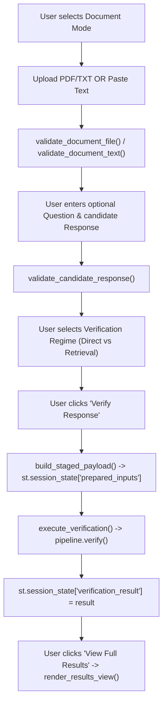
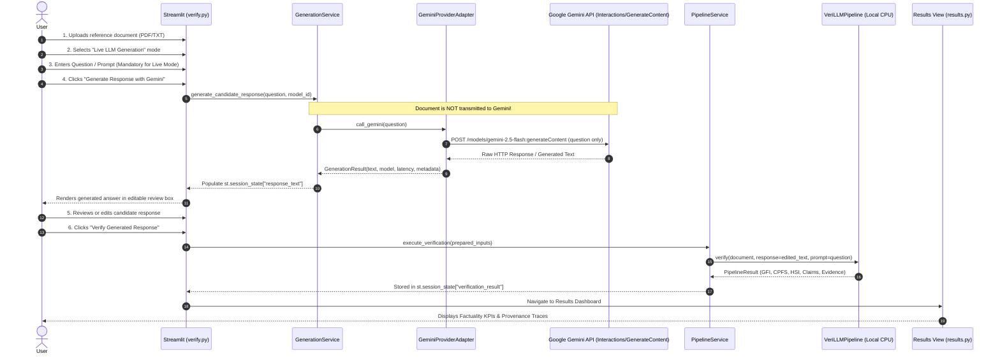
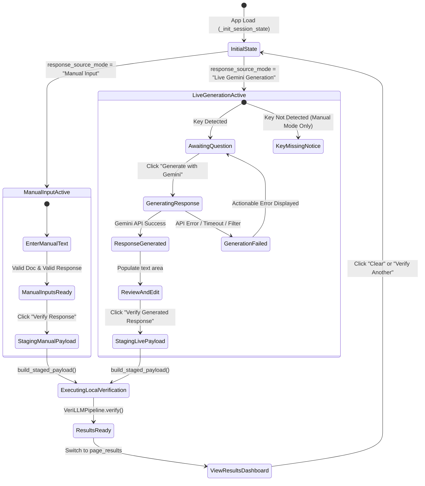
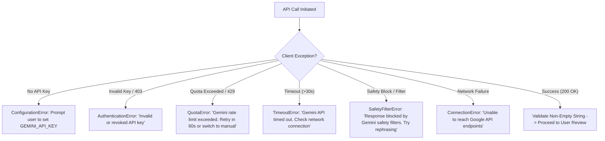
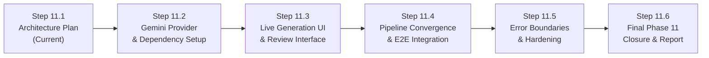

# VeriLLM Phase 11 — Step 11.1: Live LLM Integration Architecture Planning Report

**Author:** VeriLLM Engineering & Core AI Architecture Team  
**Planning Date:** November 14, 2026  
**Artifact Path:** [`backend/experiments/results/13_phase11_1_architecture.md`](file:///d:/drive%20e/VeriLLM/backend/experiments/results/13_phase11_1_architecture.md)  
**Status:** **`APPROVED ARCHITECTURE PLAN`**  
**Target Milestone:** Phase 11 (Live LLM Response Generation & End-to-End Grounded Verification)

---

## 1. Executive Summary & Purpose

Phase 10 established a fully functional, local Streamlit frontend application directly integrated with the production [`VeriLLMPipeline`](file:///d:/drive%20e/VeriLLM/backend/ml_engine/pipeline.py), backed by the fine-tuned DeBERTa-v3 cross-encoder and the frozen Stage 1 $C2$ calibration bundle.

Phase 11 introduces **Live LLM Response Generation**, enabling users to generate candidate answers in real time using Google Gemini and immediately verify those answers against local reference documents using the existing VeriLLM pipeline.

### Core Architectural Principle: Strict Separation of Generation and Verification
To maintain rigorous scientific and operational credibility, VeriLLM enforces an inviolable separation of duties:
1. **Gemini (Generator):** Operates strictly as a candidate response generator. Gemini receives **only** the user's question; it is **never** sent the uploaded reference document by default, and it **never** determines whether its own output is factual, hallucinated, or supported.
2. **VeriLLM Local Stack (Verifier):** The local fine-tuned DeBERTa-v3 model, sliding-window passage retriever, claim extractor, and calibrated response scorer remain **solely responsible** for proposition extraction, evidence matching, calibrated NLI verification, hallucination quantification, and scoring.
3. **Convergence on a Single Pipeline:** Both the established **Manual Verification** workflow and the new **Live Gemini Verification** workflow converge onto the exact same `VeriLLMPipeline.verify()` endpoint.

```
┌─────────────────────────────────────────────────────────────────────────────────┐
│                           WORKFLOW CONVERGENCE MODEL                            │
└─────────────────────────────────────────────────────────────────────────────────┘

[Workflow 1: Manual Verification]
   User uploads document ──┐
   User pastes response ───┼───► [Staged Payload] ───┐
   User selects regime ────┘                         │
                                                     ▼
                                         ┌───────────────────────┐
                                         │  VeriLLMPipeline      │
                                         │  (Local CPU Stack)    │
                                         │  • Claim Extraction   │
                                         │  • Passage Retrieval  │
                                         │  • DeBERTa + Frozen C2│
                                         │  • Response Scoring   │
                                         └───────────┬───────────┘
                                                     │
[Workflow 2: Live Gemini Verification]               ▼
   User uploads document ──┐                [PipelineResult]
   User enters question ───┼──► [Gemini]             │
   User reviews/edits ─────┼──► [Response]           ▼
   User selects regime ────┘        │        [Results Dashboard]
                                    │        (GFI, CPFS, HSI,    │
                                    └──────► Provenance Traces)  │
```

---

## 2. Existing Application Architecture Discovered from Source Inspection

The following existing files, interfaces, and state structures were verified directly from source code inspection:

### 2.1 File Organization & Responsibilities
- **[`frontend/app.py`](file:///d:/drive%20e/VeriLLM/frontend/app.py):** Main entry point. Initializes Streamlit configuration (`layout="wide"`), applies global CSS from `styles.py`, renders persistent sidebar branding, and manages multi-page routing via `st.navigation` across three pages: `Overview`, `Verify Response`, and `Results`.
- **[`frontend/views/verify.py`](file:///d:/drive%20e/VeriLLM/frontend/views/verify.py):** Implements reference document input (File Uploader supporting `.pdf` and `.txt`, or Direct Text Entry area), candidate response textarea, optional prompt input, regime selector (`Retrieval Augmented` vs `Direct Context`), real-time counters, input validation, and verification execution.
- **[`frontend/views/results.py`](file:///d:/drive%20e/VeriLLM/frontend/views/results.py):** Visual analytics view rendering response-level KPI scorecards (GFI, CPFS, HSI, $N$), rate pills (ESR, CCR, USR, UVR, CUR), Altair distribution charts, calibrated posterior probability charts, a metric interpretation guide, interactive claim filtering, and provenance evidence boxes.
- **[`frontend/utils/pipeline_service.py`](file:///d:/drive%20e/VeriLLM/frontend/utils/pipeline_service.py):** Bridges frontend views to backend ML components. Houses `get_pipeline()` as a cached resource singleton (`@st.cache_resource`), `map_staged_inputs_to_pipeline_args()`, and `execute_verification()`.
- **[`backend/ml_engine/pipeline.py`](file:///d:/drive%20e/VeriLLM/backend/ml_engine/pipeline.py):** Houses `VeriLLMPipeline`, orchestrating PDF parsing (`pypdf`), sliding-window chunking, atomic proposition extraction (`spaCy`), dense passage retrieval (`all-MiniLM-L6-v2`), calibrated DeBERTa cross-encoder inference, and response scoring (`ResponseScorer`).
- **[`backend/requirements.txt`](file:///d:/drive%20e/VeriLLM/backend/requirements.txt):** Core dependencies. Already includes `python-dotenv>=1.0.0`, `streamlit>=1.40.0`, `torch>=2.2.0`, `transformers>=4.40.0`, `pydantic>=2.6.0`, `fastapi`, and `pypdf`.
- **[`.gitignore`](file:///d:/drive%20e/VeriLLM/.gitignore):** Already ignores `.env`, `.env.*`, `backend/.env`, and `frontend/.env` (lines 12–22), ensuring environment credentials cannot be committed.
- **[`.streamlit/config.toml`](file:///d:/drive%20e/VeriLLM/.streamlit/config.toml):** Standard dark theme parameters (`primaryColor = "#3B82F6"`, `backgroundColor = "#0B0F17"`, `secondaryBackgroundColor = "#111827"`).

### 2.2 Verified Function Signatures & Interfaces

#### A. Backend Verification Pipeline
```python
# backend/ml_engine/pipeline.py
def verify(
    self,
    document: Union[str, Path, bytes, io.BytesIO],
    response: str,
    prompt: Optional[str] = None,
    regime: Optional[str] = None,
    document_name: Optional[str] = None,
    response_id: str = "resp_001",
) -> PipelineResult
```

#### B. Pipeline Service Adapter
```python
# frontend/utils/pipeline_service.py
@st.cache_resource(show_spinner=False)
def get_pipeline() -> VeriLLMPipeline

def map_staged_inputs_to_pipeline_args(
    prepared_inputs: Dict[str, Any]
) -> Dict[str, Any]

def execute_verification(
    prepared_inputs: Dict[str, Any],
    pipeline: Optional[VeriLLMPipeline] = None,
) -> PipelineResult
```

#### C. Input Staging Construction
```python
# frontend/views/verify.py
def build_staged_payload(
    doc_mode: str,
    doc_meta: Dict[str, Any],
    prompt: Optional[str],
    response: str,
    regime: str,
) -> Dict[str, Any]
```

#### D. Verified Session State Keys (Current Baseline)
- `st.session_state["doc_mode"]`: `"File Upload (PDF / TXT)"` or `"Direct Text Entry"`
- `st.session_state["raw_doc_text"]`: Text string from direct entry textarea
- `st.session_state["question_text"]`: User prompt / question string
- `st.session_state["response_text"]`: Candidate LLM response string
- `st.session_state["regime_choice"]`: `"Retrieval (Recommended)"` or `"Direct (Full Document Context)"`
- `st.session_state["uploader_version"]`: Integer incremented to reset file uploader widget
- `st.session_state["prepared_inputs"]`: Canonical dictionary containing validated inputs
- `st.session_state["verification_result"]`: `PipelineResult` object returned by `verify()`
- `st.session_state["last_verification_time"]`: Execution timestamp string

---

## 3. Current Manual Verification Data Flow

In the existing implementation (Steps 10.1–10.6), the manual verification data flow proceeds as follows:



### Data Flow Characteristics:
- The candidate response is pasted manually from an external tool, chat window, or benchmark record.
- The user prompt is optional and only provides conversational metadata for provenance reporting.
- Verification executes synchronously under a Streamlit spinner and populates session state.

---

## 4. Proposed Live Gemini Verification Data Flow

The proposed live verification flow introduces an automated, interactive generation stage prior to verification while preserving identical downstream verification mechanics:



### Key Invariant Validations in Data Flow:
1. **Reference Document Isolation:** The reference file or text never leaves the local machine. Only the user's prompt string is sent to Gemini.
2. **Review & Edit Boundary:** The LLM's response is presented in an editable text area. The user can review, refine, or approve the exact text that enters the verification engine.
3. **No Self-Evaluation:** Gemini is never prompted to critique or verify its own claims. Verification is performed exclusively by the local DeBERTa-v3 cross-encoder and calibration bundle.

---

## 5. Proposed Module & File Structure

To integrate live response generation cleanly without polluting existing verification modules, the following new files and structural additions are planned:

```
d:\drive e\VeriLLM\
├── backend\
│   └── ml_engine\
│       └── llm_generator\                # [NEW MODULE] Live LLM Generation Layer
│           ├── __init__.py               # Exports GeminiProviderAdapter & GenerationResult
│           ├── client.py                 # Low-level google-genai SDK wrapper & error mapping
│           └── models.py                 # Pydantic schemas: GenerationRequest, GenerationResult
├── frontend\
│   ├── utils\
│   │   ├── pipeline_service.py           # Existing verification service (PRESERVED)
│   │   └── generation_service.py         # [NEW SERVICE] Streamlit generation bridge & state helper
│   └── views\
│       └── verify.py                     # [MODIFIED in 11.3] UI controls for Manual vs Live modes
└── backend\
    └── tests\
        ├── test_gemini_client.py         # [NEW TESTS in 11.2] Unit tests for adapter & mock API
        ├── test_generation_service.py    # [NEW TESTS in 11.3] Tests for generation service logic
        └── test_live_workflow.py         # [NEW TESTS in 11.4] End-to-end integration tests
```

### Module Responsibilities:

| Proposed Module | File Path | Exact Responsibilities |
| :--- | :--- | :--- |
| **Pydantic Schemas** | `backend/ml_engine/llm_generator/models.py` | Defines `GenerationRequest`, `GenerationResult`, `GenerationError`, and `ModelOption` data models. |
| **Gemini Client Adapter** | `backend/ml_engine/llm_generator/client.py` | Encapsulates the official `google-genai` SDK, client instantiation (`genai.Client`), `GEMINI_API_KEY` resolution, timeout management, retry policies, and structured exception mapping. |
| **Frontend Generation Service** | `frontend/utils/generation_service.py` | Streamlit-facing service providing cached client initialization, `generate_response()`, API key status detection, and state staging. Never imports verification models. |
| **Verify View Extensions** | `frontend/views/verify.py` | Introduces mode selector (`Manual Entry` vs `Live Gemini Generation`), generation action buttons, editable response staging, and generation metadata badges. |

---

## 6. Exact Integration Point with Existing VeriLLMPipeline

The proposed architecture achieves **zero-footprint backend coupling**:

### 6.1 Unchanged Verification Pipeline
The underlying production verification engine [`VeriLLMPipeline.verify()`](file:///d:/drive%20e/VeriLLM/backend/ml_engine/pipeline.py#L347-L368) requires **zero modifications**:
```python
result = pipeline.verify(
    document=document_arg,       # Exactly the same local PDF or text
    response=response_arg,       # Populated with Gemini's response (or user-edited version)
    prompt=prompt_arg,           # Populated with user's question
    regime=regime_arg,           # Direct or Retrieval as chosen by user
    document_name=doc_name,      # Local document name
    response_id="gemini_gen_001" # Provenance tracker
)
```

### 6.2 Unchanged Pipeline Service Mapping
[`map_staged_inputs_to_pipeline_args()`](file:///d:/drive%20e/VeriLLM/frontend/utils/pipeline_service.py#L42-L108) accepts `st.session_state["prepared_inputs"]`. Whether the response originated from manual typing or Gemini generation, `build_staged_payload()` constructs the exact same schema:
```python
staged_payload = build_staged_payload(
    doc_mode=doc_mode,
    doc_meta=doc_meta,
    prompt=question_text,        # Sent to Gemini AND passed to pipeline
    response=response_text,      # Generated by Gemini, approved/edited by user
    regime=regime_key,
)
```

### 6.3 Shared Results Dashboard
The existing [`frontend/views/results.py`](file:///d:/drive%20e/VeriLLM/frontend/views/results.py) renders `PipelineResult` without caring how the response was authored. All KPI scorecards (GFI, CPFS, HSI), Altair distribution charts, calibrated probability bars, and claim citations work immediately without modification.

---

## 7. Proposed Streamlit Session-State Lifecycle

To support live generation alongside manual verification without state corruption or unexpected reruns, the session state architecture will be expanded cleanly:

### 7.1 New Session State Variables

| State Key | Type | Default Value | Purpose |
| :--- | :--- | :--- | :--- |
| `response_source_mode` | `str` | `"Manual Input"` | Controls UI mode: `"Manual Input"` vs `"Live Gemini Generation"`. |
| `selected_model_id` | `str` | `"gemini-2.5-flash"` | Configurable model identifier chosen by user or environment. |
| `raw_generated_text` | `Optional[str]` | `None` | Stores the unaltered string returned directly by Gemini. |
| `generation_metadata` | `Optional[Dict]` | `None` | Stores generation latency (seconds), token counts, and model ID. |
| `is_generating` | `bool` | `False` | Protects against concurrent button presses during active generation. |
| `gemini_api_status` | `Dict[str, Any]` | `{"available": False}` | Tracks API key availability and initialization state. |

### 7.2 Session State Transition Diagram



---

## 8. Gemini API Configuration & Security Strategy

### 8.1 Official Google Gen AI SDK Integration
The integration will use the modern, official Google Gen AI Python SDK:
```python
# Required import
from google import genai
from google.genai import types
from google.genai.errors import APIError
```

### 8.2 Authentication & Key Resolution Hierarchy
1. **Environment Variable (`GEMINI_API_KEY`):** Standard primary source. The official SDK automatically detects `GEMINI_API_KEY` when instantiating `client = genai.Client()`.
2. **Local `.env` File Support:** Utilizing `python-dotenv` (already in `backend/requirements.txt`), the application will call `dotenv.load_dotenv()` at startup.
3. **Repository Security:** The existing `.gitignore` already ignores `.env`, `backend/.env`, and `frontend/.env`. A template `.env.example` will document the key format without secrets:
   ```env
   # .env.example
   GEMINI_API_KEY=your_gemini_api_key_here
   GEMINI_MODEL=gemini-2.5-flash
   ```
4. **Zero-Secret Exposure Rule:**
   - The API key will **never** be rendered in the Streamlit UI (no text input for raw secrets).
   - The API key will **never** be logged to terminal stdout, logfiles, or session state.
   - Only masked availability (`GEMINI_API_KEY: Configured (***...1234)`) will appear in administrative diagnostics.

### 8.3 Model Selection Strategy
- **Default Model:** `gemini-2.5-flash` (or `gemini-2.0-flash`), optimizing for low latency, high quality, and minimal quota consumption.
- **Configurability:** Model ID will be resolvable from `GEMINI_MODEL` environment variable, with an optional dropdown in the UI if multiple verified models are supported.
- **Future-Proofing:** No model IDs will be hardcoded in application logic; all calls will reference a configurable setting.

### 8.4 Graceful Offline / Missing-Key Degradation
If no API key is detected:
- The application will **not crash**.
- The Manual Verification mode remains **100% active and unrestricted**.
- In Live Generation mode, an informational card will explain:
  > *"Gemini API Key Not Configured. To enable live AI answer generation, configure `GEMINI_API_KEY` in your environment or a local `.env` file. Manual response verification remains fully functional."*

---

## 9. Comprehensive Error Handling Strategy

Live network and API interactions will be enclosed in structured error boundaries mapping API exceptions to user-friendly Streamlit notifications:



### Error Taxonomy & Remediation:

| Exception Class | Root Cause | UI Presentation | User Action Required |
| :--- | :--- | :--- | :--- |
| **`GeminiMissingKeyError`** | `GEMINI_API_KEY` is not set. | `st.info` card with setup instructions. | Set environment variable or use Manual mode. |
| **`GeminiAuthError`** | Invalid, expired, or unauthorized API key (HTTP 401/403). | `st.error("Authentication failed: Invalid Gemini API key.")` | Verify API key credentials in Google AI Studio. |
| **`GeminiQuotaError`** | Rate limit or token quota exceeded (HTTP 429). | `st.warning("Rate limit exceeded. Please wait a minute or use manual entry.")` | Wait for quota bucket refresh or switch to manual verification. |
| **`GeminiTimeoutError`** | Request duration exceeds timeout threshold (default 30.0s). | `st.error("Request timed out. Google API took too long to respond.")` | Re-trigger generation or check internet latency. |
| **`GeminiSafetyBlockError`** | Candidate prompt triggered safety filters (`finish_reason != STOP`). | `st.warning("Response blocked by Gemini safety filters.")` | Rephrase the question to avoid triggering safety categories. |
| **`GeminiEmptyResponseError`** | API returned 200 OK but content is empty string. | `st.error("Gemini returned an empty response.")` | Modify prompt to elicit substantive factual answers. |
| **`GeminiNetworkError`** | DNS resolution failure or connection reset. | `st.error("Network connection error. Unable to reach Gemini.")` | Check local internet connectivity. |

---

## 10. Anticipated Dependency Changes for Step 11.2

To support the official Google Gen AI SDK in Step 11.2, the following changes to `backend/requirements.txt` are planned:

### Dependency Additions
```txt
# Google Gen AI Python SDK (Official unified client for Gemini)
google-genai>=1.0.0
```

### Compatibility Analysis with Existing Stack
- **Pydantic Compatibility:** `google-genai` utilizes Pydantic v2. The existing environment already runs `pydantic>=2.6.0` (validated across all 209 passing tests). No conflict.
- **PyTorch & Hugging Face:** `google-genai` is a lightweight HTTP/REST client and does not interact with PyTorch or Transformers libraries.
- **Python-Dotenv:** `python-dotenv>=1.0.0` is already present in `backend/requirements.txt`.
- **Streamlit:** Streamlit 1.67.0 works asynchronously with external SDK calls.

---

## 11. Unit Testing & Live Integration Strategy

A three-tier testing strategy will be adopted to guarantee zero regressions:

### 11.1 Mocked Unit Tests (`backend/tests/test_gemini_client.py`)
- Mocks `google.genai.Client` using Python's `unittest.mock.MagicMock`.
- Tests client initialization with explicit keys vs environment variables.
- Tests correct parameter passing (`model`, `temperature`, `max_output_tokens`).
- Tests all 7 error branches (missing key, auth error, rate limit, timeout, safety block, empty text, network error).
- Executes offline in under 1 second without requiring internet or credentials.

### 11.2 Frontend Generation Tests (`backend/tests/test_generation_service.py`)
- Tests session state transitions when generating text.
- Tests that manual verification remains operative when Gemini fails or is unconfigured.
- Tests that user edits to generated text are accurately preserved in `prepared_inputs`.

### 11.3 Gated Live Integration Tests (`backend/tests/test_live_workflow.py`)
- Conditional test using pytest skip logic:
  ```python
  @pytest.mark.skipif(
      not os.getenv("GEMINI_API_KEY"),
      reason="GEMINI_API_KEY environment variable not set. Skipping live API test."
  )
  def test_live_gemini_generation_and_verification():
      # Executes live end-to-end verification
  ```
- Ensures development CI/CD passes offline while allowing explicit manual verification against live Google servers.

### 11.4 Full Regression Baseline
- The entire existing regression suite (**209 passing tests**) must continue to pass with 100% success rate throughout all Phase 11 steps.

---

## 12. Architectural Invariants, Risks & Mitigations

### 12.1 Permanent Architectural Invariants
1. **Model Weights Frozen:** The local fine-tuned DeBERTa model (`backend/models/verillm_deberta/`) will never be retrained or altered during LLM integration.
2. **Calibration Bundle Unchanged:** The frozen Stage 1 calibration bundle (`10_stage1_frozen_bundle.json`), temperature parameters ($T=1.5229$), bias offsets, and $H2$ decision thresholds ($\tau_{\text{contra}}=0.35$, $\tau_{\text{sup}}=0.70$, $\tau_{\text{floor}}=0.20$) will remain untouched.
3. **Scoring Formulas Immutable:** $GFI$, $CPFS$, and $HSI$ formulas in `ml_engine/scorer/response_scorer.py` will not be altered.
4. **Document Data Sovereignty:** The reference document remains local. It is never uploaded to Gemini.

### 12.2 Risk Matrix & Mitigations

| Risk | Impact | Architectural Mitigation |
| :--- | :---: | :--- |
| **Reference Document Leakage** | Critical | Strict architecture: The generation service only passes `question` to `client.models.generate_content()`. The document parameter is entirely absent from the generator's interface. |
| **LLM Self-Grading Illusion** | Critical | Gemini is strictly confined to generating candidate text. Verification is exclusively performed by DeBERTa-v3 on CPU. |
| **Manual Workflow Regression** | High | Manual verification is kept as an independent, primary radio option. The staging and verification code paths remain identical. |
| **External API Outage** | Medium | Graceful error banners. If Gemini is down or throttled, users are immediately directed to paste text manually. |
| **Credential Infiltration into Git** | High | `.gitignore` already protects `.env`. Security checks will confirm zero secrets in source code. |

---

## 13. Ordered Implementation Plan (Steps 11.2–11.6)

Following this architecture plan, Phase 11 will proceed in five structured steps:



- **Step 11.1 (Current):** Live LLM Integration Architecture Planning (Report: `13_phase11_1_architecture.md`).
- **Step 11.2:** Gemini Provider Implementation & Dependency Setup:
  - Add `google-genai` to `backend/requirements.txt`.
  - Implement `backend/ml_engine/llm_generator/client.py` and `models.py`.
  - Implement unit test suite `backend/tests/test_gemini_client.py`.
- **Step 11.3:** Streamlit Generation Interface & Review View:
  - Implement `frontend/utils/generation_service.py`.
  - Update `frontend/views/verify.py` with dual-mode selector (`Manual` vs `Live Gemini`).
  - Implement editable candidate review component.
- **Step 11.4:** End-to-End Pipeline Convergence & Verification:
  - Connect reviewed Gemini response directly to `execute_verification()`.
  - Validate that Results Dashboard renders GFI, CPFS, and claim citations seamlessly.
- **Step 11.5:** UI Hardening, Error Boundaries & Quota Management:
  - Implement retry guidance, safety filter handling, and offline fallback notices.
  - Stress-test invalid keys, timeouts, and network disconnections.
- **Step 11.6:** Final Phase 11 Validation & Project Closure:
  - Run full regression testing (209 baseline tests + Phase 11 tests).
  - Execute live end-to-end verification turn with real Gemini API call.
  - Generate Phase 11 closure report (`14_phase11_closure_report.md`).

---

## 14. Verification Summary

- **Source Code Files Inspected:** 8 core files (`frontend/app.py`, `frontend/views/verify.py`, `frontend/views/results.py`, `frontend/utils/pipeline_service.py`, `frontend/utils/styles.py`, `backend/ml_engine/pipeline.py`, `backend/requirements.txt`, `.gitignore`).
- **Architectural Conflicts Discovered:** None. The existing `prepared_inputs` payload and `VeriLLMPipeline.verify()` interface are completely decoupled from how the response string was created.
- **Non-Interference Adherence:** 0 lines of existing source code modified in this planning step.

