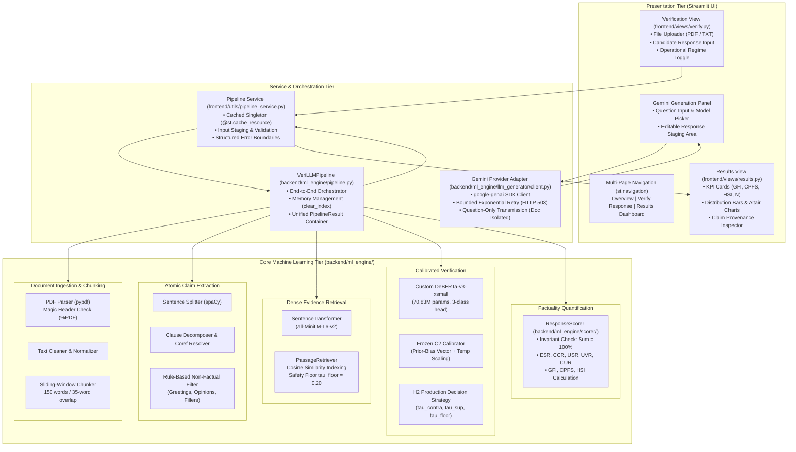
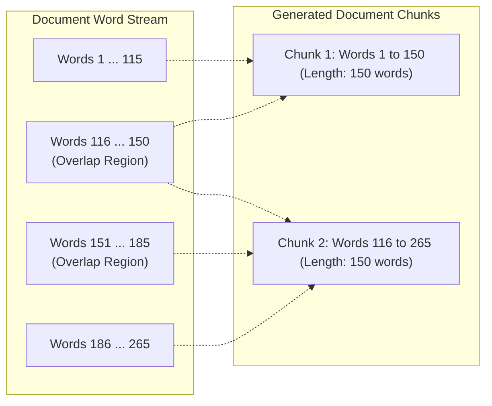
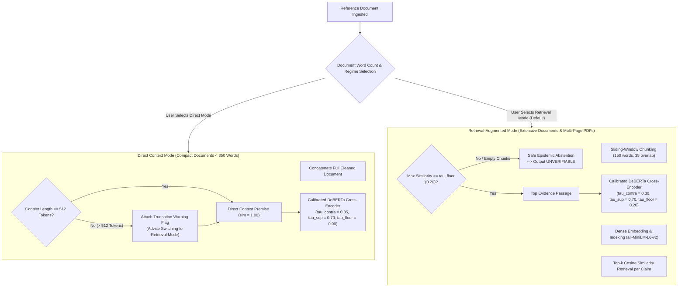
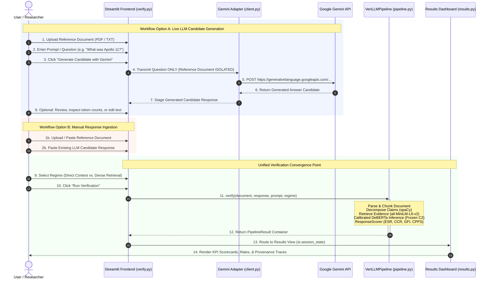

# Chapter 3: Proposed VeriLLM System Architecture

---

## 3.1 Introduction

The deployment of Large Language Models (LLMs) across high-stakes domains—including clinical healthcare, legal informatics, and technical engineering—demands rigorous mechanisms to evaluate and verify the factual reliability of generated text. Generative language models frequently exhibit *hallucinations*, producing outputs that are syntactically fluent and persuasively phrased, but factually ungrounded, logically inconsistent, or in direct contradiction with authoritative source material \cite{yuan2024ragtruth, li2023halueval}. 

Conventional automated evaluation approaches have predominantly relied on two flawed paradigms:
1. **Document-Level Binary Scoring**: Classifying an entire multi-sentence paragraph as either wholly "hallucinated" or wholly "faithful." This binary aggregation obscures the localization of factual errors, conflating benign omissions with severe factual contradictions \cite{kryscinski2020evaluating}.
2. **Generative LLM-as-a-Judge**: Prompting another commercial generative model (such as GPT-4) to evaluate factual consistency. This approach introduces circular self-preference biases, stochastic variance, lack of probability calibration, prohibitive inference costs, and latency bottlenecks \cite{tang2024minicheck}.

To overcome these limitations, this thesis introduces **VeriLLM**, a hybrid, model-agnostic, and document-grounded verification framework designed for fine-grained factual diagnosis. Grounding the verification process strictly in user-supplied reference evidence, VeriLLM decomposes candidate text into atomic factual propositions, identifies relevant evidence through dense semantic retrieval, subjects each proposition to calibrated neural cross-encoder verification, and aggregates the resulting verdicts into mathematically consistent factuality metrics.

The primary design objectives of the proposed architecture are:
- **Fine-Grained Granularity**: Evaluating individual atomic propositions rather than entire responses, enabling transparent character-level offset tracing.
- **Model-Agnostic Operation**: Decoupling response generation from verification to evaluate outputs from any proprietary API or open-weights model family.
- **Calibration-Driven Decision Making**: Replacing uncalibrated heuristic thresholds with an out-of-sample regularized calibration and decision rule.
- **Epistemic Abstention**: Explicitly isolating claims lacking evidence (`UNVERIFIABLE`) to prevent penalizing retrieval limitations as hallucinations.
- **Local Deployment & Data Sovereignty**: Operating entirely on standard host CPU hardware without transmitting confidential reference documents to external cloud services.

---

## 3.2 Overall System Architecture

The VeriLLM system is architected as a modular, state-safe, pure Python pipeline. The system cleanly decouples user interface orchestration from the underlying verification engine. Figure 3.1 illustrates the complete system architecture and data flow across the presentation, orchestration, and machine learning tiers.



*Figure 3.1: Overall VeriLLM System Architecture showing the presentation, orchestration, and core machine learning tiers.*

### 3.2.1 Presentation Tier
The frontend is implemented using Streamlit (`frontend/app.py`), providing an interactive dashboard without requiring an auxiliary Node.js/React build environment. The interface utilizes Streamlit's modern `st.navigation` routing across three core views:
- **Overview View** (`frontend/views/overview.py`): Displays architectural documentation, operational guidelines, and category definitions.
- **Verify View** (`frontend/views/verify.py`): Handles multi-modal document ingestion, response entry, optional prompt specification, operational regime toggles, and live candidate response generation.
- **Results View** (`frontend/views/results.py`): Renders response-level KPI scorecards, rate metric breakdowns, Altair probability distribution charts, and an expandable proposition inspector with citation provenance.

### 3.2.2 Orchestration Tier
The bridge between the user interface and the core engine is governed by [`frontend/utils/pipeline_service.py`](file:///d:/drive%20e/VeriLLM/frontend/utils/pipeline_service.py). It exposes `get_pipeline()` wrapped in `@st.cache_resource(show_spinner=False)`. This caching guarantees that the 70.83-million parameter DeBERTa cross-encoder weights and the SentenceTransformer embedding model are loaded once into CPU memory, avoiding redundant weight initialization across user interactions. The service validates staged UI inputs, maps them to canonical pipeline kwargs, and enforces structured error boundaries.

### 3.2.3 Core Pipeline Orchestrator (`VeriLLMPipeline`)
The [`VeriLLMPipeline`](file:///d:/drive%20e/VeriLLM/backend/ml_engine/pipeline.py) class in `backend/ml_engine/pipeline.py` serves as the centralized production orchestrator. It manages the lifecycle of document processing, claim extraction, passage retrieval, neural inference, and scoring, returning a strongly typed Pydantic [`PipelineResult`](file:///d:/drive%20e/VeriLLM/backend/ml_engine/pipeline.py#L62-L102) container. Crucially, the pipeline enforces strict memory management: following evidence retrieval, temporary passage embeddings are purged via `clear_index()` to prevent memory leakage during extended execution sessions.

---

## 3.3 Document Ingestion and Preprocessing

Factual verification depends directly on the integrity of the reference context. The document ingestion subsystem supports two primary input modalities: portable document format (PDF) files and unformatted plain-text streams.

### 3.3.1 PDF Extraction and Security Validation
PDF ingestion is executed via [`pypdf`](file:///d:/drive%20e/VeriLLM/backend/ml_engine/evidence_retriever/pdf_parser.py) in `backend/ml_engine/evidence_retriever/pdf_parser.py`. To prevent arbitrary binary injection and malformed file crashes, the ingestion module enforces strict security checks:
1. **Magic Header Validation**: The binary stream must begin with the `%PDF` magic byte signature. Files lacking this header are immediately rejected with an explicit validation error.
2. **Page-by-Page Extraction**: Text is extracted sequentially from each page, recording page numbers to maintain strict citation provenance for retrieved evidence.
3. **Scanned PDF Rejection Guardrail**: If total extracted text across all pages yields fewer than 10 non-whitespace characters, the parser raises an explicit `ValueError` stating that scanned/rasterized image-only PDFs are not supported. This prevents the downstream pipeline from silently verifying against empty evidence strings. Optical Character Recognition (OCR) is explicitly excluded from the current scope.

### 3.3.2 Plain-Text Normalization
Plain-text inputs (uploaded `.txt` files or text pasted directly into the UI) are processed via [`clean_text()`](file:///d:/drive%20e/VeriLLM/backend/ml_engine/evidence_retriever/text_cleaner.py) in `backend/ml_engine/evidence_retriever/text_cleaner.py`. The cleaner:
- Normalizes irregular UTF-8 quotation marks, dashes, and non-breaking spaces into standard ASCII representations.
- Replaces repetitive whitespace and tab sequences with single spaces while preserving natural paragraph boundaries (`\n\n`).
- Strips non-printable control characters while retaining standard punctuation marks necessary for syntactic parsing.

### 3.3.3 Sliding-Window Document Chunking
Long reference documents cannot be directly passed into transformer cross-encoders due to quadratic self-attention complexity and strict context length limits. The ingestion engine incorporates a [`SlidingWindowChunker`](file:///d:/drive%20e/VeriLLM/backend/ml_engine/evidence_retriever/chunker.py) that partitions normalized document text into semantically coherent passages.

The chunker operates with two empirically validated parameters:
- **Chunk Size ($W$)**: 150 words (approximately 200 tokens).
- **Overlap ($O$)**: 35 words (approximately 45 tokens).



*Figure 3.2: Sliding-window chunking mechanism showing 150-word window and 35-word overlap boundary.*

The overlap parameter guarantees that factual propositions spanning chunk boundaries are not truncated. Each chunk is assigned a deterministic identifier (e.g. `doc_p1_c001`), maintaining page provenance, start character offset, end character offset, and total word count.

---

## 3.4 Atomic Claim Extraction

Verifying generated text at the paragraph or sentence level introduces semantic conflation. A single compound sentence produced by an LLM often contains multiple independent assertions, some of which may be completely factual while others are fabricated.

Consider the compound assertion:
> *"Neil Armstrong stepped onto the lunar surface in July 1969, and the Apollo 11 crew subsequently conducted a pizza party on the Moon."*

A binary sentence-level verifier is forced into an erroneous compromise: either marking the entire sentence as hallucinated (discarding the true historical fact of the lunar landing) or marking it as supported (ignoring the blatant fabrication of the pizza party). VeriLLM resolves this via fine-grained atomic claim extraction.

### 3.4.1 Sentence Splitting and Clause Decomposition
The extraction subsystem ([`backend/ml_engine/claim_extractor/`](file:///d:/drive%20e/VeriLLM/backend/ml_engine/claim_extractor/)) coordinates three processing stages:
1. **Sentence Boundary Disambiguation**: Employs spaCy's statistical dependency parser (`en_core_web_sm`) to segment candidate text into sentences, accurately handling numerical decimals, abbreviations (e.g., "Dr.", "e.g."), and quotation bounds.
2. **Compound Clause Decomposition**: Decomposes sentences containing coordinating conjunctions (`and`, `but`, `whereas`), relative clauses (`which`, `who`), and semicolons into standalone grammatical propositions. Each proposition contains a distinct subject, predicate, and object.
3. **Salient Subject and Coreference Resolution**: When compound decomposition produces secondary clauses with elided subjects or relative pronouns (e.g., *"and subsequently conducted..."*), the decomposer extracts the salient subject from the preceding main clause (*"the Apollo 11 crew"*) and projects it into the proposition. This ensures that every extracted claim is self-contained and independently verifiable.

### 3.4.2 Filtering Non-Factual Assertions
LLM responses frequently include conversational pleasantries, procedural acknowledgments, and subjective opinions that cannot be verified against empirical documentation. Passing such expressions to an NLI verifier produces noise and miscalibration.

The [`claim_filter.py`](file:///d:/drive%20e/VeriLLM/backend/ml_engine/claim_extractor/claim_filter.py) module applies rule-based regular expression filters to categorize propositions before verification:
- **Conversational Meta-Text**: Matches greetings, pleasantries, and AI persona markers (e.g., *"Hello! Hope this helps!"*, *"As an AI language model..."*).
- **Subjective Opinions**: Matches epistemic sentiment markers lacking empirical ground truth (e.g., *"In my humble opinion..."*, *"Personally, I believe this is beautiful..."*).
- **Imperatives / Instructions**: Matches user commands (e.g., *"Please refer to the following guide..."*).

Propositions matching these criteria are assigned `is_factual = False` and tagged as `NON_FACTUAL`. They are tracked for completeness but **strictly excluded from the factuality denominator $N$**. Conversely, rhetorical questions containing embedded factual statements (e.g., *"Did you know that Apollo 11 launched from Florida?"*) are detected via syntactic pattern matching, extracted, and retained as empirical factual propositions.

---

## 3.5 Evidence Retrieval

In multi-page documents, identifying the exact passage necessary to substantiate a claim is performed by the dense passage retrieval engine ([`backend/ml_engine/evidence_retriever/passage_retriever.py`](file:///d:/drive%20e/VeriLLM/backend/ml_engine/evidence_retriever/passage_retriever.py)).

### 3.5.1 Dense Passage Embedding
VeriLLM utilizes the pretrained [`sentence-transformers/all-MiniLM-L6-v2`](https://huggingface.co/sentence-transformers/all-MiniLM-L6-v2) bi-encoder model \cite{reimers2019sentence}. This model maps text sequences to a 384-dimensional dense vector space optimized for semantic search.
- **Chunk Encoding**: During document ingestion, all generated document chunks $\{C_1, C_2, \dots, C_M\}$ are encoded in batches on the host CPU.
- **Normalization**: All resulting embedding vectors are $L_2$-normalized:
  $$\mathbf{e}_i = \frac{f_{\text{enc}}(C_i)}{\|f_{\text{enc}}(C_i)\|_2} \quad \in \mathbb{R}^{384} \tag{3.1}$$

### 3.5.2 Semantic Similarity & Evidence Selection
For each extracted factual proposition $c_j$, the claim text is encoded into the same vector space:
$$\mathbf{q}_j = \frac{f_{\text{enc}}(c_j)}{\|f_{\text{enc}}(c_j)\|_2} \quad \in \mathbb{R}^{384} \tag{3.2}$$

Semantic similarity between claim $c_j$ and evidence chunk $C_i$ is computed via the dot product (equivalent to cosine similarity on $L_2$-normalized vectors):
$$\text{sim}(c_j, C_i) = \mathbf{q}_j \cdot \mathbf{e}_i \quad \in [-1.0, 1.0] \tag{3.3}$$

The retriever ranks chunks in descending order of similarity, returning the top-$k$ candidates (default $k=3$). The highest-scoring chunk $C^* = \arg\max_{C_i} \text{sim}(c_j, C_i)$ is designated as the primary evidence passage.

### 3.5.3 Conceptual Role of Retrieval Similarity
> [!IMPORTANT]
> **Critical Conceptual Distinction: Relatedness vs. Entailment**  
> Dense retrieval similarity measures **semantic and topical relatedness**, not factual consistency. A retrieved chunk discussing the Apollo 11 launch may share 85% cosine similarity with a claim asserting that Apollo 11 was launched by the Soviet Union, even though the claim directly contradicts the passage. Retrieval identifies *candidate evidence*; semantic consistency is evaluated exclusively by the cross-encoder verifier.

However, retrieval similarity plays a vital gatekeeping role: determining **evidence sufficiency**. If the maximum similarity across all indexed chunks fails to meet the safety floor ($\max_i \text{sim} < \tau_{\text{floor}} = 0.20$), the retriever certifies that the reference document does not contain topically relevant information. In such cases, the claim is routed directly to `UNVERIFIABLE`, preventing ungrounded neural hallucinations.

---

## 3.6 Dual Operational Verification Regimes

To optimize accuracy across documents of differing lengths, VeriLLM implements two dedicated operational regimes: **Direct Context Mode** and **Retrieval-Augmented Verification Mode**.



*Figure 3.3: Comparative execution flow between Direct Context Mode and Retrieval-Augmented Verification Mode.*

### 3.6.1 Direct Context Mode
In Direct Context Mode, the entire cleaned reference document is supplied directly as the verification premise for every extracted proposition.
- **Use Case**: Compact reference texts, short email summaries, single-paragraph memos, and concise QA context passages ($< 350$ words).
- **Similarity Handling**: Because the complete source document is present in the cross-encoder context, retrieval similarity is not applicable and is fixed to $\text{sim} = 1.00$. The evidence sufficiency threshold is relaxed to $\tau_{\text{floor}} = 0.00$.
- **512-Token Boundary Warning**: Cross-encoder transformers exhibit quadratic attention complexity bounded by a maximum sequence length ($L_{\max} = 512$ tokens). If a reference text exceeds 350 words (~450 tokens including premise and hypothesis), later portions of the premise will be truncated by the tokenizer. The pipeline detects this condition and attaches an operational warning to `PipelineResult.warnings`, advising the user to activate Retrieval Mode to eliminate truncation error.

### 3.6.2 Retrieval-Augmented Verification Mode
In Retrieval-Augmented Verification Mode (the production default), the reference document is chunked, indexed, and queried dynamically for each proposition.
- **Use Case**: Multi-page reports, research papers, lengthy manuals, and large plain-text corpora.
- **Similarity Floor & Epistemic Abstention**: Each proposition is evaluated against its top retrieved passage. If the top passage satisfies $\text{sim} \ge \tau_{\text{floor}} = 0.20$, the cross-encoder is invoked. If similarity falls below 0.20, or if the document contains zero extractable text chunks, the pipeline abstains from neural inference and assigns `UNVERIFIABLE`.
- **Memory Release**: Immediately following proposition retrieval, all chunk embeddings stored in NumPy arrays are released via `clear_index()`.

### 3.6.3 Operational Regime Comparison

| Architectural Dimension | Direct Context Mode | Retrieval-Augmented Verification Mode |
| :--- | :--- | :--- |
| **Target Document Scope** | Concise texts ($< 350$ words / $< 512$ tokens) | Multi-page PDFs and extensive documents ($> 350$ words) |
| **Evidence Formulation** | Full document text passed as unified premise | Dynamically retrieved 150-word sliding-window chunk |
| **Retrieval Embedding Step** | None (Zero vectorization overhead) | Dense encoding via `all-MiniLM-L6-v2` |
| **Evidence Floor Gate ($\tau_{\text{floor}}$)** | Disabled ($\tau_{\text{floor}} = 0.00$, $\text{sim} \equiv 1.00$) | Enforced ($\tau_{\text{floor}} = 0.20$ safety threshold) |
| **Abstention Behavior** | Abstains only on empty reference input | Abstains when top passage similarity $< 0.20$ |
| **Calibrated Thresholds** | $\tau_{\text{contra}} = 0.35, \tau_{\text{sup}} = 0.70$ | $\tau_{\text{contra}} = 0.30, \tau_{\text{sup}} = 0.70$ |
| **Token Limit Risk** | Subject to 512-token head truncation warning | Immune to token limits (passages bounded to 150 words) |

*Table 3.1: Comparative summary of Direct Context Mode and Retrieval-Augmented Verification Mode.*

---

## 3.7 Five-Way Verification Classification

VeriLLM categorizes every proposition into one of five mutually exclusive classes. Table 3.2 outlines their formal definitions and operational criteria.

| Category Label | Epistemic Semantics | Primary Attribution | Operational Handling |
| :--- | :--- | :--- | :--- |
| **`SUPPORTED`** | The proposition is directly entailed by and consistent with the reference evidence passage. | Document-Grounded Factuality | Counted in $S$; included in numerator of Support Rate ($ESR$) and $GFI$. |
| **`CONTRADICTED`** | The proposition directly conflicts with or refutes empirical facts stated in the evidence. | Active Hallucination (Direct Conflict) | Counted in $C$; penalizes $CPFS$; forms the numerator of $HSI$ and $CCR$. |
| **`UNSUPPORTED`** | The proposition makes assertions that are completely unmentioned or absent from the evidence. | Extrinsic Hallucination (Absent Evidence) | Counted in $U$; penalizes $GFI$; included in Combined Uncertainty Rate ($CUR$). |
| **`UNVERIFIABLE`** | The claim cannot be verified due to missing evidence or passage similarity $< 0.20$. | Epistemic Abstention (Retrieval Miss) | Counted in $V$; included in $CUR$; **never penalized as an active hallucination**. |
| **`NON_FACTUAL`** | Conversational pleasantries, personal greetings, or subjective opinion statements. | Non-Empirical Language | Counted in $NF$; **completely partitioned out of the factual denominator $N$**. |

*Table 3.2: The VeriLLM Five-Way Proposition Classification Framework.*

### 3.7.1 Contradiction vs. Absence of Evidence
A fundamental contribution of this framework is the explicit differentiation between **direct contradiction** (`CONTRADICTED`) and **absence of evidence** (`UNSUPPORTED`). 

In many existing hallucination benchmarks and binary verification tools (such as MiniCheck \cite{tang2024minicheck}), both failure modes are collapsed into a single negative label ($y = 0$). This conflation is scientifically unsound:
- An assertion contradicting reference facts (e.g. asserting that a medication has no side effects when the documentation lists cardiac risk) constitutes an **active, dangerous falsehood**.
- An assertion stating an unmentioned fact (e.g. stating the company's founding year when the provided text only discusses quarterly revenue) represents an **unsubstantiated extrapolation**, which may be factually true in the physical world but ungrounded in the context.

### 3.7.2 Why Binary Baselines (MiniCheck) Cannot Resolve Fine-Grained Classes
MiniCheck \cite{tang2024minicheck} was designed as an efficient binary fact-checker trained on synthetic sentence pairs to predict support probability $p(\text{supported}) \in [0, 1]$. While effective for coarse filtering, its single scalar output cannot mathematically separate a claim that is false from a claim that is merely unmentioned. By implementing a 3-class cross-encoder architecture backed by RAGTruth, VeriLLM provides independent probability outputs for all three semantic states.

---

## 3.8 Calibrated Verification and Decision Strategy

Neural network classifiers trained via cross-entropy loss are notoriously miscalibrated, often producing softmax probabilities that approach $1.0$ or $0.0$ even on incorrect predictions \cite{guo2017calibration}. In factual verification, deploying uncalibrated softmax scores with naive argmax decision rules leads to extreme false-positive contradiction rates on imbalanced datasets.

VeriLLM incorporates a two-stage calibrated decision pipeline consisting of a custom fine-tuned DeBERTa-v3 cross-encoder and an out-of-sample frozen calibration transformation.

### 3.8.1 Custom DeBERTa-v3-xsmall Cross-Encoder
The neural backbone is [`cross-encoder/nli-deberta-v3-xsmall`](https://huggingface.co/cross-encoder/nli-deberta-v3-xsmall) (70,831,107 parameters), fine-tuned on the RAGTruth benchmark across 2,065 training source documents.
- **Input Formatting**: Premise and hypothesis are concatenated into a single cross-encoder sequence:
  $$\mathbf{x} = \text{[CLS]} \circ \text{Evidence Passage} \circ \text{[SEP]} \circ \text{Atomic Claim} \circ \text{[SEP]}$$
- **Linear Classification Head**: The 384-dimensional representation of the `[CLS]` token is projected through a linear classification layer to yield three unnormalized logits:
  $$\mathbf{z} = [z_{\text{contra}}, z_{\text{sup}}, z_{\text{unsup}}]^T \in \mathbb{R}^3 \tag{3.4}$$

### 3.8.2 Logit Reconstruction and Frozen $C2$ Calibration
To adjust the raw logits for empirical base-rate imbalances and temperature overconfidence, VeriLLM applies the **$C2$ Regularized Prior-Bias + Temperature Scaling** transformation \cite{guo2017calibration}.

For each operational regime, the calibrator parameters were tuned exclusively on 30 Val-Dev sources and frozen into `10_stage1_frozen_bundle.json`. Given raw softmax probabilities $\mathbf{s} \in \mathbb{R}^3$, the verifier reconstructs centered logits:
$$z_k = \log s_k - \frac{1}{3}\sum_{j=0}^2 \log s_j \tag{3.5}$$

The calibrated probability vector $\mathbf{p} = [p_{\text{contra}}, p_{\text{sup}}, p_{\text{unsup}}]^T$ is computed via:
$$p_k = \frac{\exp\left(\frac{z_k + b_k}{T}\right)}{\sum_{j=0}^2 \exp\left(\frac{z_j + b_j}{T}\right)} \quad \text{for } k \in \{0, 1, 2\} \tag{3.6}$$

#### Frozen Parameter Values from `10_stage1_frozen_bundle.json`:
1. **Direct Context Regime ($C2_{\text{direct}}$)**:
   - Temperature: $T = 1.76959203$
   - Prior-bias vector: $\mathbf{b} = [-0.66788442, +0.71171648, -0.04383205]$
   - $L_2$ regularization parameter: $\lambda_{\text{reg}} = 0.001$
2. **Retrieval Regime ($C2_{\text{retrieval}}$)**:
   - Temperature: $T = 2.50411010$
   - Prior-bias vector: $\mathbf{b} = [-0.72845197, +1.22831149, -0.49985952]$
   - $L_2$ regularization parameter: $\lambda_{\text{reg}} = 0.001$

The negative intercept on the contradiction logit ($b_0 = -0.6679$ in Direct, $b_0 = -0.7285$ in Retrieval) regularizes marginal contradiction probabilities toward their empirical prevalence (~3.8%), eliminating spurious false alarms on neutral assertions.

### 3.8.3 $H2$ Production Decision Strategy
The verifier maps calibrated posterior probabilities $\mathbf{p}$ into final categorical verdicts using the production **$H2$ Decision Strategy**:

$$\hat{y} = \begin{cases}
\text{CONTRADICTED}, & \text{if } p_{\text{contra}} \ge \tau_{\text{contra}} \\
\text{SUPPORTED}, & \text{else if } p_{\text{sup}} \ge \tau_{\text{sup}} \\
\text{UNSUPPORTED}, & \text{otherwise}
\end{cases} \tag{3.7}$$

Subject to the following pre-registered operational thresholds:
- **Direct Regime**: $\tau_{\text{contra}} = 0.35$, $\tau_{\text{sup}} = 0.70$, $\tau_{\text{floor}} = 0.00$.
- **Retrieval Regime**: $\tau_{\text{contra}} = 0.30$, $\tau_{\text{sup}} = 0.70$, $\tau_{\text{floor}} = 0.20$.

#### Epistemic Floor Overrides:
Across both regimes, two invariant overrides take absolute precedence:
1. **Missing Evidence Override**: If a claim's evidence text is empty or missing, $\hat{y}$ is set to `UNVERIFIABLE`.
2. **Retrieval Similarity Floor**: In Retrieval Mode, if $\text{sim}(c_j, C^*) < \tau_{\text{floor}} = 0.20$, $\hat{y}$ is set to `UNVERIFIABLE`.

---

## 3.9 Response-Level Factuality Quantification

Once all propositions are assigned categorical verdicts, the scoring engine ([`backend/ml_engine/scorer/response_scorer.py`](file:///d:/drive%20e/VeriLLM/backend/ml_engine/scorer/response_scorer.py)) aggregates claim-level classifications into mathematically consistent response-level factuality metrics.

### 3.9.1 Factual Proposition Denominator ($N$)
Let $S$, $C$, $U$, and $V$ represent the counts of supported, contradicted, unsupported, and unverifiable propositions in the candidate response. The total empirical factual proposition count $N$ is defined as:

$$N = S + C + U + V \tag{3.8}$$

Non-factual propositions ($NF$) are excluded from $N$ to prevent pleasantries (e.g., *"Hello!"*) from artificially inflating the denominator and diluting observed hallucination rates.

### 3.9.2 Factuality Rate Metrics
For all responses where $N > 0$, the engine computes five mutually exclusive rate percentages:

1. **Evidence Support Rate ($ESR$)**:
   $$\text{ESR} = \frac{S}{N} \times 100 \tag{3.9}$$
2. **Confirmed Contradiction Rate ($CCR$)**:
   $$\text{CCR} = \frac{C}{N} \times 100 \tag{3.10}$$
3. **Unsupported Rate ($USR$)**:
   $$\text{USR} = \frac{U}{N} \times 100 \tag{3.11}$$
4. **Unverifiable Rate ($UVR$)**:
   $$\text{UVR} = \frac{V}{N} \times 100 \tag{3.12}$$
5. **Combined Uncertainty Rate ($CUR$)**:
   $$\text{CUR} = \frac{U + V}{N} \times 100 = \text{USR} + \text{UVR} \tag{3.13}$$

### 3.9.3 Mathematical Conservation Invariant
By construction, because every factual proposition must receive exactly one of the four factual category labels, the sum of the four mutually exclusive rates satisfies the strict conservation law:

$$\text{ESR} + \text{CCR} + \text{USR} + \text{UVR} = \frac{S + C + U + V}{N} \times 100 \equiv 100.00\% \tag{3.14}$$

The scorer verifies this condition numerically on every execution, asserting that:
$$|(\text{ESR} + \text{CCR} + \text{USR} + \text{UVR}) - 100.0| \le 0.01 \tag{3.15}$$
and records `ResponseScore.mathematical_invariants_verified = True`.

### 3.9.4 Factuality Indices
To provide actionable summary indicators for downstream monitoring, VeriLLM synthesizes rates into three bounded indices:

1. **Grounded Factuality Index ($GFI$)**:
   $$\text{GFI} = \text{ESR} = \frac{S}{N} \times 100 \quad \in [0.0, 100.0] \tag{3.16}$$
   Represents the proportion of the response directly corroborated by reference evidence.
2. **Contradiction-Penalized Factuality Score ($CPFS$)**:
   $$\text{CPFS} = \max\left(0, \frac{S - \lambda \cdot C}{N}\right) \times 100 \quad (\lambda = 1.0) \tag{3.17}$$
   Penalizes responses containing active contradictions. Even if a response contains 3 supported claims, the presence of 3 contradicted claims reduces $CPFS$ to $0.0$.
3. **Hallucination Severity Index ($HSI$)**:
   $$\text{HSI} = \text{CCR} = \frac{C}{N} \times 100 \quad \in [0.0, 100.0] \tag{3.18}$$
   Measures the density of active factual falsehoods. Color-coded in red when $HSI > 0.0\%$.

### 3.9.5 Handling the $N = 0$ Edge Case
When an LLM produces a response containing zero factual assertions (e.g. an apology or purely opinionated statement: *"Hello! In my personal opinion, astronomy is wonderful!"*), all extracted propositions are classified as `NON_FACTUAL`, yielding $N = 0$.

In this scenario:
- Computing rates would result in a division-by-zero error ($\frac{0}{0}$).
- The scorer explicitly sets all rates ($ESR, CCR, USR, UVR, CUR$) and indices ($GFI, CPFS, HSI$) to `None`.
- The UI renders these values as `"N/A"` with an informative notice: *"Response contains no empirical factual claims to verify ($N=0$)."*
- `has_factual_claims` is recorded as `False`.

---

## 3.10 Complete End-to-End Workflow

VeriLLM supports two operational user workflows that converge onto a single unified verification pipeline: **Manual Verification** and **Live Gemini Verification**. Figure 3.4 diagrams the convergence model and strict privacy boundaries.



*Figure 3.4: Sequence diagram illustrating the dual workflow convergence model and reference document privacy boundary.*

### 3.10.1 Workflow Path A: Live Gemini Generation
In the Live LLM Verification workflow:
1. The user uploads a reference document and enters a specific question.
2. The user initiates generation via the **Generate Candidate with Gemini** interface.
3. The [`GeminiProviderAdapter`](file:///d:/drive%20e/VeriLLM/backend/ml_engine/llm_generator/client.py) formats a generation request containing **only the user's question**.
4. **Data Sovereignty Invariant**: The uploaded reference document remains strictly local on the host filesystem and is **never transmitted to Google's servers**.
5. Gemini generates a candidate response, which is returned and populated into an editable textarea in the Streamlit UI, displaying latency and token usage metrics.
6. The user can review, edit, or accept the candidate response before initiating verification.

### 3.10.2 Workflow Path B: Manual Verification
In the Manual Verification workflow:
1. The user uploads a reference document (or pastes raw source text).
2. The user pastes an arbitrary candidate response previously generated by any external model (e.g. Claude, ChatGPT, Llama, Mistral) without requiring an API key.
3. The user selects the operational regime and initiates verification.

### 3.10.3 Unified Convergence on `VeriLLMPipeline.verify()`
Both workflows stage an identical input dictionary:
```python
prepared_inputs = {
    "doc_mode": "upload" | "text",
    "doc_file_bytes": bytes,
    "doc_text": str,
    "doc_name": str,
    "response_text": str,
    "prompt_text": Optional[str],
    "regime": "retrieval" | "direct"
}
```
The pipeline service converts this dictionary into canonical arguments and executes [`VeriLLMPipeline.verify()`](file:///d:/drive%20e/VeriLLM/backend/ml_engine/pipeline.py#L180-L245). This guarantees that evaluated metrics are 100% independent of whether the response was generated live or pasted manually.

---

## 3.11 Summary

This chapter has detailed the architectural design and structural implementation of the VeriLLM verification framework. Rather than treating hallucination detection as a coarse binary task or relying on uncalibrated generative judges, VeriLLM establishes a modular, claim-grounded evaluation pipeline.

The architecture coordinates:
1. Robust document parsing and sliding-window passage chunking (150 words, 35-word overlap).
2. Syntactic sentence decomposition and pronoun-resolved atomic proposition extraction.
3. Dense vector passage retrieval with an evidence sufficiency threshold ($\tau_{\text{floor}} = 0.20$).
4. Dual operational regimes optimizing performance for compact contexts ($< 350$ words) versus multi-page documents.
5. Calibrated cross-encoder verification utilizing fine-tuned DeBERTa-v3 with out-of-sample $C2$ prior-bias and temperature scaling.
6. A five-way categorization framework isolating non-factual expressions and missing evidence.
7. Mathematical response-level factuality quantification ($GFI, CPFS, HSI$) adhering to strict conservation invariants.
8. A dual-workflow Streamlit interface enabling live Gemini candidate generation while enforcing local data sovereignty.

This verified architectural stack provides the empirical foundation for the machine learning training methodology, calibration ablation studies, and comprehensive test benchmarks presented in subsequent chapters.

