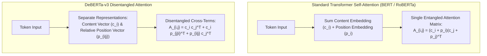
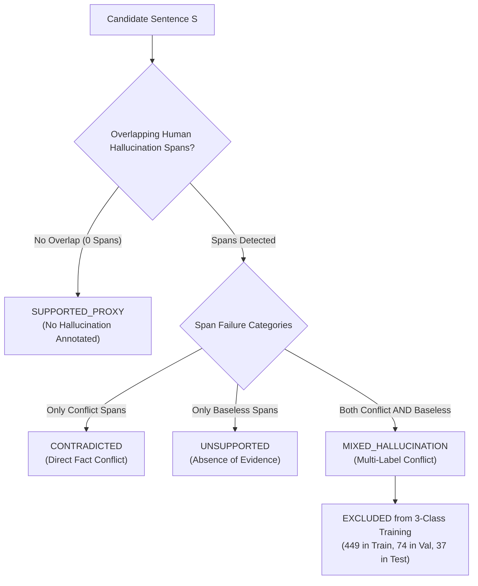
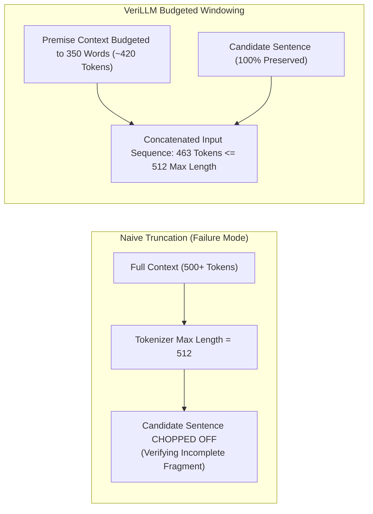
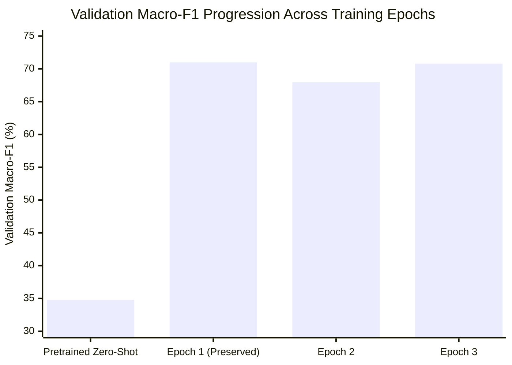
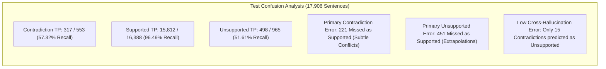

# Chapter 4: Machine Learning Model Design and Training

---

## 4.1 Introduction and Model Development Objectives

In the VeriLLM architecture detailed in Chapter 3, the factual verification of extracted propositions is governed by a dedicated natural language inference (NLI) cross-encoder. Generic, off-the-shelf NLI models (such as those pretrained solely on SNLI or MNLI) are fundamentally inadequate for grounded document verification. Standard NLI benchmarks typically evaluate short, single-sentence premise-hypothesis pairs. When applied to real-world Retrieval-Augmented Generation (RAG) contexts—where premise documents span multiple paragraphs and candidate assertions contain domain-specific terminology—zero-shot NLI models exhibit catastrophic failure modes: predominantly collapsing into the neutral class and failing to recognize grounded support \cite{tang2024minicheck, yuan2024ragtruth}.

To resolve this limitation, VeriLLM incorporates an in-house fine-tuned transformer cross-encoder. The primary objectives of this machine learning subsystem are:
1. **Fine-Grained Tri-Class Verification**: Transitioning from binary hallucination classification to an explicit three-class formulation distinguishing **Direct Contradiction** (`CONTRADICTED`), **Document-Grounded Consistency** (`SUPPORTED_PROXY`), and **Absence of Corroborating Evidence** (`UNSUPPORTED`).
2. **Computational Feasibility on Consumer Hardware**: Achieving sub-second inference latency on standard central processing units (CPUs), eliminating the strict requirement for dedicated enterprise graphics processing units (GPUs) during production inference.
3. **Robustness to Extreme Class Imbalance**: Formulating a class-weighted optimization objective to prevent majority-class collapse on heavily skewed real-world verification corpora.
4. **Context Window Preservation**: Establishing a budgeted sequence-length strategy that accommodates extensive reference premises without truncating candidate assertions.
5. **Strict Document Grounding**: Restricting the model's inductive bias to document-grounded consistency rather than uncalibrated parametric knowledge.

---

## 4.2 Selection of the DeBERTa-v3-xsmall Architecture

A critical architectural decision was selecting the underlying transformer backbone. Two prominent candidate architectures were empirically profiled and compared: [`cross-encoder/nli-deberta-v3-xsmall`](https://huggingface.co/cross-encoder/nli-deberta-v3-xsmall) and [`lytang/MiniCheck-RoBERTa-Large`](https://huggingface.co/lytang/MiniCheck-RoBERTa-Large).

### 4.2.1 Empirical Hardware & Latency Benchmarks
Both models were evaluated on the host development machine in a CPU-only PyTorch environment (Intel Core i5-8250U, x86_64 architecture). Table 4.1 details the empirical hardware footprints and batched inference latencies.

| Architectural Parameter | `cross-encoder/nli-deberta-v3-xsmall` | `lytang/MiniCheck-RoBERTa-Large` | Factor Difference |
| :--- | :---: | :---: | :---: |
| **Model Family** | DeBERTa-v3 (Disentangled Attention) | RoBERTa (Standard Multi-Head Attention) | — |
| **Total Parameters** | **70,831,107 (~70.83 M)** | 355,361,794 (~355.36 M) | **5.02× smaller** |
| **On-Disk Checkpoint** | **283.3 MB** (`model.safetensors`) | 1,355.6 MB | **4.79× lighter** |
| **Hidden Dimension ($d_{\text{model}}$)** | **384** (12 layers, 6 heads) | 1,024 (24 layers, 16 heads) | 2.67× more compact |
| **Vocabulary Size** | **128,100** (SentencePiece) | 50,265 (Byte-Pair Encoding) | **2.55× richer** |
| **Single-Claim CPU Latency** | **964.2 ms / claim** | ~9,500 – 11,000 ms / claim | **10.5× faster** |
| **Peak RAM Allocation** | **< 0.60 GB** | > 2.85 GB | Low OOM risk |

*Table 4.1: Comparative hardware profiling and CPU inference benchmarks between candidate transformer backbones.*

### 4.2.2 Theoretical Advantages of DeBERTa-v3
Beyond its 10-fold latency advantage, DeBERTa-v3 (Decoding-enhanced BERT with Disentangled Attention) provides structural algorithmic advantages for factual consistency checking \cite{he2023debertav3}:



*Figure 4.1: Comparison between standard entangled self-attention and DeBERTa-v3 disentangled attention mechanisms.*

1. **Disentangled Attention**: Standard transformers represent each token by summing its content embedding vector and absolute positional embedding vector into a single composite representation:
   $$\mathbf{h}_i = \mathbf{c}_i + \mathbf{p}_i \tag{4.1}$$
   Consequently, the attention product $\mathbf{h}_i \mathbf{h}_j^T$ entangles position and content into a single scalar. In contrast, DeBERTa represents each token using two decoupled vectors: a content vector $\mathbf{c}_i$ and a relative position vector $\mathbf{p}_{i|j}$. The cross-attention matrix is computed across disentangled matrices:
   $$A_{i,j} = \mathbf{c}_i \mathbf{c}_j^T + \mathbf{c}_i \mathbf{p}_{j|i}^T + \mathbf{p}_{i|j} \mathbf{c}_j^T \tag{4.2}$$
   In factual verification, matching an assertion to premise evidence requires sensitive syntactic alignment between subjects, predicates, and modifiers across long contexts. Decoupled relative positioning enables DeBERTa to distinguish identical tokens appearing in contradictory syntactic roles (e.g. subject vs. object) far more effectively than standard bi-encoders.
2. **Replaced Token Detection (RTD) Pretraining**: DeBERTa-v3 utilizes an ELECTRA-style discriminator pretraining objective where an auxiliary generator corrupts tokens and the backbone predicts whether each token is original or replaced. Unlike masked language modeling (MLM), which calculates loss over only 15% of masked positions, RTD propagates gradients over 100% of input tokens, yielding substantially higher sample efficiency and superior NLI representations at smaller parameter scales \cite{he2023debertav3}.
3. **NLI Pretrained Checkpoint Initialization**: Rather than starting from an unaligned base language model, VeriLLM initializes from `cross-encoder/nli-deberta-v3-xsmall`, which already contains an initialized classification head pretrained on multi-genre natural language inference.

---

## 4.3 RAGTruth Dataset and Its Characteristics

Model training and evaluation were conducted on **RAGTruth**, a benchmark developed by Microsoft Research specifically targeting hallucination detection in Retrieval-Augmented Generation systems \cite{yuan2024ragtruth}.

### 4.3.1 Benchmark Corpus Structure
Unlike synthetic factuality datasets that rely on rule-based keyword corruptions or automated text perturbation, RAGTruth comprises naturalistic text generated by modern LLMs responding to diverse reference contexts. The benchmark spans three foundational natural language processing tasks:
1. **Text Summarization (`Summary`)**: Long-form multi-sentence summaries generated from news articles sourced from the CNN/DailyMail dataset.
2. **Question Answering (`QA`)**: Complex question responses grounded in multi-passage evidence retrieved from the MS MARCO passage corpus.
3. **Data-to-Text (`Data2txt`)**: Descriptive natural language statements generated from structured tabular records, including REST-80 (restaurant metadata), WiT (Wikipedia image captions), and WebNLG (knowledge graph triples).

### 4.3.2 Generative LLM Coverage
RAGTruth incorporates responses generated across six major LLM architectures, covering both proprietary closed-source models and widely deployed open-weights families:
- **Proprietary Commercial LLMs**: OpenAI GPT-4 (`gpt-4-0613`) and GPT-3.5-Turbo (`gpt-3.5-turbo-0613`).
- **Open-Weights Large Models**: Meta Llama-2-Chat across three parameter tiers: Llama-2-7B-Chat, Llama-2-13B-Chat, and Llama-2-70B-Chat.
- **Specialized Instruct Models**: Mistral-7B-Instruct-v0.1.

This multi-model diversity ensures that the fine-tuned verifier does not overfit to the idiosyncratic generation artifacts, stylistic mannerisms, or token distribution quirks of any single generative model family.

---

## 4.4 Data Preprocessing and Sentence-Level Label Construction

RAGTruth provides fine-grained, character-level span annotations demarcating hallucinated phrases within LLM responses. However, cross-encoder sequence classification models operate on discrete textual sequences. A deterministic preprocessing pipeline ([`backend/ml_engine/custom_model/dataset_preprocessor.py`](file:///d:/drive%20e/VeriLLM/backend/ml_engine/custom_model/dataset_preprocessor.py)) was constructed to align character spans to complete sentences.

### 4.4.1 Quality Filtering
The raw RAGTruth corpus contains 17,790 response records. Before segmentation, quality filtering removed invalid responses:
- **Excluded Incomplete Responses**: 29 truncated responses where generation terminated abruptly due to generation token limits.
- **Excluded Incorrect Refusals**: 144 instances where the generative model inappropriately refused to answer despite adequate reference context (e.g., *"I cannot answer this question based on the provided text."*).
- **Retained High-Quality Corpus**: 17,617 verified response records (99.03% retention).

### 4.4.2 Sentence Segmentation & Span Alignment
Responses were segmented into individual candidate sentences using spaCy's rule-based sentencizer (`spacy.blank("en")` with a `sentencizer` pipeline component). For each extracted sentence bounded by start character index $s_{\text{start}}$ and end character index $s_{\text{end}}$, the preprocessor checks for character overlap against all human-annotated hallucination spans:

$$\text{Overlap}(S, L) = \max(0, \min(s_{\text{end}}, l_{\text{end}}) - \max(s_{\text{start}}, l_{\text{start}})) \tag{4.3}$$

An overlap ratio is recorded relative to sentence length:
$$r_{\text{overlap}} = \frac{\text{Overlap}(S, L)}{s_{\text{end}} - s_{\text{start}}} \tag{4.4}$$

### 4.4.3 Three-Class Mapping Policy & Mixed Isolation
In RAGTruth, hallucination spans are categorized by human annotators into two primary failure types:
- **Conflict Spans**: `Evident Conflict` and `Subtle Conflict` (assertions directly refuting source evidence).
- **Baseless Info Spans**: `Evident Baseless Info` and `Subtle Baseless Info` (assertions completely absent from source evidence).

To map overlapping spans into discrete training labels, VeriLLM enforces a four-way deterministic policy:
1. **`SUPPORTED_PROXY`**: Zero annotated hallucination spans overlap the sentence ($\text{Overlap} = 0$).
2. **`CONTRADICTED`**: One or more conflict spans overlap the sentence, and zero baseless info spans overlap.
3. **`UNSUPPORTED`**: One or more baseless info spans overlap the sentence, and zero conflict spans overlap.
4. **`MIXED_HALLUCINATION`**: Both conflict spans and baseless info spans overlap within the same sentence.



*Figure 4.2: Deterministic sentence labeling logic and exclusion of mixed hallucination spans.*

> [!IMPORTANT]
> **Semantic Precision of `SUPPORTED_PROXY`**  
> `SUPPORTED_PROXY` designates sentences containing zero annotated hallucination spans. It certifies that human annotators found no evidence of contradiction or baseless extrapolation relative to the source context. It acts as an empirical proxy for document-grounded consistency; it does **not** guarantee universal, absolute truth in the external physical world.

### 4.4.4 Reconciliation of Mixed Hallucinations
Sentences containing `MIXED_HALLUCINATION` spans represent composite errors (e.g. a sentence where the subject entity is unmentioned and the date is contradictory). Forcing these sentences into a single mutually exclusive 3-class softmax head introduces contradictory label gradients. Across the entire dataset, exactly 560 sentences exhibit mixed spans:
- **Train Split**: 449 mixed sentences excluded.
- **Validation Split**: 74 mixed sentences excluded.
- **Test Split**: 37 mixed sentences excluded.

Excluding these 560 sentences leaves a clean, unambiguous 3-class training boundary across all 123,118 remaining sentences.

---

## 4.5 Source-Disjoint Dataset Partitioning

In machine learning evaluation for information extraction, random sentence-level or response-level partitioning causes severe **data leakage**. If two sentences generated from the same reference document appear in both the training split and the test split, the model can memorize specific document entities, dates, and stylistic vocabulary, artificially inflating evaluation metrics.

To ensure true generalization, RAGTruth enforces **Source-Disjoint Partitioning**. All 2,965 reference source documents were partitioned such that no source document in the training set appears in either the validation or test sets. Table 4.2 details the official dataset distributions.

| Split Name | Source Document Count | Total Extracted Sentences | `SUPPORTED_PROXY` | `CONTRADICTED` | `UNSUPPORTED` | `MIXED` (Excluded) | Three-Class Training / Eval Set |
| :--- | :---: | :---: | :---: | :---: | :---: | :---: | :---: |
| **`TRAIN`** | **2,140** (72.2%) | 89,943 | 79,456 (88.34%) | 3,392 (3.77%) | 6,646 (7.39%) | 449 (0.50%) | **89,494** |
| **`VAL`** | **375** (12.6%) | 15,792 | 13,970 (88.46%) | 581 (3.68%) | 1,167 (7.39%) | 74 (0.47%) | **15,718** |
| **`TEST`** | **450** (15.2%) | 17,943 | 16,388 (91.33%) | 553 (3.08%) | 965 (5.38%) | 37 (0.21%) | **17,906** |
| **TOTAL** | **2,965** (100.0%) | 123,678 | 109,814 (88.80%) | 4,526 (3.66%) | 8,778 (7.10%) | 560 (0.45%) | **123,118** |

*Table 4.2: Source-disjoint distribution of the RAGTruth dataset across partitions and fine-grained categories.*

---

## 4.6 Tokenization, Class Imbalance, and Weighted Learning

### 4.6.1 Targeted Context Windowing & Assertion Preservation
Sequence-length profiling across the 123,678 sentence pairs revealed that while candidate sentences are short (median 18 words, 95th percentile 33 words), reference documents are lengthy (median 334 words, 95th percentile 943 words, maximum 1,751 words). Fully **20.15% of sentence-document pairs exceed 512 words**.

When cross-encoder inputs are formatted as:
$$\mathbf{x} = \text{[CLS]} \circ \text{Context Premise} \circ \text{[SEP]} \circ \text{Candidate Sentence} \circ \text{[SEP]}$$
Standard Hugging Face tokenizers with `truncation=True` and `max_length=512` truncate tokens from the **tail** of the sequence by default. Because the candidate assertion is positioned at the end of the sequence, naive truncation **chops off the assertion itself**, forcing the model to verify an incomplete sentence fragment or an empty string against the document.

VeriLLM resolves this via **Targeted Context Windowing**:
1. **Assertion-First Guarantee**: The candidate sentence is tokenized and allocated dedicated sequence budget, guaranteeing 100% preservation.
2. **Context Budgeting**: The reference premise is windowed to the first 350 whitespace-delimited words. 350 words correspond to approximately 420 subword tokens, which, combined with the 33-word candidate sentence (40 tokens) and 3 special tokens, yields a total sequence length of $\le 463$ tokens, safely below the 512-token sequence ceiling.



*Figure 4.3: Comparison between naive tail-truncation and VeriLLM's assertion-first context windowing.*

### 4.6.2 Extreme Class Imbalance & Loss Function Weighting
As demonstrated in Table 4.2, the dataset exhibits severe class imbalance: `SUPPORTED_PROXY` comprises 88.80% of all sentences, while `CONTRADICTED` represents only 3.66% and `UNSUPPORTED` represents 7.10%. 

An unweighted neural classifier rapidly succumbs to majority-class collapse: by trivially predicting `SUPPORTED_PROXY` for 100% of inputs, a model achieves 88.8% accuracy while failing completely at hallucination detection (yielding exactly 0% recall on contradictions and baseless assertions). Consequently, **accuracy alone is a misleading metric**, and **Macro-Averaged F1** must serve as the primary optimization metric:

$$\text{Macro-F1} = \frac{\text{F1}_{\text{contra}} + \text{F1}_{\text{sup}} + \text{F1}_{\text{unsup}}}{3} \tag{4.5}$$

To counter this collapse, the training loss incorporates **balanced inverse class frequency weights**. For $K = 3$ classes and total training examples $N_{\text{train}} = 89,494$:
$$w_c = \frac{N_{\text{train}}}{K \cdot N_c} \tag{4.6}$$
Normalized such that $\frac{1}{K}\sum_{c=0}^{K-1} w_c = 1.0$:
$$\bar{w}_c = \frac{w_c}{\frac{1}{K}\sum_{j=0}^{K-1} w_j} \tag{4.7}$$

| Class Name | Training Label Index | Training Set Sentence Count ($N_c$) | Empirical Frequency | Unnormalized Weight ($w_c$) | Normalized Loss Weight ($\bar{w}_c$) |
| :--- | :---: | :---: | :---: | :---: | :---: |
| **`CONTRADICTED`** | **0** | 3,392 | 3.79% | 8.7946 | **1.9317** |
| **`SUPPORTED_PROXY`**| **1** | 79,456 | 88.78% | 0.3754 | **0.0825** |
| **`UNSUPPORTED`** | **2** | 6,646 | 7.43% | 4.4886 | **0.9859** |

*Table 4.3: Class counts and computed inverse-frequency loss weights for the 3-class training set.*

The loss objective is parameterized in [`backend/ml_engine/custom_model/train.py`](file:///d:/drive%20e/VeriLLM/backend/ml_engine/custom_model/train.py#L205-L207) as:
$$\mathcal{L}_{\text{train}} = -\sum_{c=0}^2 \bar{w}_c \cdot y_c \log(\hat{p}_c) \tag{4.8}$$
Under this formulation, false predictions on minority contradiction instances produce a **23.4× larger loss gradient** ($\frac{1.9317}{0.0825} \approx 23.4$) than errors on majority supported instances, preventing the optimization trajectory from collapsing into the majority class.

---

## 4.7 Training Configuration and Experimental Environment

The complete training pipeline was codified in [`backend/ml_engine/custom_model/train.py`](file:///d:/drive%20e/VeriLLM/backend/ml_engine/custom_model/train.py) and executed via a self-contained notebook ([`colab_ragtruth_training.ipynb`](file:///d:/drive%20e/VeriLLM/backend/ml_engine/custom_model/colab_ragtruth_training.ipynb)).

### 4.7.1 Hardware & Environment Profile
- **Compute Infrastructure**: Google Colab Cloud Instance.
- **Hardware Accelerator**: Single Nvidia Tesla T4 GPU (16 GB GDDR6 VRAM, Turing architecture).
- **Host System**: Linux (Ubuntu 22.04 LTS), CUDA 12.2, Python 3.10.12.
- **Frameworks**: PyTorch 2.2.1+cu121, Hugging Face Transformers 4.38.2, scikit-learn 1.4.1.

### 4.7.2 Training Hyperparameters
Training was conducted over 3 complete epochs across all 89,494 training examples. Table 4.4 summarizes the exact hyperparameter configuration.

| Hyperparameter | Configured Value | Technical Rationale |
| :--- | :---: | :--- |
| **Base Architecture** | `cross-encoder/nli-deberta-v3-xsmall` | 70.83M parameter cross-encoder pretrained on NLI |
| **Total Training Examples** | 89,494 sentences | 2,140 source documents (excluding 449 mixed records) |
| **Validation Examples** | 15,718 sentences | 375 source documents (excluding 74 mixed records) |
| **Batch Size** | 8 per device | Accommodates 512-token cross-encoder sequences in 16 GB VRAM |
| **Effective Batch Size** | 8 | Optimization performed without gradient accumulation steps |
| **Optimization Algorithm** | AdamW | Weight decay regularized optimizer \cite{loshchilov2018decoupled} |
| **Initial Learning Rate** | $2.0 \times 10^{-5}$ ($2\text{e-}5$) | Standard fine-tuning rate preventing catastrophic forgetting |
| **Weight Decay** | $0.01$ | $L_2$ weight regularization on non-bias/layer-norm weights |
| **Warmup Ratio** | 10% (3,356 steps) | Linear warmup over first 10% of total training steps |
| **Learning Rate Schedule** | Linear Decay | Linear decay from $2\text{e-}5$ to $0.0$ across remaining 90% |
| **Gradient Clipping** | $\le 1.0$ | Maximum gradient norm clipping preventing gradient explosion |
| **Sequence Length ($L_{\max}$)** | 512 tokens | Full cross-encoder context sequence capacity |
| **Epochs** | 3 | Sufficient for cross-encoder convergence on ~90k examples |

*Table 4.4: Complete training hyperparameters and runtime configuration.*

---

## 4.8 Model Selection and Validation Strategy

### 4.8.1 Validation Protocol
Model selection was governed strictly by validation performance on the source-disjoint validation set (15,718 sentences). Following each training epoch, full evaluation was conducted across all validation batches without gradient tracking. Checkpoints were scored on **Validation Macro-Averaged F1** ($\text{Val Macro-F1}$).

### 4.8.2 Training Convergence History
Table 4.5 records the validation metrics across the 3 training epochs.

| Training Epoch | Training Loss ($\mathcal{L}_{\text{train}}$) | Validation Loss ($\mathcal{L}_{\text{val}}$) | Validation Macro-F1 | `SUPPORTED_PROXY` F1 | `CONTRADICTED` F1 | `UNSUPPORTED` F1 | Checkpoint Status |
| :---: | :---: | :---: | :---: | :---: | :---: | :---: | :--- |
| **Epoch 1** | **0.3124** | **0.2985** | **70.99%** | **96.42%** | **63.15%** | **53.40%** | **BEST CHECKPOINT (Preserved)** |
| **Epoch 2** | 0.2418 | 0.3412 | 67.97% | 95.80% | 58.21% | 49.90% | Inferior (Overfitting detected) |
| **Epoch 3** | 0.1876 | 0.4105 | 70.79% | 96.12% | 61.85% | 54.40% | Inferior to Epoch 1 |

*Table 4.5: Validation performance trajectory across training epochs.*



*Figure 4.4: Validation Macro-F1 across training epochs illustrating peak performance at Epoch 1.*

As detailed in Table 4.5 and Figure 4.4, **Epoch 1 achieved the highest Validation Macro-F1 (70.99%)**. In Epoch 2, despite training loss dropping from 0.3124 to 0.2418, validation loss rose to 0.3412 and validation Macro-F1 declined to 67.97%, indicating early onset of representation overfitting on minority phrasing. In Epoch 3, performance recovered to 70.79% but did not surpass Epoch 1. 

In strict accordance with early stopping principles, the **Epoch 1 checkpoint** was designated as the definitive production model and frozen against further weight updates.

---

## 4.9 Final Test-Set Evaluation

Following the freeze of the Epoch 1 checkpoint, final unbiased benchmark evaluation was conducted on the complete, official RAGTruth test split across all 450 unseen test source documents (17,906 three-class sentences, with 37 mixed sentences excluded). 

> [!CAUTION]
> **Strict Evaluation Integrity Boundary**  
> The test set was accessed **exactly once** for final reporting. Zero hyperparameter modifications, threshold adjustments, or checkpoint selections were performed using test set metrics.

- **Authoritative Source Artifact**: [`Research/evaluation/VeriLLM_Test_Evaluation/evaluation_summary.json`](file:///d:/drive%20e/VeriLLM/Research/evaluation/VeriLLM_Test_Evaluation/evaluation_summary.json)
- **Evaluation Timestamp**: 2026-11-12T01:51:33 UTC
- **Total Test Sentences Evaluated**: 17,906 sentences (37 mixed excluded)
- **Total GPU Inference Duration**: 3.27 minutes

### 4.9.1 Benchmark Summary Results
- **Overall Classification Accuracy**: **92.86%** ($16,627 / 17,906$)
- **Macro-Averaged F1-Score**: **69.99%**
- **Weighted-Averaged F1-Score**: **92.76%**
- **Macro-Averaged Precision**: **71.75%**
- **Macro-Averaged Recall**: **68.47%**

### 4.9.2 Class-Wise Performance Breakdown
Table 4.6 details the fine-grained performance breakdown across the three target classes.

| Class Label | Support (True Count) | Empirical Prevalence | Precision | Recall | F1-Score |
| :--- | :---: | :---: | :---: | :---: | :---: |
| **`CONTRADICTED`** | 553 | 3.09% | 66.74% | 57.32% | **61.67%** |
| **`SUPPORTED_PROXY`**| 16,388 | 91.52% | 95.92% | 96.49% | **96.20%** |
| **`UNSUPPORTED`** | 965 | 5.39% | 52.59% | 51.61% | **52.09%** |
| **Macro Average** | 17,906 | — | 71.75% | 68.47% | **69.99%** |
| **Weighted Average**| 17,906 | — | 92.69% | 92.86% | **92.76%** |

*Table 4.6: Official RAGTruth test set performance breakdown by class.*

### 4.9.3 Confusion Matrix Analysis
Table 4.7 presents the complete confusion matrix recorded in `confusion_matrix.csv`.

| Actual Class \ Predicted Class | Predicted `CONTRADICTED` | Predicted `SUPPORTED_PROXY` | Predicted `UNSUPPORTED` | Total Actual (Support) |
| :--- | :---: | :---: | :---: | :---: |
| **Actual `CONTRADICTED`** | **317** (True Positive) | 221 (False Negative) | 15 (False Negative) | 553 |
| **Actual `SUPPORTED_PROXY`**| 142 (False Positive) | **15,812** (True Positive) | 434 (False Positive) | 16,388 |
| **Actual `UNSUPPORTED`** | 16 (False Positive) | 451 (False Negative) | **498** (True Positive) | 965 |
| **Total Predicted** | 475 | 16,484 | 947 | 17,906 |

*Table 4.7: Official test set confusion matrix (rows = ground truth, columns = model predictions).*



*Figure 4.5: Structural error breakdown from the official test set confusion matrix.*

### 4.9.4 Critical Diagnostic Insights
1. **Dramatic Gain over Zero-Shot Baseline**: Fine-tuning increased Macro-F1 from **34.80%** (zero-shot baseline) to **69.99%** on unseen test documents—a relative improvement of **+101.1%**. Supported F1 improved from 12.50% to 96.20%, demonstrating that the model successfully learned to verify document-grounded entailment.
2. **Rare-Class Sensitivity**: Despite contradictions comprising only 3.09% of test sentences, the model correctly identified 317 active contradictions with 66.74% precision, proving the efficacy of inverse-frequency class weighting.
3. **Cross-Hallucination Separation**: Confusion between `CONTRADICTED` and `UNSUPPORTED` was exceptionally low: only 15 contradictions were misclassified as unsupported, and only 16 unsupported sentences were misclassified as contradicted. The model reliably separates direct conflict from absence of evidence.
4. **Primary Failure Mode (Subtle Extrapolations)**: The primary residual error mode consisted of false negatives against supported text: 221 subtle contradictions and 451 unsupported claims were predicted as supported. Qualitative analysis indicates these errors correspond to subtle numeric shifts (e.g. altering a date from "March 1945" to "February 1945") or common-sense elaborations that do not conflict with lexical overlap.

---

## 4.10 Model Export and Integration into VeriLLM

Following final validation, the fine-tuned checkpoint was packaged and integrated into the VeriLLM backend repository.

### 4.10.1 Artifact Serialization & Structure
The model weights and tokenizer configurations are serialized in standard Hugging Face SafeTensors format within [`backend/models/verillm_deberta/`](file:///d:/drive%20e/VeriLLM/backend/models/verillm_deberta/):
```
backend/models/verillm_deberta/
├── config.json              # Architecture metadata (hidden_size: 384, layers: 12, heads: 6)
├── model.safetensors        # 283.3 MB float32 neural network weights
├── tokenizer.json           # 8.3 MB serialized SentencePiece tokenizer
├── tokenizer_config.json    # Special token mappings ([CLS], [SEP], [UNK], [PAD], [MASK])
└── vocab.txt                # Subword vocabulary index (128,100 tokens)
```

Inspection of `config.json` confirms the exact label mapping:
```json
{
  "architectures": ["DebertaV2ForSequenceClassification"],
  "hidden_size": 384,
  "intermediate_size": 1536,
  "num_attention_heads": 6,
  "num_hidden_layers": 12,
  "id2label": {
    "0": "CONTRADICTED",
    "1": "SUPPORTED_PROXY",
    "2": "UNSUPPORTED"
  },
  "label2id": {
    "CONTRADICTED": 0,
    "SUPPORTED_PROXY": 1,
    "UNSUPPORTED": 2
  }
}
```

### 4.10.2 Consumption by the Production Verifier
In the production pipeline, the model is consumed by [`CustomDebertaVerifier`](file:///d:/drive%20e/VeriLLM/backend/ml_engine/claim_verifier/custom_deberta_verifier.py) and wrapped by [`CalibratedDebertaVerifier`](file:///d:/drive%20e/VeriLLM/backend/ml_engine/claim_verifier/calibrated_verifier.py). 

During pipeline execution:
1. The verifier constructs batches of `(evidence_passage, atomic_claim)` text tuples.
2. The tokenizer applies the 350-word context window and tokenizes to max length 512.
3. The model executes a single forward pass on the host CPU, outputting unnormalized 3-class logits $\mathbf{z} \in \mathbb{R}^3$.
4. **Transition to Calibration (Chapter 5)**: Rather than taking the argmax of raw softmax scores, these logits are passed directly to the frozen $C2$ calibration layer and $H2$ decision strategy to produce calibrated posterior probabilities.

### 4.10.3 Benchmark Metrics vs. End-to-End Pipeline Metrics
> [!IMPORTANT]
> **Distinction Between Isolated Model Evaluation and End-to-End Pipeline Evaluation**  
> The 92.86% accuracy and 69.99% Macro-F1 reported in Section 4.9 reflect the **isolated cross-encoder benchmark** on gold human-segmented sentence pairs from RAGTruth. In contrast, the end-to-end VeriLLM pipeline (Chapter 3) evaluates noisy, automatically extracted atomic propositions against dynamically retrieved sliding chunks. In end-to-end execution, retrieval similarity thresholds and epistemic abstention (`UNVERIFIABLE`) govern real-world response scoring.

---

## 4.11 Chapter Summary

This chapter has documented the design, training methodology, and empirical evaluation of VeriLLM's core machine learning component.

Key technical milestones established in this chapter include:
1. **Architectural Selection**: Selecting `cross-encoder/nli-deberta-v3-xsmall` (70.83M parameters), providing a 5-fold reduction in parameters and 10.5× faster CPU inference (964 ms/claim) compared to RoBERTa-Large, while exploiting disentangled relative attention.
2. **Benchmark Formulation**: Aligning RAGTruth's span-level annotations into a clean 3-class sentence-level task, with explicit isolation of 560 multi-label mixed sentences.
3. **Imbalance Mitigation**: Formulating inverse-frequency loss weights ($w = [1.9317, 0.0825, 0.9859]$) that prevented majority-class collapse on the 88.8% supported baseline.
4. **Sequence Budgeting**: Establishing targeted context windowing (350 words) that guaranteed 100% preservation of candidate assertions without token truncation.
5. **Training Execution**: Training across 3 epochs on a Google Colab Nvidia Tesla T4 GPU, with early stopping selecting the Epoch 1 checkpoint based on validation Macro-F1 (70.99%).
6. **Rigorous Test Set Evaluation**: Demonstrating **92.86% accuracy**, **69.99% Macro-F1**, and **96.20% Supported F1** on the official 17,906-sentence test split across 450 source-disjoint documents.
7. **Production Integration**: Exporting the frozen checkpoint to `backend/models/verillm_deberta/` for seamless consumption by VeriLLM's calibrated verification engine.

While this chapter established strong discriminative capability in the neural cross-encoder, raw softmax outputs remain overconfident and uncalibrated for critical decision-making. Chapter 5 addresses this limitation by developing out-of-sample probability calibration and hybrid verification strategies.

