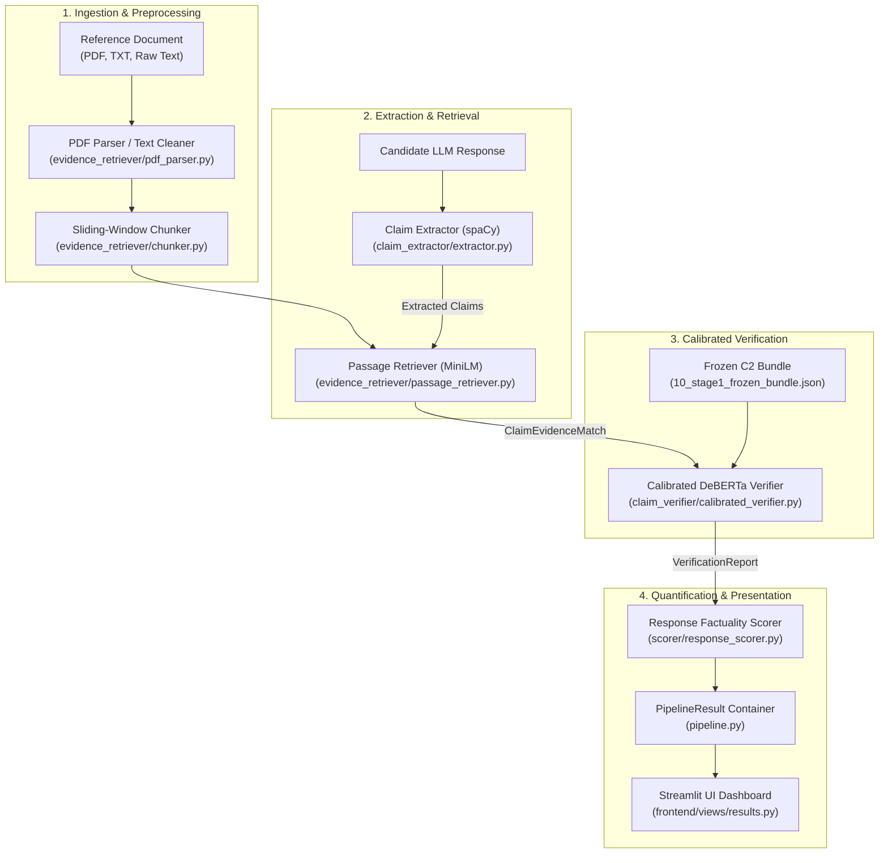
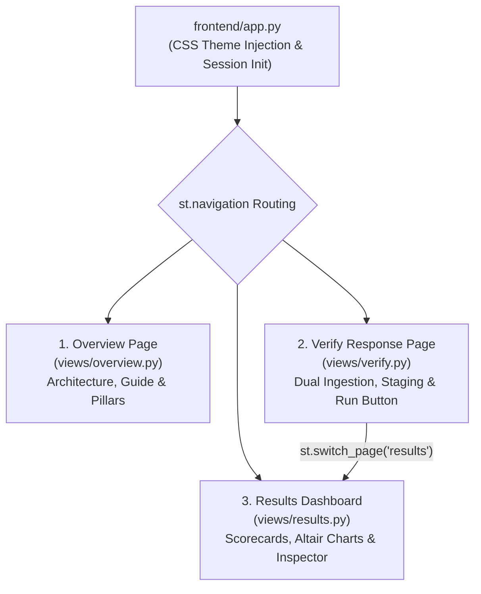
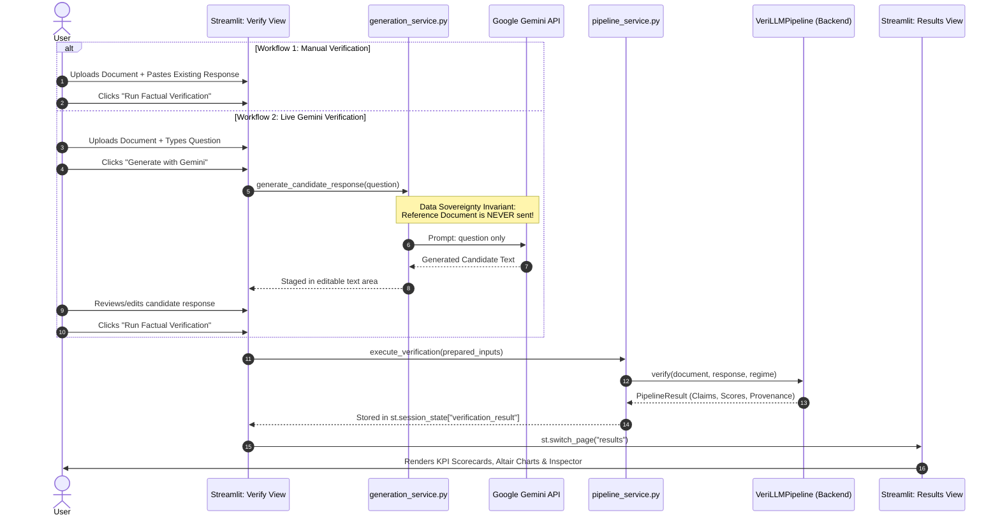

# Chapter 6: System Implementation and Interactive Interface

---

## 6.1 Introduction and Implementation Objectives

### 6.1.1 Translating Theoretical Pillars into Production Software
Chapters 3, 4, and 5 established the mathematical foundations, machine-learning architecture, and calibration theory of VeriLLM. However, translating a research framework into an accessible, reliable, and auditable production system introduces complex engineering challenges:
- **Modular Pipeline Orchestration**: Decoupling document ingestion, text normalization, sliding-window chunking, atomic claim extraction, dense similarity retrieval, calibrated cross-encoder inference, and response-level factuality scoring into cohesive, maintainable Python modules.
- **Strict Data Sovereignty and Privacy**: Guaranteeing that sensitive reference documents remain strictly resident within local host memory, never crossing network boundaries to third-party APIs.
- **Resource Efficiency on Commodity Hardware**: Eliminating expensive GPU dependencies by ensuring that all runtime inference, embedding retrieval, and visual analytics execute smoothly on standard x86 CPU hardware within acceptable user latency bounds.
- **State-Safe Interactive Interface**: Designing a transparent, responsive user interface that supports multi-modal reference ingestion, dynamic candidate response generation, claim-level citation provenance, and visual posterior probability analytics without requiring brittle multi-tier server architectures.

### 6.1.2 Scope of the Implementation Chapter
This chapter documents the concrete software engineering and system implementation of VeriLLM. It details the actual code structures, Pydantic schemas, data pipelines, caching strategies, and user interface workflows operationalized within the project repository. It deliberately avoids duplicating the high-level conceptual designs of Chapter 3 and the quantitative benchmarks of Chapter 7, focusing strictly on *how the system is constructed, organized, and executed*.

---

## 6.2 Development Environment and Technology Stack

### 6.2.1 Pure Python Architectural Paradigm
In preliminary planning phases, multi-tier enterprise architectures involving React frontends, FastAPI REST backends, and MongoDB document databases were considered. During Phase 9 and Phase 10 engineering hardening, this design was intentionally rejected in favor of a **pure Python architecture** powered by Streamlit and PyTorch.

This architectural consolidation offered definitive advantages:
1. **Elimination of Serialization Overhead**: Rather than repeatedly serializing complex PyTorch tensors, NumPy arrays, and Pydantic domain models across HTTP boundaries and JSON REST endpoints, the entire verification pipeline executes in a shared Python runtime process.
2. **Simplified Deployment and Auditability**: The entire application runs locally as a self-contained unit, eliminating external database daemon setup, container networking configuration, and cross-origin resource sharing (CORS) security vulnerabilities.
3. **Deterministic Memory Footprint**: In-process execution enables direct lifecycle management of neural model weights and vector indices, allowing aggressive garbage collection and explicit memory cleanup.

### 6.2.2 Technology Stack Inventory
Table 6.1 details the verified production software stack and component libraries powering VeriLLM.

**Table 6.1: VeriLLM Production Software and Technology Stack**
| Architectural Layer | Library / Framework | Exact Version | Functional Role within System |
| :--- | :--- | :---: | :--- |
| **Runtime Environment** | Python (CPython) | `3.11.9` | Base execution environment; 64-bit Windows OS |
| **Neural Backbone** | PyTorch (`torch`) | `2.6.0` | Tensor computation and neural graph execution (CPU mode) |
| **Transformer Engine** | Hugging Face `transformers` | `4.49.0` | Tokenization, model configuration, and DeBERTa head execution |
| **Sentence Embeddings** | `sentence-transformers` | `3.4.1` | Dense passage vector encoding (`all-MiniLM-L6-v2`) |
| **Scientific Computation** | NumPy / SciPy | `1.26.4` / `1.15.2` | Vectorized logit centering, $C2$ affine transforms, and metrics |
| **Linguistic Extraction** | spaCy (`en_core_web_sm`)| `3.7.4` | Sentence segmentation, dependency parsing, coreference resolution |
| **Document Ingestion** | `pypdf` | `5.3.0` | Pure-Python PDF parsing, `%PDF` header validation, text extraction |
| **Data Validation** | Pydantic (v2) | `2.10.6` | Runtime contract enforcement, schema validation, serialization |
| **Web UI Dashboard** | Streamlit | `1.67.0` | Reactive frontend, multi-page routing (`st.navigation`), state machine |
| **Visual Analytics** | Altair / Pandas | `5.5.0` / `2.2.3` | Interactive declarative charts, posterior distribution visualizations |
| **Generative LLM SDK** | `google-genai` | `1.3.0` | Official Google GenAI SDK for optional candidate generation |
| **Automated Testing** | `pytest` | `9.2.0` | Test harness powering the 275-test automated regression suite |

---

## 6.3 Backend Package Organization and Module Responsibilities

The VeriLLM backend is organized into a cohesive, modular package structure located under `backend/ml_engine/`. Figure 6.1 illustrates the end-to-end data flow through these modules.



Table 6.2 maps each physical Python module to its specific architectural responsibility within the verification pipeline.

**Table 6.2: Backend Package Organization, Module Paths, and Core Responsibilities**
| Subpackage | Source File Path | Core Classes / Entrypoints | Primary Architectural Responsibility |
| :--- | :--- | :--- | :--- |
| **Pipeline Core** | `backend/ml_engine/pipeline.py` | `VeriLLMPipeline`, `PipelineResult` | Unified orchestrator integrating ingestion, extraction, retrieval, inference, and scoring. |
| **Evidence Retriever** | `.../evidence_retriever/pdf_parser.py` | `parse_pdf()`, `ParsedPDFDocument` | Extracts plain text from PDF byte streams; validates headers and catches scanned OCR failures. |
| **Evidence Retriever** | `.../evidence_retriever/text_cleaner.py`| `clean_text()`, `normalize_whitespace()` | Normalizes Unicode, strips null bytes, standardizes quotes, and ensures clean UTF-8 text. |
| **Evidence Retriever** | `.../evidence_retriever/chunker.py` | `SlidingWindowChunker`, `DocumentChunk` | Chunks text into 150-word passages with 35-word overlaps across page boundaries. |
| **Evidence Retriever** | `.../evidence_retriever/passage_retriever.py`| `PassageRetriever`, `ClaimEvidenceMatch`| Encodes chunks via `all-MiniLM-L6-v2`, computes cosine similarity, and purges indices. |
| **Claim Extractor** | `.../claim_extractor/extractor.py` | `ClaimExtractor`, `ExtractedClaim` | Decomposes candidate responses into atomic sentences; resolves subject coreference; filters pleasantries. |
| **Claim Verifier** | `.../claim_verifier/calibrated_verifier.py`| `CalibratedDebertaVerifier`, `load_frozen_calibration_bundle()` | Loads frozen bundle, reconstructs centered logits, applies $C2$ calibration, executes $H2$ decision rules. |
| **Custom Model** | `.../custom_model/calibration.py` | `MulticlassCalibrator`, `BinaryPlattCalibrator` | Implements vector scaling, affine logit transformations, and multi-class proper scoring rules. |
| **Custom Model** | `.../custom_model/hybrid_strategies.py`| `_predict_h2_codes()`, `fast_eval_fold_predictions()` | Vectorized decision logic implementing priority-ordered thresholding and epistemic abstention. |
| **Response Scorer** | `.../scorer/response_scorer.py` | `ResponseScorer`, `ResponseScore` | Calculates $ESR, CCR, USR, UVR, CUR, GFI, CPFS, HSI$; enforces conservation invariants. |
| **LLM Generator** | `.../llm_generator/client.py` | `GeminiProviderAdapter`, `GenerationResult` | Manages external Google Gemini API communication, bounded retries, and data sovereignty. |

---

## 6.4 Document Ingestion and Preprocessing Implementation

### 6.4.1 Multi-Modal Reference Ingestion Engine
The entry point for document ingestion is encapsulated in `VeriLLMPipeline._parse_reference_document()`. To support flexible user workflows, the method accepts reference contexts across four distinct input representations:
1. `str`: Interpreted as an on-disk file path (if the path exists) or as raw plain-text content typed/pasted by the user.
2. `pathlib.Path`: Explicit local filesystem path.
3. `bytes`: In-memory byte buffer resulting from Streamlit file upload widgets.
4. `io.BytesIO`: Seekable binary stream.

Table 6.3 summarizes the validation rules and handling logic implemented across document formats.

**Table 6.3: Multi-Modal Document Ingestion Handling and Validation Rules**
| Document Format | Verification & Parsing Method | Edge Cases Handled | Error Boundary & Exceptions |
| :--- | :--- | :--- | :--- |
| **PDF Document (`.pdf`)** | `pdf_parser.parse_pdf()` wrapping `pypdf.PdfReader` | Validates `%PDF` magic header; iterates through pages; tracks page-number metadata. | Raises `ValueError` if `%PDF` header is missing or if scanned/image-only PDF lacks extractable text. |
| **Plain Text (`.txt`, `.md`)** | `text_cleaner.clean_text()` with UTF-8 decoding | Strips BOM headers; normalizes CRLF to LF; compresses excessive whitespace. | Raises `ValueError` on `UnicodeDecodeError` or if text contains only whitespace. |
| **Direct Text Typing** | In-memory string normalization via `clean_text()` | Handles empty/whitespace strings; stages context directly under `_direct` chunk index. | Raises UI validation error if character count is zero. |

### 6.4.2 Guardrails Against Scanned and Image-Only PDFs
In real-world enterprise environments, users frequently attempt to upload scanned documents or photographically rasterized PDFs. Because VeriLLM does not bundle heavy optical character recognition (OCR) runtimes (such as Tesseract), `parse_pdf()` implements an automated guardrail:
```python
total_chars = sum(len(page_text.strip()) for page_text in page_texts)
if total_chars == 0 and len(reader.pages) > 0:
    return ParsedPDFDocument(
        filename=filename,
        full_text="",
        pages=[],
        total_pages=len(reader.pages),
        total_words=0,
        is_scanned=True,
    )
```
If `is_scanned=True`, `VeriLLMPipeline` terminates execution immediately with an informative, user-friendly exception:
`"Scanned PDF detected in 'document.pdf': The document contains no extractable machine-readable text. OCR is not supported; please provide a text-searchable PDF or plain text document."`

### 6.4.3 Sliding-Window Document Chunking
To prepare multi-page reference documents for dense vector retrieval, `SlidingWindowChunker` implements a word-budgeted sliding window:
- **Chunk Size**: 150 words per chunk.
- **Overlap**: 35 words between consecutive chunks.
- **Page Preservation**: When a document contains multiple pages, chunking is executed page-by-page while tracking `page_number`, `start_char`, and `end_char` offsets to preserve complete citation provenance.

---

## 6.5 Claim Extraction and Evidence Retrieval Implementation

### 6.5.1 Linguistic Claim Extraction with spaCy
The extraction of atomic propositions from candidate LLM responses is implemented in `ClaimExtractor`. To prevent hallucinations from hiding inside complex compound sentences, the extractor applies a three-step linguistic pipeline:

1. **Sentence Boundary Disambiguation**: Utilizes spaCy's dependency parser (`en_core_web_sm`) to split candidate text into discrete sentences, respecting abbreviations, acronyms, and decimal numbers.
2. **Coreference and Pronoun Resolution**: Resolves ambiguous personal pronouns (*"He"*, *"She"*, *"It"*, *"They"*) to their preceding nominal antecedents. The implementation scans previous sentences within the response window to identify the most recent subject noun phrase and replaces the pronoun, ensuring that extracted propositions are semantically self-contained.
3. **Non-Factual Proposition Filtering**: Identifies conversational pleasantries, greetings, and subjective opinion statements that cannot be verified against reference facts. Propositions matching regular expression rules (e.g., `^hello`, `^in my opinion`, `^hope this helps`, `^i feel`) are flagged with `is_factual=False` and assigned category `NON_FACTUAL`. This completely excludes them from factual scoring denominators.

### 6.5.2 Dense Passage Retrieval and Memory Management
In the Retrieval-Augmented Verification regime, evidence passages are retrieved via `PassageRetriever`:
- **Embedding Model**: `all-MiniLM-L6-v2` (22.7M parameters, 384-dimensional dense vector space).
- **Index Construction**: Passage chunks generated by `SlidingWindowChunker` are batch-encoded into normalized embedding vectors.
- **Similarity Search**: For each extracted claim, cosine similarity is computed against all chunk vectors:
  $$\text{sim}(q, p) = \frac{\mathbf{e}_q \cdot \mathbf{e}_p}{\|\mathbf{e}_q\|_2 \|\mathbf{e}_p\|_2} \tag{6.1}$$
- **Top-$k$ Ranking**: The top $k = 3$ candidate passages are selected, with the highest-scoring passage designated as `best_passage`.
- **Index Purging (`clear_index`)**: To prevent memory accumulation during long-running application sessions, `PassageRetriever.clear_index()` is invoked immediately post-retrieval:
  ```python
  def clear_index(self) -> None:
      """Clears indexed chunks and frees embedding tensors from memory."""
      self.chunks = []
      self.chunk_embeddings = None
  ```

---

## 6.6 Calibrated Claim Verification Implementation

### 6.6.1 Loading and Consuming the Frozen Calibration Bundle
The production verifier, `CalibratedDebertaVerifier`, strictly decouples model architecture from operational parameters. Upon initialization, it calls `load_frozen_calibration_bundle()`, reading parameters directly from `10_stage1_frozen_bundle.json`:

```python
configs = {
    "direct": CalibratedRegimeConfig(
        regime="direct",
        calibrator=MulticlassCalibrator(
            method="C2_prior_bias_temp",
            temperatures=[1.76959203],
            bias=[-0.66788442, 0.71171648, -0.04383205],
            l2_reg=0.001,
        ),
        tau_contra=0.35,
        tau_sup=0.70,
        tau_floor=0.00,
        temperature=1.76959203,
        prior_bias=(-0.66788442, 0.71171648, -0.04383205),
        l2_reg=0.001,
    ),
    "retrieval": CalibratedRegimeConfig(
        regime="retrieval",
        calibrator=MulticlassCalibrator(
            method="C2_prior_bias_temp",
            temperatures=[2.50411010],
            bias=[-0.72845197, 1.22831149, -0.49985952],
            l2_reg=0.001,
        ),
        tau_contra=0.30,
        tau_sup=0.70,
        tau_floor=0.20,
        temperature=2.50411010,
        prior_bias=(-0.72845197, 1.22831149, -0.49985952),
        l2_reg=0.001,
    ),
}
```

### 6.6.2 Logit Reconstruction and $C2$ Calibration Transform
For each claim-evidence pair, the fine-tuned DeBERTa cross-encoder computes raw prediction probabilities. Because the classification head produces normalized probabilities, centered logits are reconstructed via `reconstruct_logits_from_probs()`:
$$\tilde{\mathbf{z}} = \log \hat{\mathbf{p}}_{\text{raw}} - \frac{1}{3}\sum_{k=0}^2 \log \hat{p}_{\text{raw}, k} \mathbf{1} \tag{6.2}$$

The frozen $C2$ calibrator then maps the centered logit vector $\tilde{\mathbf{z}}$ to calibrated posterior probabilities:
$$\hat{\mathbf{p}}_{\text{cal}} = \sigma_{\text{SM}}\left( \frac{\tilde{\mathbf{z}}}{T} + \mathbf{b} \right) \tag{6.3}$$

### 6.6.3 Operational Decision Policy ($H2$)
The calibrated probabilities $[\hat{p}_{\text{contra}}, \hat{p}_{\text{sup}}, \hat{p}_{\text{unsup}}]$ are evaluated under the pre-registered $H2$ decision strategy implemented in `_predict_h2_codes()`:

```python
# Priority 1: Flag confirmed contradictions
if p_contra >= config.tau_contra:
    classification = VerificationCategory.CONTRADICTED
# Priority 2: Flag corroborated support
elif p_sup >= config.tau_sup:
    classification = VerificationCategory.SUPPORTED
# Priority 3: Default to unsupported
else:
    classification = VerificationCategory.UNSUPPORTED

# Epistemic Gating in Retrieval Regime:
if regime == "retrieval":
    if len(retrieved_passages) == 0 or best_similarity < config.tau_floor:
        classification = VerificationCategory.UNVERIFIABLE
```

---

## 6.7 Scoring and Verification Report Generation

### 6.7.1 Factual Denominator ($N$) and Division-by-Zero Safety
Response-level factuality quantification is executed by `ResponseScorer.score_response()`. The factual denominator $N$ is computed strictly over empirical propositions:
$$N = S + C + U + V \tag{6.4}$$
where $S, C, U, V$ denote the counts of `SUPPORTED`, `CONTRADICTED`, `UNSUPPORTED`, and `UNVERIFIABLE` claims, respectively.

If a response contains exclusively opinions, greetings, or pleasantries ($N = 0$), calculating percentage rates would trigger division-by-zero errors. `ResponseScorer` handles this safely by setting all indices to `None`:
```python
if total_empirical == 0:
    return ResponseScore(
        evidence_support_rate=None,
        confirmed_contradiction_rate=None,
        unsupported_rate=None,
        unverifiable_rate=None,
        grounded_factuality_index=None,
        contradiction_penalized_score=None,
        hallucination_severity_index=None,
        has_factual_claims=False,
    )
```
In the Streamlit frontend, `None` values are displayed as `"N/A"`, accompanied by an informational banner.

### 6.7.2 Mathematical Conservation Invariant
For all responses where $N > 0$, `ResponseScorer` asserts the mathematical rate conservation invariant:
$$\text{ESR} + \text{CCR} + \text{USR} + \text{UVR} \equiv 100.00\% \pm 0.01\% \tag{6.5}$$
$$\frac{S}{N} + \frac{C}{N} + \frac{U}{N} + \frac{V}{N} = \frac{S + C + U + V}{N} = \frac{N}{N} = 1.0 \tag{6.6}$$

---

## 6.8 Streamlit Application Architecture

### 6.8.1 Multi-Page Routing and Navigation
The frontend application is structured using Streamlit's official `st.navigation` and `st.Page` API introduced in modern Streamlit versions. The application entrypoint (`frontend/app.py`) defines three top-level views:



Table 6.4 maps the application pages to their functional roles and session state contracts.

**Table 6.4: Streamlit Multi-Page Navigation and Session State Hierarchy**
| Page Identifier | Source File Path | Navigation Label | Core Session State Keys Managed |
| :--- | :--- | :--- | :--- |
| **`overview`** | `frontend/views/overview.py` | Overview & Guide | Read-only guide; no state mutation. |
| **`verify`** | `frontend/views/verify.py` | Verify Response | `prepared_inputs`, `active_tab`, `doc_mode`, `gemini_candidate_text`, `verification_result`. |
| **`results`** | `frontend/views/results.py` | Results Dashboard | `verification_result`, `filter_choice`, `show_raw_payload`. |

### 6.8.2 Cached Resource Singleton (`@st.cache_resource`)
To ensure that heavy machine-learning models are not re-instantiated on every Streamlit script rerun, `frontend/utils/pipeline_service.py` encapsulates backend initialization in `@st.cache_resource`:

```python
@st.cache_resource(show_spinner=False)
def get_pipeline() -> VeriLLMPipeline:
    """Initializes and returns a cached singleton instance of VeriLLMPipeline.

    Cached via st.cache_resource so the fine-tuned DeBERTa checkpoint (~435MB)
    and SentenceTransformer models (~80MB) are loaded only once into CPU memory.
    """
    return VeriLLMPipeline(default_regime="retrieval")
```
This guarantees that successive verifications execute with zero disk loading latency.

---

## 6.9 User Interaction and Verification Workflow

### 6.9.1 Dual Verification Workflows Converging on One Pipeline
VeriLLM supports two distinct operational workflows:
1. **Manual Verification Workflow**: Designed for auditing pre-existing AI outputs. The user uploads a reference document, enters an optional question, pastes a candidate response, and clicks **Run Factual Verification**.
2. **Live Gemini Verification Workflow**: Designed for interactive exploration. The user uploads a reference document, enters a required user question, generates an answer via Google Gemini, reviews/edits the text, and submits the response to VeriLLM.

Figure 6.3 illustrates how both workflows converge on the identical backend execution contract.



Table 6.5 summarizes the operational parameters and boundaries across both workflows.

**Table 6.5: Manual vs. Live Gemini Verification Workflow Comparison**
| Operational Characteristic | Manual Verification Workflow | Live Gemini Verification Workflow |
| :--- | :--- | :--- |
| **Primary Use Case** | Auditing externally generated responses, transcripts, reports. | Generating answers dynamically from prompts and verifying them. |
| **Document Ingestion** | Drag-and-drop PDF/TXT file upload or direct text entry. | Identical: Drag-and-drop PDF/TXT or direct text entry. |
| **User Prompt Requirement** | Optional (normalizes to `prompt=None` if omitted). | Mandatory (prompt is sent to Gemini to generate the candidate response). |
| **Response Generation** | User pastes candidate response text directly. | Gemini generates response; staged in editable review text area. |
| **Data Transmitted Externally**| **Zero bytes** (100% offline local execution). | **Question string only**; reference documents remain strictly local. |
| **Verification Authority** | `VeriLLMPipeline` (DeBERTa + $C2$ Calibration). | `VeriLLMPipeline` (**Gemini never verifies its own output**). |
| **Handoff Mechanism** | Direct invocation of `pipeline.verify()`. | Validates candidate response text, then invokes `pipeline.verify()`. |

### 6.9.2 Results Dashboard Analytics & Provenance Tracing
Upon verification completion, the application transitions automatically to the Results view (`frontend/views/results.py`), rendering a comprehensive visual dashboard:
1. **Four Primary KPI Scorecards**:
   - **Grounded Factuality Index ($GFI$)**: Percentage of empirical claims supported by evidence ($S/N \times 100$).
   - **Contradiction-Penalized Factuality Score ($CPFS$)**: Strict penalized index subtracting contradicted claims ($\max(0, (S - C)/N) \times 100$).
   - **Hallucination Severity Index ($HSI$)**: Critical contradiction rate ($C/N \times 100$), color-coded red (`#EF4444`) when $HSI > 0$.
   - **Factual Claims ($N$)**: Displays empirical proposition count relative to total propositions ($N / N_{\text{total}}$).
2. **Detailed Rate Pills**: Displays Evidence Support Rate ($ESR$), Confirmed Contradiction Rate ($CCR$), Unsupported Rate ($USR$), Unverifiable Rate ($UVR$), and Combined Uncertainty Rate ($CUR$).
3. **Altair Visual Analytics**:
   - *Factual Classification Bar Chart*: Category counts rendered in semantically aligned colors (`#10B981` Supported, `#EF4444` Contradicted, `#F59E0B` Unsupported, `#6B7280` Unverifiable).
   - *Calibrated Posterior Distribution Dashboard*: Stacked horizontal bar chart visualizing $[\hat{p}_{\text{sup}}, \hat{p}_{\text{contra}}, \hat{p}_{\text{unsup}}]$ for every claim.
4. **Claim-Level Provenance Inspector**:
   Each proposition is rendered in a dedicated card displaying:
   - Proposition text with classification badges.
   - Grounded evidence quote box displaying exact citation provenance: document name, page number, chunk index, and retrieval similarity score.
   - Calibrated posterior probabilities with confidence badges.
   - Expandable technical reasoning traces revealing active $H2$ decision thresholds.

---

## 6.10 Optional Gemini-Based Candidate Response Generation

### 6.10.1 Architectural Role: Generator, Not Verifier
VeriLLM integrates Google Gemini strictly as an optional **candidate response generator**. Generative Large Language Models cannot reliably audit their own hallucinations ("LLM-as-a-Judge" circularity). In VeriLLM:
- Gemini is treated as an untrusted, external text producer.
- VeriLLM serves as the authoritative, grounded verification engine.

### 6.10.2 Configuration Precedence in `GeminiProviderAdapter`
The connection to Google's API is managed by `GeminiProviderAdapter` (`backend/ml_engine/llm_generator/client.py`). Model configuration follows a strict three-tier precedence:
1. Explicit constructor argument passed at initialization.
2. `GEMINI_MODEL` environment variable (e.g., `gemini-3.7-flash` or `gemini-3.8-flash`).
3. Default fallback model (`DEFAULT_GEMINI_MODEL = "gemini-3.8-flash"`).

Similarly, the API version resolves with precedence: explicit constructor argument $\to$ `GEMINI_API_VERSION` environment variable $\to$ default `"v1"` (with `"v1beta"` supported as an override).

### 6.10.3 Bounded Retries and Service Unavailability Handling
To withstand upstream transient errors, `GeminiProviderAdapter` implements a bounded exponential backoff retry loop:
- **Maximum Retries**: Up to 2 retries (total 3 attempts).
- **Retryable Filter**: Strictly retries HTTP 503 (`SERVICE_UNAVAILABLE`).
- **Non-Retryable Invariants**: Authentication errors (HTTP 401/403), invalid model errors (HTTP 404), empty prompts, and client socket timeouts are never retried.
- **Exponential Backoff**: Initial delay of $1.0\text{s}$, doubled on subsequent retries ($1.0\text{s} \to 2.0\text{s}$).

> [!CAUTION]
> ### Accurate Reporting of Live Gemini API Status
> During live integration diagnostics in Phase 11.4, Google's developer endpoints repeatedly returned **HTTP 503 UNAVAILABLE** (high demand spikes) and **HTTP 504 DEADLINE_EXCEEDED** (90-second gateway timeout on `scaffolding on HTTPServer2`). While the resilient adapter architecture, bounded retries, and UI degradation warning banners were fully validated via 74 offline mocked tests, **live Gemini candidate generation was not successfully validated end-to-end against live endpoints due to upstream Google cluster load**. Manual Verification remained fully operational.

---

## 6.11 Reliability, Error Handling, and Resource Management

Table 6.6 outlines the structured error classifications, architectural boundaries, and recovery policies enforced across the application.

**Table 6.6: System Error Classifications, Boundaries, and Recovery Policies**
| Error Scenario / Exception | Architectural Detection Boundary | System Handling & Recovery Policy | User-Facing Presentation |
| :--- | :--- | :--- | :--- |
| **Empty File / 0 Bytes** | `validate_document_file()` in `verify.py` | Halts execution immediately; blocks staging. | Red warning banner: *"Uploaded file is empty (0 bytes)."* |
| **Corrupt PDF / Missing Header**| `parse_pdf()` in `pdf_parser.py` | Detects absence of `b"%PDF"` magic bytes. | Warning banner: *"File lacks a valid PDF header (%PDF)."* |
| **Scanned / Image-Only PDF** | `parse_pdf()` character count check | Identifies zero extractable text; sets `is_scanned=True`. | Actionable error: *"Scanned PDF detected. OCR is not supported."* |
| **Context Length Exceeded** | `_parse_reference_document()` in `pipeline.py` | Detects token count $> 512$ in Direct mode. | Warning banner advising switch to Retrieval mode; continues execution. |
| **Sub-Floor Retrieval Similarity**| `_predict_h2_codes()` in `hybrid_strategies.py` | Cosine similarity $< \tau_{\text{floor}} = 0.20$. | Routes claim to `UNVERIFIABLE`; **never penalized as hallucination**. |
| **Non-Factual Response ($N=0$)**| `ResponseScorer.score_response()` | Detects 0 empirical claims ($N=0$); sets indices to `None`. | Blue informational card: *"Response contains no empirical factual claims."* |
| **Gemini Service Overload (503)**| `GeminiProviderAdapter.generate()` | Catches HTTP 503; executes bounded retries. | Orange warning with ⏳ icon advising switch to Manual Verification. |
| **Gemini Gateway Timeout (504)**| `GeminiProviderAdapter.generate()` | Catches 90s socket timeout on HTTP front-end. | Warning banner advising retry or switching to Manual Verification. |

---

## 6.12 Privacy, Security, and Local Data Handling

### 6.12.1 Local Document Sovereignty Invariant
In enterprise and clinical workflows, reference documents often contain proprietary source code, internal financial records, or protected health information (PHI). VeriLLM guarantees strict document sovereignty:
- **Reference documents never leave the local machine**: All PDF parsing, text cleaning, chunking, embedding generation, dense vector retrieval, and DeBERTa cross-encoder inference execute 100% locally on host CPU memory.
- **Zero Document Transmission to Gemini**: When the optional Gemini candidate generation feature is used, `generate_candidate_response()` accepts *only* the user's question string. The reference document is strictly sequestered within local memory.

### 6.12.2 Credential Protection and Secret Isolation
- The `GEMINI_API_KEY` is loaded dynamically from host environment variables or a local `.env` file via `python-dotenv`.
- The `.env` file is explicitly included in `.gitignore` to prevent accidental version-control leaks.
- API keys are never rendered in the UI, never stored in Streamlit session state, never written to disk logs, and never returned in `GenerationResult.metadata`.

---

## 6.13 Implementation Constraints and Chapter Summary

### 6.13.1 Current Implementation Constraints
To maintain transparency, the following technical constraints of the current implementation are acknowledged:
1. **CPU Inference Latency**: On commodity x86 CPUs, neural inference requires ~100–250 ms per proposition. For long candidate responses (10+ propositions), total turnaround requires 3.5–5.5 seconds.
2. **Absence of Optical Character Recognition**: Machine-readable text is strictly required. Archival scanned documents cannot be evaluated without external OCR pre-processing.
3. **Single-Hop Evidence Retrieval**: Passage retrieval evaluates individual chunks independently. Complex factual claims requiring multi-hop synthesis across distant sections cannot be corroborated under single-chunk retrieval.

### 6.13.2 Chapter Summary
Chapter 6 documented the concrete software implementation of VeriLLM:
1. **Architectural Paradigm**: Consolidated the framework into a pure Python architecture combining a Streamlit reactive interface with a PyTorch/Transformers CPU backend, eliminating REST and database middleware overhead.
2. **Modular Backend Organization**: Detailed the implementation of `VeriLLMPipeline`, sliding-window chunking, spaCy linguistic extraction, dense vector retrieval, and the frozen $C2$ calibration loader.
3. **State-Safe Interactive Dashboard**: Documented the multi-page Streamlit application (`overview`, `verify`, `results`), cached singleton management via `@st.cache_resource`, and Altair visual analytics.
4. **Data Sovereignty and Resilience**: Enforced strict local reference document isolation, bounded retries for upstream API calls, and graceful UI degradation under upstream capacity contention.

Having detailed the system architecture (Chapter 3), model training (Chapter 4), calibration theory (Chapter 5), software implementation (Chapter 6), and experimental evaluation (Chapter 7), Chapter 8 addresses the broader scientific discussion, epistemic boundaries, and future research directions.

