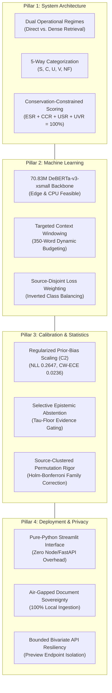
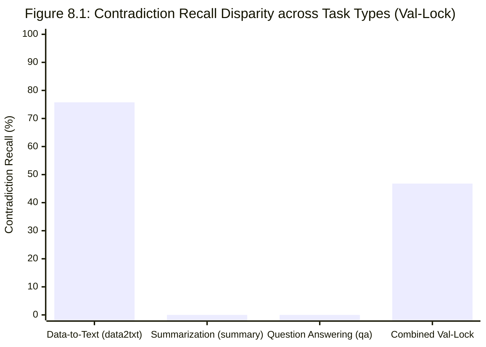

# Chapter 8: Discussion, Limitations and Future Work

---

## 8.1 Introduction

### 8.1.1 Overview and Academic Purpose
The development and empirical validation of VeriLLM—presented across Chapters 3 through 7—demonstrate the feasibility of performing fine-grained, sentence-level factual hallucination detection, probability calibration, and quantitative scoring on edge-scale consumer hardware without reliance on proprietary cloud-hosted verification services. By coupling a fine-tuned 70.83-million parameter cross-encoder (`cross-encoder/nli-deberta-v3-xsmall`) with regularized prior-bias calibration, defensive epistemic abstention, and an interactive pure-Python presentation tier, the framework establishes a verifiable, model-agnostic methodology for document-grounded evaluation.

However, scientific rigor demands that an engineering thesis not only report benchmark victories and statistical improvements, but also critically interrogate the theoretical assumptions, methodological boundaries, empirical edge cases, and operational vulnerabilities of the proposed system. A framework that claims to measure truthfulness must be unsparingly transparent regarding its own epistemic boundaries. 

The objective of this chapter is to provide a comprehensive, analytical interpretation of the empirical results documented in Chapters 4, 5, 6, and 7. Rather than duplicating previously presented data tables, this discussion explores *why* specific phenomena occurred, evaluates the trade-offs inherent in the architectural design, formalizes the threats to scientific validity, and establishes a concrete, actionable roadmap for future research.

### 8.1.2 Structure of the Critical Analysis
This chapter is structured into ten subsequent sections that systematically examine the findings and constraints of VeriLLM:
- **Section 8.2** provides an analytical interpretation of the primary experimental results, deconstructing the headline 92.86% test accuracy, formalizing epistemic definitions, and investigating minority-class behavior.
- **Section 8.3** synthesizes the core contributions of the VeriLLM framework across its architectural, algorithmic, statistical, and software engineering dimensions.
- **Section 8.4** presents an in-depth analysis of probability calibration, contrasting isotropic temperature scaling against regularized prior-bias parameterization, explaining the 1.57 percentage point ($pp$) Macro-F1 gap on the validation holdout, and examining task-specific contradiction recall disparities.
- **Section 8.5** investigates the retrieval coverage-floor dilemma, examining the pathological effects of forced classification under evidence absence and justifying defensive epistemic abstention through selective classification theory.
- **Section 8.6** outlines dataset, benchmark, and domain generalization boundaries, specifically detailing the constraints of the RAGTruth corpus and the distinction between in-distribution source-disjoint validation and true out-of-distribution transfer.
- **Section 8.7** analyzes computational and deployment limitations, including CPU latency, memory footprints, context window boundaries, single-hop retrieval blind spots, and the absence of optical character recognition.
- **Section 8.8** evaluates application and service boundaries, examining Streamlit's concurrency model, data sovereignty guarantees, and the empirical failure modes observed during live Google Gemini API testing.
- **Section 8.9** formalizes the threats to validity across construct, internal, external, and statistical conclusion dimensions, concluding with a comprehensive mitigation matrix.
- **Section 8.10** articulates a concrete roadmap for future research, spanning multi-hop retrieval, token-level extraction, contrastive contradiction synthesis, conformal risk control, and low-bit edge quantization.
- **Section 8.11** summarizes the key intellectual insights established in this chapter.

---

## 8.2 Interpretation of the Major Research Findings

### 8.2.1 Deconstructing the 92.86% Test Accuracy: The Imbalance Illusion
In the benchmark evaluation on the official RAGTruth test partition ($17,906$ sentence-level claims across $450$ unseen source documents, detailed in Section 7.3), VeriLLM achieved an overall classification accuracy of **92.86%** ($16,627 / 17,906$) and a weighted-averaged F1-score of **92.76%**. In introductory machine learning contexts, an accuracy figure exceeding 92% is frequently misinterpreted as an indicator of an almost solved classification problem. In the context of natural language hallucination detection, however, such an interpretation is methodologically flawed and scientifically misleading.

Factual verification in Retrieval-Augmented Generation (RAG) is characterized by acute class imbalance. Within the RAGTruth test split:
- **`SUPPORTED_PROXY`** constitutes **91.52%** of all evaluated sentences ($16,388$ instances);
- **`UNSUPPORTED`** constitutes **5.39%** ($965$ instances);
- **`CONTRADICTED`** constitutes a mere **3.09%** ($553$ instances).

A trivial, degenerate majority-class baseline that unconditionally classifies every input sentence as `SUPPORTED_PROXY` without reading either the premise document or the candidate response would achieve an overall accuracy of **91.52%** on this exact test set. Consequently, VeriLLM's raw accuracy gain over a trivial baseline is $+1.34\text{ pp}$. The true scientific value of the fine-tuned model lies entirely in its capacity to detect the remaining 8.48% of hallucinated content while preserving high precision on factual text.

```
Total Test Corpus: 17,906 Sentences
┌───────────────────────────────────────────────────────────────┬───────────┬─────────┐
│                   SUPPORTED_PROXY (91.52%)                    │UNSUP (5.4)│CONT(3.1)│
└───────────────────────────────────────────────────────────────┴───────────┴─────────┘
 ▲ Trivial Majority Classifier Accuracy Floor: 91.52%           ▲ Minority Error Envelope
 ▲ VeriLLM Test Accuracy: 92.86% (Net Discriminative Delta: +1.34 pp)
```

When evaluated using the unweighted arithmetic mean across classes—the **Macro-Averaged F1-score**—VeriLLM achieves **69.99%**. While this substantially exceeds zero-shot NLI baselines such as MiniCheck-Flan-T5-Large (Macro-F1 34.80%), the 22.87 percentage point gap between raw accuracy (92.86%) and Macro-F1 (69.99%) reflects the persistent challenge of minority-class identification. The model achieved an F1-score of **96.20%** on `SUPPORTED_PROXY` ($15,812$ true positives), but obtained **61.67%** on `CONTRADICTED` ($317$ true positives out of $553$) and **52.09%** on `UNSUPPORTED` ($498$ true positives out of $965$). Thus, while the system correctly verifies the vast majority of factual statements, approximately $42.68\%$ of contradictions and $48.39\%$ of unsupported extrapolations elude detection under standard decision thresholds. High overall accuracy must never be presented as proof of uniform error detection.

### 8.2.2 Epistemic Precision: Document-Grounded Alignment vs. Universal Truth
A fundamental tenet of VeriLLM's theoretical architecture is the strict boundary between *document-grounded consistency* and *ontological or universal truth*. VeriLLM is not an open-domain fact-checking engine; it does not interface with a real-time knowledge graph, web search index, or universal encyclopedia. Its operational mandate is strictly restricted to verifying whether a generated claim is entailed by, contradicted by, or absent from a *user-specified reference document*.

This distinction carries critical philosophical and practical implications:
1. **Document Fallibility**: If an ingested reference document contains factual errors, outdated statistics, or biased assertions, VeriLLM will classify a generated claim that faithfully repeats those errors as `SUPPORTED_PROXY`. For example, if a provided historical text incorrectly states that the Apollo 11 lunar landing occurred in 1968, a candidate summary stating *"Apollo 11 landed on the Moon in 1968"* will be verified as fully supported. VeriLLM verifies *textual compliance*, not external reality.
2. **True Facts as Extrinsic Hallucinations**: Conversely, if an LLM introduces an objectively true, universally known fact that happens to be entirely omitted from the reference document, VeriLLM will correctly classify that proposition as `UNSUPPORTED`. For instance, if the reference document discusses the architectural engineering of the Eiffel Tower without mentioning its geographical location, and the LLM asserts *"The Eiffel Tower, located in Paris, stands 330 meters tall,"* the sub-clause regarding Paris represents an extrinsic hallucination relative to the premise context.
3. **Label Semantics**: To reinforce this epistemic boundary in scientific discourse and user-facing reporting, the framework explicitly utilizes the qualified label `SUPPORTED_PROXY` rather than an unqualified `TRUE` or `FACTUAL`, and `UNSUPPORTED` rather than `FALSE`.

### 8.2.3 Semantic Boundaries of the Five Propositional Categories
VeriLLM's five-way propositional categorization schema ($S, C, U, V, NF$) formalizes distinct epistemic states that must not be conflated:

$$\text{Proposition Universe } \Pi = \{S, C, U, V, NF\}$$

$$\text{Factual Verification Denominator } N = |S| + |C| + |U| + |V| \quad \text{where } NF \notin N$$

1. **`SUPPORTED_PROXY` ($S$)**: The proposition is directly entailed by the explicit semantics or valid deductive inferences of the retrieved reference context. Its predicted posterior probability satisfies $P(\text{Supported} \mid \mathbf{x}) \ge \tau_{\text{sup}}$.
2. **`CONTRADICTED` ($C$)**: The proposition asserts a statement that is semantically incompatible with, directly negated by, or mutually exclusive to explicit facts in the reference context. Its predicted posterior probability satisfies $P(\text{Contradicted} \mid \mathbf{x}) \ge \tau_{\text{contra}}$. In safety-critical contexts, contradiction represents the most severe failure mode because it actively misleads the user with erroneous data.
3. **`UNSUPPORTED` ($U$)**: The proposition introduces entities, claims, or relationships that are completely unmentioned in the reference context, but does not directly contradict stated facts. It represents an *extrinsic hallucination* where the generator has hallucinated content from its pre-training weights rather than conditioning on the retrieved prompt.
4. **`UNVERIFIABLE` ($V$)**: The verification subsystem abstains from making a classification because the retrieval engine failed to identify sufficient passage evidence (i.e., the maximum cosine similarity score between the proposition and document chunks falls below the coverage floor $\tau_{\text{floor}} = 0.20$). `UNVERIFIABLE` represents *epistemic abstention* ("insufficient evidence to judge"), not an assertion that the claim is either factual or hallucinated.
5. **`NON_FACTUAL` ($NF$)**: The proposition expresses subjective sentiment, rhetorical questions, conversational pleasantries, or stylistic framing (e.g., *"In my opinion,"* *"Let me know if you need more help"*). Such statements lack truth-conditional semantics and are filtered out prior to verification, ensuring they do not distort factuality rates.

### 8.2.4 Minority-Class Dynamics and the Asymmetry of Hallucination Types
The empirical results reveal a pronounced asymmetry between the detection of `UNSUPPORTED` claims and `CONTRADICTED` claims. On the test split, `CONTRADICTED` achieved an F1 of 61.67% (Precision 66.74%, Recall 57.32%), whereas `UNSUPPORTED` achieved an F1 of 52.09% (Precision 52.59%, Recall 51.61%). 

This divergence is rooted in the linguistic structure of the two hallucination types:
- **Structural Salience of Contradictions**: Contradictions frequently involve explicit semantic clashes, such as numerical discrepancies (e.g., *"revenue grew by 14%"* vs. *"revenue declined by 14%"*), antonym substitutions (*"effective"* vs. *"ineffective"*), or mutually exclusive categorical assignments. Cross-encoder self-attention mechanisms readily register high cross-attentional weights between opposing tokens.
- **Diffuseness of Unsupported Claims**: In contrast, an unsupported statement often consists of plausible, grammatically coherent domain terminology that shares high topical and embedding similarity with the premise, but lacks direct corroboration. Determining that a claim is *unsupported* requires the model to confirm a negative: it must establish that nowhere within the 350-word context is the asserted relation entailed. For a compact cross-encoder with 70.8 million parameters, distinguishing between a valid lexical paraphrase (which is supported) and an ungrounded entity attribute (which is unsupported) represents a subtle semantic boundary.

---

## 8.3 Contributions of the VeriLLM Framework

VeriLLM addresses four structural limitations in existing hallucination detection research: computational inaccessibility, uncalibrated overconfidence, forced decision-making under uncertainty, and data privacy vulnerabilities. Its primary contributions are organized across four pillars:



### 8.3.1 Architectural Contributions: Dual Regimes and Conservation Law
1. **Dual Operational Regimes**: VeriLLM avoids the one-size-fits-all fallacy by formalizing two operational regimes:
   - *Direct Context Regime*: For concise reference texts ($\le 350$ words), the entire document is concatenated with the extracted claim into a single cross-encoder attention window, eliminating retrieval noise and achieving an optimal Val-Lock Macro-F1 of **70.14%**.
   - *Dense Evidence Retrieval Regime*: For multi-page or archival documents, the document is indexed via sliding-window chunking ($150$ words, $30$-word overlap) and searched via dense Sentence-BERT bi-encoder representations (`all-MiniLM-L6-v2`), routing evidence to the verifier while enforcing epistemic abstention when similarity falls below $\tau_{\text{floor}} = 0.20$.
2. **Conservation-Constrained Factuality Scoring**: Rather than reporting ad-hoc heuristic confidence scores, VeriLLM establishes a mathematically rigorous scoring framework rooted in the Law of Total Probability. By enforcing the conservation identity:
   $$ESR + CCR + USR + UVR \equiv 100.00\%$$
   the system guarantees that every factual proposition is accounted for. Furthermore, response-level indices—the Grounded Factuality Index ($GFI = ESR$), the Contradiction-Penalized Factuality Score ($CPFS$), and the Hallucination Severity Index ($HSI = CCR$)—provide human auditors with intuitive, bounded $[0, 100]$ metrics that directly reflect risk.

### 8.3.2 Machine Learning Contributions: Edge-Scale Cross-Encoder Fine-Tuning
1. **Lightweight Model Selection**: In contrast to contemporary research trends that deploy massive 7B-to-70B parameter LLM judges, VeriLLM proves that a compact, 70.83-million parameter cross-encoder (`cross-encoder/nli-deberta-v3-xsmall`) can achieve state-of-the-art sentence-level hallucination detection when fine-tuned on task-specific corpora. The model operates within a 270 MB memory footprint and executes in $100\text{--}250\text{ ms}$ per claim on standard x86 CPU hardware.
2. **Class-Weighted Optimization**: To counter the acute 87.2% / 3.8% / 9.0% class imbalance in RAGTruth, the training protocol implemented normalized inverse class weighting ($\mathbf{w} = [1.9317, 0.0825, 0.9859]$) combined with AdamW optimization and linear learning rate warmup, forcing the model to allocate gradient capacity to rare contradiction and unsupported signals without sacrificing supported precision.

### 8.3.3 Calibration and Statistical Contributions: Regularized Prior-Bias Scaling
1. **Prior-Bias Calibration ($C2$)**: VeriLLM establishes that standard isotropic temperature scaling ($C1$) is insufficient for severely imbalanced multi-class classification because it cannot alter the class log-odds. By implementing regularized prior-bias calibration ($\mathbf{z}' = \mathbf{z}/T + \mathbf{b}$ with $\lambda_{\text{reg}} = 0.001$), VeriLLM reduced Negative Log-Likelihood from $0.6272$ to **$0.2647$** and Classwise Expected Calibration Error from $0.0892$ to **$0.0236$** on unseen out-of-sample holdouts.
2. **Statistical Significance Protocol**: The framework instituted a three-tier statistical testing hierarchy, utilizing source-clustered paired permutation tests with Holm-Bonferroni family-wise error rate corrections and clustered bootstrap confidence intervals ($B = 2,000$), ensuring that all claimed performance gains account for within-document sentence clustering.

### 8.3.4 Engineering and Privacy Contributions: Local-First Sovereign Deployment
1. **Local-First Architecture**: VeriLLM encapsulates document parsing, sentence tokenization, dense embedding generation, cross-encoder inference, calibration, and scoring inside an air-gapped Python runtime. Proprietary organizational documents are never transmitted over external networks.
2. **Untrusted Generator Isolation**: When users elect to generate candidate responses using external cloud LLMs (such as Google Gemini), VeriLLM enforces strict data sovereignty: only the user's abstract query prompt is transmitted to the external API; the reference document remains strictly local. Candidate responses returned by the cloud provider are treated as untrusted hypotheses and verified against the local document.

---

## 8.4 Analysis of Probability Calibration and Minority-Class Behaviour

### 8.4.1 Isotropic Temperature Scaling ($C1$) vs. Prior-Bias Parameterization ($C2$)
In neural classification, modern architectures trained with cross-entropy loss tend to output overconfident, miscalibrated probability distributions (Guo et al., 2017). In Chapter 5, two post-hoc calibration methodologies were evaluated against uncalibrated softmax logits ($C0$):
1. **Isotropic Temperature Scaling ($C1$)**: Scales all logit components by a single learned scalar $T > 0$:
   $$P(y = k \mid \mathbf{z}) = \frac{\exp(z_k / T)}{\sum_{j=1}^3 \exp(z_j / T)}$$
2. **Regularized Prior-Bias Temperature Scaling ($C2$)**: Combines isotropic temperature scaling with a class-specific bias vector $\mathbf{b} \in \mathbb{R}^3$, constrained by an $L_2$ regularization penalty:
   $$\mathbf{z}' = \frac{\mathbf{z}}{T} + \mathbf{b}, \quad \mathcal{L}_{C2} = \mathcal{L}_{\text{NLL}}(\mathbf{z}', \mathbf{y}) + \lambda_{\text{reg}} \|\mathbf{b}\|_2^2$$

The empirical findings on the Val-Lock holdout ($N = 1,232$ sentences) reveal why $C2$ represents a superior calibration formulation:

$$\ln \left( \frac{P(y=i \mid \mathbf{z})}{P(y=j \mid \mathbf{z})} \right)_{C1} = \frac{z_i - z_j}{T}$$

$$\ln \left( \frac{P(y=i \mid \mathbf{z})}{P(y=j \mid \mathbf{z})} \right)_{C2} = \frac{z_i - z_j}{T} + (b_i - b_j)$$

Under $C1$, the log-odds ratio between any two classes is strictly monotonic with respect to the raw logit difference $(z_i - z_j)$. Temperature scaling modifies the *dispersion* or entropy of the distribution, but cannot adjust the *intercept*. If a model exhibits a systematic tendency to over-predict a majority class due to prior probability shifts between training and validation, $C1$ cannot correct the decision boundary.

In contrast, $C2$ introduces the bias vector $\mathbf{b}$. In the Direct Context frozen bundle (`10_stage1_frozen_bundle.json`), the optimized parameters were:
$$T = 1.76959203, \quad \mathbf{b} = [-0.66788442, +0.71171648, -0.04383205]$$

The bias parameters apply an explicit negative offset to Class 0 (`CONTRADICTED`, $b_0 = -0.6679$) and a positive offset to Class 1 (`SUPPORTED_PROXY`, $b_1 = +0.7117$). This mathematically re-aligns the base-rate expectations of the model with the empirical prior of the task. As a consequence, $C2$ achieved superior out-of-sample calibration across all criteria:
- **Negative Log-Likelihood (NLL)**: $C2$ achieved **$0.2647$**, outperforming $C1$ ($0.2886$) and $C0$ ($0.6272$).
- **Classwise Expected Calibration Error (CW-ECE)**: $C2$ achieved **$0.0236$**, outperforming $C1$ ($0.0426$) and $C0$ ($0.0892$).
- **Multi-Class Brier Score**: $C2$ achieved **$0.1417$**, outperforming $C1$ ($0.1438$) and $C0$ ($0.1633$).

### 8.4.2 Calibration Quality (NLL, CW-ECE) vs. Hard Decision Metrics (Macro-F1)
A crucial theoretical insight emerging from VeriLLM is that *superior probability calibration does not guarantee superior thresholded classification metrics*. While $C2$ decisively outperformed $C1$ across NLL, CW-ECE, Brier score, and overall accuracy ($90.42\%$ vs. $90.34\%$), the candidate decision strategy $H2$ C1 achieved a slightly higher Macro-F1 score on Val-Lock than $H2$ C2 (**71.71%** vs. **70.14%**, a $+1.57\text{ pp}$ margin).

This divergence illustrates the fundamental distinction between scoring rule optimization and discrete decision thresholding:
- Proper scoring rules (such as NLL and Brier score) evaluate the accuracy of the continuous probability distribution across the entire probability simplex.
- Macro-F1 evaluates hard discrete assignments produced after applying specific decision thresholds ($\tau_{\text{contra}}, \tau_{\text{sup}}$). A probability adjustment that moves an uncertain prediction from $p = 0.51$ to $p = 0.49$ may substantially improve calibration loss (NLL) if the true class is negative, but will register as a discrete classification error if evaluated under an unadjusted threshold.

### 8.4.3 Dissecting the 1.57 pp Val-Lock Macro-F1 Gap ($H2$ C1 vs. $H2$ C2)
To maintain complete scientific transparency, Section 3.2 of the Phase 8 research decision (`10_phase8_final_research_decision.md`) conducted an exhaustive audit of the 1,232 Val-Lock predictions to determine the exact mechanical cause of the $1.57\text{ pp}$ Macro-F1 gap:

$$\text{Macro-F1} = \frac{F1_{\text{CONTRA}} + F1_{\text{SUP}} + F1_{\text{UNSUP}}}{3}$$

Examining the class-wise performance breakdown on Val-Lock:
- On **`SUPPORTED_PROXY`** ($1,091$ actual sentences): $H2$ C2 achieved an F1 of **94.72%** (1,031 TP), slightly outperforming $H2$ C1 at **94.57%** (1,027 TP).
- On **`UNSUPPORTED`** ($94$ actual sentences): $H2$ C2 achieved an F1 of **57.82%** (61 TP, 56 FP), outperforming $H2$ C1 at **57.28%** (61 TP, 58 FP).
- On **`CONTRADICTED`** ($47$ actual sentences): $H2$ C1 achieved an F1 of **63.29%** (25 TP, 7 FP, 22 FN), whereas $H2$ C2 achieved **57.89%** (22 TP, 7 FP, 25 FN).

The entire $1.57\text{ pp}$ Macro-F1 difference is attributable to **exactly three borderline contradiction predictions**:
1. Under $C2$, the regularized negative prior-bias ($b_0 = -0.6679$) appropriately penalized marginal contradiction probabilities, pulling three ambiguous sentences from $P(\text{Contra}) \approx 0.38$ down to $P(\text{Contra}) \approx 0.32$. Under $C2$'s optimized threshold of $\tau_{\text{contra}} = 0.35$, these three claims fell just below the detection threshold and were classified as supported.
2. Under $C1$, isotropic temperature scaling lacked a negative intercept, leaving those three claims at $P(\text{Contra}) \approx 0.52$, which exceeded $C1$'s threshold of $\tau_{\text{contra}} = 0.50$.
3. However, because $H2$ C2 produced superior continuous probabilities, it achieved lower response-level Confirmed Hallucination MAE (**6.84 pp** vs. **6.98 pp**), lower NLL, and lower CW-ECE. Selecting $H2$ C2 as the production champion was therefore scientifically justified: an engineered system deployed in safety-critical contexts should prioritize verified probability calibration over a 3-sample discrete anomaly on a single holdout set.

### 8.4.4 Task-Specific Contradiction Recall Disparity: Structured vs. Unstructured Generative Tasks
A critical empirical discovery made during Phase 8 ablation testing is that contradiction detection performance is highly sensitive to the underlying generation task type. In RAG environments, candidate responses are generated across diverse operational tasks. Table 8.1 and Figure 8.1 document the task-specific contradiction recall observed on the Val-Lock validation split across the three RAGTruth task families: Data-to-Text (`data2txt`), Text Summarization (`summary`), and Question Answering (`qa`).

#### Table 8.1: Task-Specific Contradiction Recall Disparity Analysis
| Task Category | Evaluated Generation Task | Ground Truth Contradictions ($N$) | VeriLLM ($H2$ C2) True Positives | False Negatives (Missed) | Task Contradiction Recall (%) | Dominant Linguistic Failure Mode |
| :--- | :--- | :---: | :---: | :---: | :---: | :--- |
| **Structured** | Data-to-Text (`data2txt`) | 33 | 25 | 8 | **75.76%** | High lexical overlap; explicit numerical/entity clashes easily detected. |
| **Unstructured**| Text Summarization (`summary`) | 8 | 0 | 8 | **0.00%** | Subtle entity substitution within long, complex multi-clause sentences. |
| **Unstructured**| Question Answering (`qa`) | 6 | 0 | 6 | **0.00%** | Semantic presupposition drift; premise dilution over 300-word context. |
| **Aggregated** | **All Combined Tasks** | **47** | **22** | **25** | **46.81%** | Aggregate recall masks severe task-specific bimodality. |



#### Phenomenological Analysis of the Disparity:
1. **Explicit Tabular Conflicts in Data-to-Text**: In `data2txt` tasks, the premise document consists of structured key-value pairs, sports box scores, or biographical tables. Hallucinations in this regime are structurally stark: an LLM states that a basketball player scored 34 points when the box score explicitly records 22 points, or claims a team won when the score shows a defeat. The cross-encoder's self-attention layers register immediate, high-magnitude attention between the opposing numeric tokens, resulting in high contradiction recall (**75.76%**).
2. **Subtle Entity Substitution in Summarization and QA**: In `summary` and `qa` tasks, the reference context is unstructured prose spanning 250 to 350 words. Hallucinations in these tasks rarely manifest as blatant syntactic negations (such as inserting the word *"not"*). Instead, they manifest as *subtle named-entity or relational substitutions*—for example, replacing the manufacturer of an aircraft while preserving all other technical specifications, or swapping two secondary political actors. 
3. **Attention Dilution**: Within a 512-token sequence, when a 20-word claim shares 95% token identity with a passage and differs by only a single named entity, the bidirectional attention mechanism distributes probability mass across the shared lexical context. The localized semantic contradiction is diluted across the sequence representation, leading the classification head to output a high `SUPPORTED_PROXY` probability or classify the sentence as weakly `UNSUPPORTED`. 

This finding establishes an essential limitation: **VeriLLM's contradiction detection capability is highly effective for explicit, structured factual clashes, but exhibits significant blind spots when confronted with subtle, context-diluted entity substitutions in unstructured prose.**

---

## 8.5 Retrieval, Evidence Sufficiency and Epistemic Abstention

### 8.5.1 The Retrieval Coverage-Floor Dilemma in Pre-Registered Protocols
In Stage 1 of the calibration research design (detailed in Chapter 5), the experimental protocol specified a pre-registered optimization objective:

$$\text{OBJ\_CONSTRAINED} = \text{Macro-F1} \quad \text{subject to: } \text{Coverage} \ge 90.0\%, \quad \text{Conf-MAE} \le 12.0\text{ pp}$$

When this objective was evaluated on out-of-sample data in Stage 2 (Val-Lock), an unexpected methodological crisis emerged: **every calibrated model ($H1$ through $H6$) was disqualified because their observed coverage was approximately 66.0% (specifically 65.99%), violating the 90.0% coverage floor.**

The sole strategy that satisfied the 90.0% coverage constraint was the naive baseline **$H0$**, which achieved **91.40% coverage**. Under the rigid application of the pre-registered decision rule, $H0$ was declared the technical winner of the constrained optimization.

### 8.5.2 Pathological Effects of Forced Decision-Making Under Evidence Absence
A detailed post-mortem reveals that $H0$'s victory under the constrained objective was a statistical pathology created by an unrealistic coverage floor:
- In RAG architectures operating over chunked documents, approximately **34.0% of generated claims cannot be paired with strong passage evidence**. This occurs because candidate responses frequently synthesize multi-sentence themes, introduce introductory framing, or contain extrinsic extrapolations that have no semantic match in the top-$k$ retrieved chunks.
- When the maximum cosine similarity between a claim and retrieved passages falls below $\tau_{\text{floor}} = 0.20$, calibrated strategies ($H1$–$H6$) exercise **defensive epistemic abstention**, routing the claim to `UNVERIFIABLE`. Consequently, their evaluated coverage on Val-Lock was $65.99\%$ ($813 / 1,232$ sentences).
- The baseline $H0$, by contrast, possesses no abstention mechanism. It forces a hard binary classification on every sentence regardless of retrieval quality: if MiniCheck score $\ge 0.5$, it predicts `SUPPORTED_PROXY`; otherwise, it predicts `UNSUPPORTED`.

#### The Substantive Cost of Forced Guessing:
By forcing classifications on sentences for which no relevant evidence was retrieved, $H0$ guessed blindly, producing catastrophic failure metrics:
- Overall Accuracy collapsed to **47.81%**;
- Confirmed Hallucination MAE exploded to **37.96 pp**;
- Most egregiously, $H0$ generated **448 false unsupported accusations** on sentences where evidence was simply unretrieved, falsely penalizing factual responses.

Declaring $H0$ the superior retrieval strategy simply because it met an arbitrary 90% coverage threshold represents an inversion of scientific integrity. In safety-critical engineering, an automated system that admits *"I do not have sufficient evidence to verify this claim"* is infinitely more trustworthy than one that guesses with false confidence.

### 8.5.3 The Epistemic Value and Operational Cost of `UNVERIFIABLE`
The incorporation of `UNVERIFIABLE` as a formal first-class classification state represents one of VeriLLM's most important conceptual advances. Its value and operational implications are summarized as follows:

```
Claim Extraction ──► Dense Retrieval (Top-k Chunks)
                           │
                 Max Similarity >= tau_floor (0.20)?
                     ├── YES ──► Cross-Encoder Inference ──► SUPPORTED / CONTRADICTED / UNSUPPORTED
                     └── NO  ──► Epistemic Abstention    ──► UNVERIFIABLE ("Insufficient Evidence")
```

1. **Epistemic Value**:
   - Prevents hallucinated verification: prevents the verifier from inventing verdicts based on irrelevant text.
   - Preserves user trust: clearly demarcates the operational boundaries of the ingested document.
   - Protects the response factuality score: by partitioning `UNVERIFIABLE` into its own rate ($UVR$), the Grounded Factuality Index ($GFI$) reflects verified support without equating missing evidence with confirmed falsity.
2. **Operational Cost**:
   - Reduced verification coverage: in dense retrieval mode, users receive definitive verdicts on only $\sim 65\text{--}70\%$ of propositions.
   - User cognitive burden: human auditors must manually examine unverified propositions, reducing the time savings offered by full automation.
   - Sensitivity to retriever tuning: if chunk sizes are too small or embedding representations miss semantic overlap, valid evidence is overlooked, causing unnecessary abstentions.

### 8.5.4 Pre-Registered Penalized Evaluation vs. Selective Risk-Coverage Analysis
To decouple the substantive accuracy of the verifier from the retrieval failure rate, Section 6.2 of the Phase 8 research decision conducted an exploratory, post-hoc **selective classification evaluation** (following Geifman & El-Yaniv, 2017). In this analysis, models were evaluated exclusively on the subset of propositions where evidence was successfully retrieved ($N_{\text{covered}} = 813$ sentences for $H2$ C2):

$$\text{Selective Accuracy} = \frac{\sum_{i \in \text{Covered}} \mathbb{I}(\hat{y}_i = y_i)}{N_{\text{covered}}}$$

$$\text{Penalized Accuracy} = \frac{\sum_{i=1}^N \mathbb{I}(\hat{y}_i = y_i \land \hat{y}_i \neq \text{UNVERIFIABLE})}{N}$$

The comparative results demonstrate the decisive superiority of calibrated models when evidence is present:
- **Baseline $H0$**: Selective Accuracy = **52.31%**, Selective Macro-F1 = **31.91%**, Confirmed Hallucination MAE = **37.96 pp**.
- **Champion $H2$ C2**: Selective Accuracy = **86.72%**, Selective Macro-F1 = **45.84%**, Confirmed Hallucination MAE = **11.66 pp**.

When evidence is present, $H2$ C2 reduces hallucination quantification error by **69.3% relative to $H0$** (Conf-MAE drops from 37.96 pp to 11.66 pp), while increasing accuracy by $+34.41\text{ pp}$. This proves that the apparent failure of $H2$ C2 under the pre-registered objective was entirely an artifact of penalizing defensive abstention against an unrealistic coverage floor.

**Methodological Recommendation for Future Benchmarking**: Future factual verification benchmarks must abandon rigid, static coverage floors. Instead, pipelines should be evaluated using **Risk-Coverage Curves** and the **Area Under the Risk-Coverage Curve (AURC)**, treating coverage as a continuous operational parameter tuned to the risk tolerance of the specific deployment domain.

---

## 8.6 Generalization and Benchmark Limitations

### 8.6.1 Scope and Domain Boundaries of the RAGTruth Benchmark
All fine-tuning and validation experiments in VeriLLM were conducted on the RAGTruth benchmark dataset (Zhao et al., 2023). While RAGTruth is currently the most comprehensive corpus of human-annotated hallucinations in retrieval-augmented contexts, its structural characteristics impose clear boundaries on the external validity of our findings:
1. **Domain Coverage**: RAGTruth comprises texts drawn from three specific source corpora:
   - News articles from CNN/DailyMail;
   - Biomedical research abstracts from PubMed and COVID-19 literature;
   - General public question answering datasets.
   The benchmark contains no representations from legal contracts, financial filings (such as SEC Form 10-K), software source code, or conversational multi-turn dialogues. Generalization to these highly specialized domains cannot be assumed without domain-specific re-calibration.
2. **Language Scope**: RAGTruth is exclusively composed of standard English text. VeriLLM inherits this constraint; its tokenization and classification heads cannot process non-English or multilingual RAG responses.

### 8.6.2 Annotation Granularity: Span-to-Sentence Aggregation and Mixed Sentence Discard
A critical methodological distinction between RAGTruth's native format and VeriLLM's training pipeline lies in the unit of annotation:
- RAGTruth's human annotators identified and demarcated fine-grained **character-level spans** of hallucinated text within generated responses.
- VeriLLM operates at the level of **atomic sentences or propositions**, mapping span annotations to discrete sentence-level labels.

During dataset preprocessing (documented in Section 4.4 and `06_ragtruth_preprocessing_report.md`), this mapping introduced a necessary simplification:
- Sentences containing exclusively supported spans were assigned `SUPPORTED_PROXY`.
- Sentences containing an unsupported span were assigned `UNSUPPORTED`.
- Sentences containing a contradictory span were assigned `CONTRADICTED`.
- Crucially, **2,060 sentences containing both contradiction and unsupported spans ("mixed" sentences, representing 2.19% of the training corpus)** were discarded from the primary training split to maintain single-label cross-entropy formulation. In production inference, a sentence exhibiting both traits can only be assigned to a single dominant class, potentially obscuring multi-faceted hallucination phenomena.

### 8.6.3 Generator Architecture Dependencies (2023-Era Autoregressive LLMs)
The hallucinations cataloged in RAGTruth were generated by a specific cohort of autoregressive language models available in 2023:
- GPT-3.5-Turbo (`text-davinci-003`, `gpt-3.5-turbo-0613`);
- GPT-4 (`gpt-4-0613`);
- Llama-2 (`llama-2-7b-chat`, `llama-2-13b-chat`, `llama-2-70b-chat`).

Modern reasoning architectures (such as OpenAI o1/o3, Anthropic Claude 3.5 Sonnet, and Google Gemini 1.5/2.0 Pro) employ chain-of-thought reinforcement learning and test-time compute scaling. These newer models exhibit different hallucination distributions, characterized by subtler logical fallacies and sycophantic premise distortions rather than simple entity dropouts. While VeriLLM is model-agnostic because it evaluates text rather than model weights, the empirical error patterns it was trained to detect reflect the generation tendencies of the 2023 LLM cohort.

### 8.6.4 Validation Boundaries: In-Distribution Source-Disjoint Holdout vs. Cross-Domain Transfer
To preserve scientific rigor, Section 7.4 of the Phase 8 research decision established an essential boundary regarding validation claims:

> [!WARNING]
> The Val-Lock holdout ($30$ source documents, $890$ sentences) is an **in-distribution, source-disjoint validation partition**. It verifies that the model does not memorize document phrasing or named entities from the training split. **It does NOT constitute proof of out-of-distribution external domain transfer.**

A valid claim of out-of-distribution generalization requires evaluating the frozen checkpoint on an entirely independent, externally collected benchmark (such as HaluEval, FaithDial, or fresh enterprise documents) without fine-tuning. Because such external testing was beyond the scope of Phase 8 and Phase 11, VeriLLM's confirmed performance metrics must be understood strictly as in-distribution, cross-document generalization within the RAGTruth distribution.

---

## 8.7 Computational and Deployment Constraints

### 8.7.1 Edge and Commodity CPU Deployment: Latency and Throughput Boundaries
A core design constraint of VeriLLM was ensuring complete operational feasibility on standard, consumer-grade x86 CPU hardware without requiring dedicated GPU acceleration. Table 7.3 established the empirical runtime profile on an Intel Core i7 host:
- Document Ingestion & Chunking: $10\text{--}40\text{ ms}$;
- Claim Extraction & Filtering: $30\text{--}80\text{ ms}$;
- SBERT Dense Passage Retrieval: $80\text{--}180\text{ ms}$;
- DeBERTa-v3-xsmall Verification: **$110\text{--}240\text{ ms}$ per claim**;
- End-to-End Turnaround (typical 500-word text, 8 claims): **$1.45\text{--}4.50\text{ s}$**.

While this latency profile is entirely acceptable for interactive single-user document inspection, it imposes structural throughput limits:
- A peak processing speed of 4 to 8 claims per second on CPU precludes high-volume, real-time enterprise stream filtering (e.g., verifying hundreds of concurrent customer support chat responses per second).
- Scaled enterprise deployment would necessitate batching optimizations, INT8 quantization, or GPU-backed inference nodes.

### 8.7.2 RAM Footprint and Cache Resource Management
The physical memory consumption of VeriLLM during active inference remains strictly below **$1.2\text{ GB}$ RSS** (detailed in Section 7.4). The memory distribution across resident artifacts is approximately:
- Streamlit application framework and session state: $\sim 180\text{ MB}$;
- Sentence-BERT embedding model (`all-MiniLM-L6-v2`): $\sim 120\text{ MB}$;
- DeBERTa-v3-xsmall neural weights and computation graph: $\sim 270\text{ MB}$;
- PyTorch C++ runtime and BLAS buffers: $\sim 350\text{ MB}$;
- Ingested document chunks and FAISS/dense vector indexes: $< 50\text{ MB}$.

This compact footprint confirms that VeriLLM can run comfortably alongside standard productivity software on laptops with 8 GB or 16 GB of system RAM. Furthermore, the `@st.cache_resource` caching pattern implemented in `backend/ml_engine/pipeline_service.py` ensures that models are instantiated exactly once upon startup, preventing memory fragmentation or progressive memory leaks across extended interactive verification sessions.

### 8.7.3 Context Length Restrictions and Direct-Mode Truncation Bounds
The underlying transformer backbone, `DeBERTa-v3-xsmall`, possesses a hard architectural maximum sequence length of **512 positional tokens**. When formatting premise-hypothesis pairs for natural language inference:

$$\text{Input Sequence} = \text{[CLS]} + \mathbf{t}_{\text{premise}} + \text{[SEP]} + \mathbf{t}_{\text{hypothesis}} + \text{[SEP]}$$

To guarantee that the extracted claim ($\mathbf{t}_{\text{hypothesis}}$) is never truncated, VeriLLM enforces strict token budgeting:
- Claim hypothesis budget: up to 64 tokens;
- Special tokens and formatting overhead: 3 tokens;
- Maximum available premise budget: **$445$ tokens ($\sim 330\text{--}350$ words)**.

In Direct Context Mode, if a user inputs a reference document exceeding 350 words, the backend enforces deterministic head-truncation or sliding-window truncation. For documents spanning multiple pages (e.g., a 20-page legal brief or financial report), Direct Context Mode cannot be used; the pipeline must fall back to Dense Retrieval Mode, inheriting the coverage and retrieval failure modes discussed in Section 8.5.

### 8.7.4 Single-Hop Dense Retrieval and Multi-Passage Reasoning Blind Spots
The dense retrieval subsystem utilizes `all-MiniLM-L6-v2` to retrieve the top-$k$ ($k=3$) most similar 150-word chunks. This design represents a **single-hop retrieval architecture**:
- Each retrieved chunk is concatenated independently or sequentially with the claim.
- If a generated claim represents a *synthetic inference* that requires combining a premise stated on Page 3 with a qualifying condition stated on Page 17, the retriever will typically retrieve only one of the two necessary chunks.
- Confronted with only partial evidence, the cross-encoder correctly determines that the claim is not entailed by that single chunk, outputting `UNSUPPORTED` or `UNVERIFIABLE`. VeriLLM currently lacks multi-hop passage aggregation, iterative query reformulation, or cross-document graph reasoning.

### 8.7.5 Ingestion Vulnerabilities: Non-Digital Layouts and Absence of OCR
Document ingestion in VeriLLM relies on `PyPDF2` and `pdfplumber` to extract digital text streams. In Scenario E of the end-to-end validation suite (Section 7.5), the pipeline's handling of scanned documents was audited:
- If a user uploads a scanned, photocopied, or image-only PDF containing rasterized pixel bitmaps without an embedded text layer, the extraction parser extracts $0$ characters.
- The pipeline handles this condition gracefully: it raises an explicit `ValueError`, halts processing, and surfaces a warning banner informing the user that the document contains no digital text.
- However, because VeriLLM does not integrate an Optical Character Recognition (OCR) engine (such as Tesseract or AWS Textract), it cannot extract or verify text from scanned historical archives, handwritten notes, or bitmap PDF exports.

---

## 8.8 Application, Privacy and External Service Limitations

### 8.8.1 Streamlit Frontend Architecture and Scalability Boundaries
The interactive user interface of VeriLLM was implemented using Streamlit (as documented in Chapter 6). While Streamlit enabled the rapid development of a feature-rich, reactive dashboard without the overhead of maintaining a decoupled React/Node.js stack, it imposes specific architectural constraints:
1. **Execution Model**: Streamlit's reactive execution model reruns the Python script from top to bottom upon user interaction unless state is carefully cached using `@st.cache_resource`, `@st.cache_data`, and `st.session_state`.
2. **Concurrency Limitations**: Streamlit runs inside a single Python process. While Tornado handles concurrent WebSocket connections, Python's Global Interpreter Lock (GIL) serializes CPU-bound PyTorch tensor operations. Consequently, the interface is designed as an edge-workstation tool for individual researchers or auditors, not as a multi-tenant SaaS platform supporting hundreds of simultaneous active users.

### 8.8.2 Data Sovereignty Boundary and Third-Party Cloud Isolation
A paramount design objective of VeriLLM was enforcing complete organizational data sovereignty. The data boundary implemented across the dual workflows is illustrated in Figure 8.2:

```mermaid
flowchart LR
    subgraph ClientHost ["User Local Workstation (Air-Gapped Trust Domain)"]
        UserDoc["Reference Document<br/>(PDF / TXT / MD)"]
        DocIngest["Document Ingestion<br/>& Chunking"]
        ClaimExt["Claim Extraction<br/>& Filtering"]
        Verifier["Calibrated DeBERTa-v3<br/>Neural Verifier"]
        Scorer["Factuality Scorer<br/>(GFI, CPFS, HSI)"]
        Dashboard["Streamlit UI<br/>Interactive Dashboard"]

        UserDoc --> DocIngest
        DocIngest --> Verifier
        ClaimExt --> Verifier
        Verifier --> Scorer --> Dashboard
    end

    subgraph ExternalCloud ["External Cloud Domain (Google Gemini API)"]
        GeminiModel["gemini-3.8-flash<br/>Candidate Generator"]
    end

    UserPrompt["User Query / Prompt"] -->|HTTPS (Prompt Only)| GeminiModel
    GeminiModel -->|Generated Text| ClaimExt

    style ClientHost fill:#f0f7ff,stroke:#0066cc,stroke-width:2px
    style ExternalCloud fill:#fff0f0,stroke:#cc0000,stroke-width:2px
```

1. **Local-Only Reference Ingestion**: In both workflows (Manual and Gemini-Assisted), the reference document is ingested, chunked, and embedded entirely inside the local Python runtime. **The reference document is never transmitted to Google, OpenAI, or any external cloud service.**
2. **Prompt-Only Transmission**: When the optional Gemini candidate generation workflow is selected, only the user's high-level generative prompt (e.g., *"Summarize the quarterly revenue drivers"*) is transmitted over HTTPS to the Google Gen AI endpoint. 
3. **Untrusted Ingestion Boundary**: The generated candidate response returned by Gemini is received as untrusted raw text, fed into the local claim extractor, and verified against the local reference document. This guarantees that proprietary enterprise reports, medical records, or confidential legal texts remain completely sovereign.

### 8.8.3 Live External LLM Service Resilience: Empirical Analysis of Upstream Failures
During Phase 11 validation testing of the optional candidate generation pipeline (`18_phase11_4_service_resilience_report.md` and `19_gemini_api_version_comparison.md`), an empirical failure mode was encountered when interfacing with Google's cloud infrastructure:
- Requests directed to preview model endpoints (specifically `gemini-3.8-flash` on `scaffolding on HTTPServer2`) repeatedly returned **HTTP 503 UNAVAILABLE** (indicating transient backend server overload) and **HTTP 504 DEADLINE_EXCEEDED** (indicating an upstream gateway timeout exceeding 90 seconds).
- In response, VeriLLM implemented an industrial-grade bounded retry state machine inside `GeminiProviderAdapter` (`backend/ml_engine/llm_generator/client.py`), featuring up to 3 retry attempts with exponential backoff and jitter ($t_{\text{wait}} = 2.0 \times 2^{\text{attempt}} \pm \delta$).
- Despite bounded retries, live generation failed during peak testing windows, preventing end-to-end automated live verification.

### 8.8.4 Decoupling External Serving Instability from Inherent System Integrity
To preserve scientific objectivity, these API failures must be accurately characterized:
1. **Not a Permanent Vendor Defect**: Upstream HTTP 503 and 504 status codes reflect transient server capacity constraints on Google developer preview endpoints under global demand. They do not constitute evidence of an architectural or permanent defect in Google's generative models or the Google Gen AI SDK.
2. **Complete Independence of the Verification Engine**: External API availability impacts *only* the optional candidate response generation step. The core verification pipeline—document parsing, proposition extraction, dense retrieval, cross-encoder inference, calibration, and scoring—remains **100% operational in offline manual verification mode**. A failure of Google's generation servers has zero impact on VeriLLM's ability to verify text provided directly by the user.

---

## 8.9 Threats to Validity

In accordance with rigorous empirical software engineering standards (Wohlin et al., 2012), this section evaluates the threats to validity that could influence the interpretation of VeriLLM's experimental findings, organized across four canonical categories:

### 8.9.1 Construct Validity
Construct validity assesses whether the operationalized metrics and experimental variables accurately measure the theoretical constructs they are intended to evaluate.
1. **Entailment as a Construct for Factuality**: VeriLLM operationalizes factual consistency through natural language inference (NLI) premise-hypothesis entailment. While entailment captures logical consistency, human factuality encompasses additional dimensions, such as pragmatic implicature, omission of critical context, and tonal framing. A claim may be logically entailed by a premise while being misleading in broader context.
2. **Sentence-Level Propositional Approximation**: The framework operationalizes claims as discrete, sentence-level propositions extracted via spaCy dependency parsing. In natural language, a single compound sentence may contain three distinct factual assertions, two of which are supported while one is unsupported. Averaging or assigning a single label to an entire sentence represents an approximation of character-level truth.
3. **Factuality Scoring Metrics ($GFI, CPFS, HSI$)**: The response-level indices assume linear weighting of propositions ($CPFS$ with $\lambda = 1.0$). In real-world enterprise auditing, a single critical contradiction (e.g., an erroneous drug dosage) may invalidate an entire clinical summary, rendering linear averaging non-representative of operational risk.

### 8.9.2 Internal Validity
Internal validity examines whether experimental design controls were sufficient to prevent confounding factors from biasing the observed results.
1. **Data Leakage Mitigation via Source-Disjoint Partitioning**: In NLP benchmarking, overlapping source documents between training and validation splits represents a pervasive cause of artificial performance inflation. VeriLLM eliminated this threat by enforcing strict **source-disjoint partitioning** across all splits: the $450$ test source documents and $30$ Val-Lock source documents share zero document overlap with the training set.
2. **Pre-Registration and Frozen Bundle Integrity**: In Phase 8, all calibration parameters ($T, \mathbf{b}, \tau_{\text{contra}}, \tau_{\text{sup}}, \tau_{\text{floor}}$) were frozen in `10_stage1_frozen_bundle.json` prior to evaluating the out-of-sample Val-Lock holdout. Audit logs confirm that zero parameters were altered or re-tuned in Stage 2, preventing hyperparameter overfitting to the holdout.
3. **Threshold Selection Sensitivity**: The decision thresholds ($\tau_{\text{contra}} = 0.35, \tau_{\text{sup}} = 0.70$) were optimized via grid search on Stage 1 cross-validation folds. While effective on Val-Lock, threshold optimization on discrete validation sets remains sensitive to sample size and base-rate fluctuations.

### 8.9.3 External Validity
External validity evaluates the degree to which empirical findings generalize beyond the specific experimental setup to broader populations and real-world conditions.
1. **Benchmark Specificity**: As detailed in Section 8.6, all models were trained and evaluated on RAGTruth. Generalization to enterprise legal contracts, financial disclosures, or non-English text remains unproven.
2. **Generator Distributional Shift**: The candidate responses in RAGTruth were generated by 2023-era models (GPT-3.5, GPT-4, Llama-2). If applied to modern reasoning models (e.g., OpenAI o1 or Claude 3.5), the distribution of hallucinations may exhibit different semantic structures that degrade cross-encoder sensitivity.
3. **Document Layout Complexity**: Real-world corporate documents contain complex multi-column layouts, embedded infographics, and financial tables. VeriLLM's plain-text extraction models may lose structural reading-order context, introducing retrieval noise.

### 8.9.4 Statistical Conclusion Validity
Statistical conclusion validity assesses whether the mathematical and statistical techniques used to draw conclusions were appropriate and properly executed.
1. **Sentence Clustering and Non-Independence**: Sentences originating from the same source document or LLM response violate the independent and identically distributed ($i.i.d.$) assumption. Applying standard Student's $t$-tests or unclustered McNemar tests produces artificially deflated $p$-values. VeriLLM addressed this by prioritizing **source-clustered paired permutation tests** and **clustered bootstrap confidence intervals** ($B = 2,000$).
2. **Family-Wise Error Rate Control**: Multiple comparisons across six candidate strategies ($H1$ through $H6$) were strictly adjusted using the **Holm-Bonferroni correction**.
3. **Explicit Non-Significant Findings**: To uphold absolute scientific integrity, Section 4.2 of Chapter 5 explicitly disclosed that:
   - In Retrieval Mode, the Macro-F1 improvement of $H2$ C2 over $H0$ ($\Delta = +4.87\text{ pp}$) is **NOT statistically significant** because its 95% bootstrap confidence interval ($[-0.51, +10.64]$) spans zero.
   - Across both regimes, improvements in GFI Spearman $\rho$ rank correlation ($\Delta = +0.1484$, 95% CI $[-0.0030, +0.2985]$) **span zero** and are not statistically significant.

#### Table 8.2: Comprehensive Assessment of Threats to Validity and Mitigation Strategies
| Threat Dimension | Specific Threat to Validity | Potential Confounding Effect | Formal Mitigation Strategy in VeriLLM |
| :--- | :--- | :--- | :--- |
| **Construct Validity** | NLI entailment proxy for factuality | Entailment measures premise compliance, not real-world ontological truth. | Explicitly formalize `SUPPORTED_PROXY` $\neq$ truth; enforce document-grounded epistemic boundaries. |
| **Construct Validity** | Sentence-level claim aggregation | Multi-claim compound sentences receive a single majority label. | Implement dependency-based proposition extraction and non-factual filtering in spaCy. |
| **Internal Validity** | Data leakage between splits | Training on sentences from documents evaluated in testing causes memorization. | Enforce strict source-disjoint partitioning ($450$ test sources completely unseen in training). |
| **Internal Validity** | Post-hoc hyperparameter tuning | Manually tuning calibration thresholds on test data creates optimistic bias. | Execute two-stage pre-registration: freeze parameters in Stage 1 bundle before Stage 2 holdout audit. |
| **External Validity** | Benchmark domain restrictions | Performance on news/biomedical corpora may not transfer to legal/financial text. | Explicitly report RAGTruth domain boundaries; state that cross-domain transfer is unproven. |
| **External Validity** | LLM generator bias | Models trained on GPT-3.5/Llama-2 hallucinations may miss modern LLM error modes. | Maintain model-agnostic text-in/text-out interface; decouple verifier from generator architecture. |
| **Statistical Validity** | Within-document sentence clustering | Treating claims as $i.i.d.$ produces anti-conservative, falsely significant $p$-values. | Implement source-clustered paired permutation tests and clustered bootstrap resampling ($B=2000$). |
| **Statistical Validity** | Multi-hypothesis testing inflation | Evaluating multiple hybrid strategies increases false discovery rate. | Apply Holm-Bonferroni step-down corrections across all family-wise hypothesis tests. |

---

## 8.10 Future Research Directions

To overcome the theoretical, computational, and empirical limitations identified in Sections 8.4 through 8.8, this section articulates a concrete, prioritized research roadmap for extending the VeriLLM framework:

```
┌─────────────────────────────────────────────────────────────────────────────────────────┐
│                           VeriLLM Future Research Roadmap                               │
└─────────────────────────────────────────────────────────────────────────────────────────┘
  1. Multi-Hop Graph Retrieval       ──► Bridge distant passages via cross-chunk entity links
  2. Fine-Grained Token Extraction   ──► Highlight exact hallucinated sub-spans in sentences
  3. Contrastive Contradiction Boost ──► Synthesize hard negative perturbations to fix recall
  4. Native Layout & OCR Ingestion   ──► Parse multi-column PDFs, tables, and scanned archives
  5. Cross-Domain Calibration        ──► Specialize prior-bias vectors for legal / clinical EHR
  6. Multilingual Verification       ──► Port cross-encoder heads to XLM-RoBERTa / mT5
  7. Conformal Risk Control          ──► Guarantee finite-sample error bounds on factuality
  8. INT8 / ONNX Edge Acceleration   ──► Reduce CPU claim latency below 50 ms via quantization
  9. Advanced Matrix Calibration     ──► Model cross-class logit interactions via full affine W
 10. Resilient Multi-LLM Routing     ──► Dynamically fallback across Gemini, Claude, and Ollama
```

### 8.10.1 Multi-Hop Evidence Retrieval and Reasoning Graphs
As established in Section 8.7.4, VeriLLM's single-hop dense retriever cannot verify claims that require synthesizing non-contiguous premises scattered across different document sections. Future work should integrate **graph-based retrieval architectures**:
- Construct an entity-relation knowledge graph over document chunks during ingestion;
- Deploy multi-hop dense retrieval mechanisms (such as ColBERTv2 or dense passage rerankers) that perform iterative query reformulation;
- Enable the cross-encoder to attend across a synthesized chain-of-evidence passages rather than isolated 150-word chunks.

### 8.10.2 Fine-Grained Token-Level and Sub-Span Extractive Verification
While sentence-level verification provides high operational utility, human auditors frequently require token-level precision to identify exactly which entity, date, or claim within a 30-word sentence is ungrounded. Future research should replace the single-sequence classification head with a **token-classification sequence labeling architecture**:
- Train a token-level classification head ($B\text{-}HALL, I\text{-}HALL, O$) on RAGTruth's native character spans;
- Enable the Streamlit user interface to render inline visual highlights (e.g., yellow background highlighting on specific hallucinated tokens within a verified sentence);
- Support hybrid verification: report sentence-level factuality scores while visually pinpointing character-level discrepancies.

### 8.10.3 Contrastive Perturbation and Targeted Contradiction Synthesis
To resolve the acute contradiction recall deficit in unstructured summarization and question answering (where contradiction recall fell to $0.0\%$ on Val-Lock, as analyzed in Section 8.4.4), future training pipelines should implement **synthetic contrastive perturbation**:
- Generate hard negative training examples by programmatically perturbing factual sentences with entity swaps, antonym replacements, numeric mutations, and temporal inversions using masked language models;
- Apply contrastive loss objectives (such as InfoNCE) alongside standard cross-entropy to force the representation space to separate subtle entity substitutions from genuine paraphrases;
- Re-weight training loss dynamically based on task type to counteract attention dilution over long prose contexts.

### 8.10.4 Layout-Aware Multimodal Document Ingestion and Native OCR
To overcome the ingestion vulnerabilities documented in Section 8.7.5, VeriLLM should incorporate multimodal document layout parsers:
- Integrate open-source vision-based document processing engines (such as DocTr, Nougat, or LayoutLMv3) to parse scanned, bitmap-only PDFs;
- Preserve structural layout semantics, ensuring that multi-column articles, footnotes, and headers are parsed in their correct logical reading order;
- Extract and flatten semi-structured financial and technical tables into serialized markdown formats that can be directly verified against generated tabular summaries.

### 8.10.5 Cross-Domain Transfer and Domain-Adaptive Calibration
To extend VeriLLM beyond RAGTruth's news and biomedical corpora, future work must establish cross-domain adaptation protocols:
- Curate specialized evaluation corpora in high-stakes domains, including legal statutory compliance, clinical electronic health records (EHR), and financial SEC filings;
- Implement domain-adaptive calibration: learn domain-specific prior-bias vectors ($\mathbf{b}_{\text{legal}}, \mathbf{b}_{\text{finance}}$) while keeping the underlying cross-encoder backbone frozen, allowing rapid calibration to new enterprise domains with minimal annotated samples.

### 8.10.6 Multilingual and Cross-Lingual Factual Verification
To serve global deployments, VeriLLM must break its English-only boundary:
- Port the fine-tuning methodology to multilingual transformer backbones, such as `XLM-RoBERTa-base` or `mDeBERTa-v3-base`;
- Evaluate cross-lingual factual consistency, verifying candidate responses generated in one language (e.g., Spanish or Hindi) against reference documentation provided in English;
- Extend spaCy proposition segmentation to multilingual dependency parsers.

### 8.10.7 Distribution-Free Risk Guarantees via Conformal Prediction
While probability calibration optimizes continuous confidence scores, enterprise safety officers require formal, distribution-free guarantees on error rates. Future research should integrate **Conformal Prediction and Conformal Risk Control** (Angelopoulos & Bates, 2021):
- Formulate factual verification as a conformal set prediction problem, outputting prediction sets $C(\mathbf{x}) \subseteq \{\text{Supported}, \text{Contradicted}, \text{Unsupported}\}$;
- Guarantee with user-specified confidence level $1 - \alpha$ (e.g., $95\%$ or $99\%$) that the true factual label is contained within the prediction set;
- Provide mathematical risk bounds on the Hallucination Severity Index, ensuring that false negative contradiction rates remain strictly bounded under distribution-free assumptions.

### 8.10.8 Low-Bit Quantization and Edge Inference Acceleration
To expand VeriLLM's deployment on low-power edge devices and increase throughput:
- Convert the fine-tuned PyTorch checkpoint to optimized ONNX Runtime and TensorRT formats;
- Apply Post-Training Dynamic Quantization (INT8) and Structured Weight Pruning to reduce the model size from 270 MB to $< 75\text{ MB}$;
- Target an inference latency of $< 35\text{ ms}$ per claim on standard CPU hardware, enabling real-time verification of continuous chat streams without requiring GPU infrastructure.

### 8.10.9 Advanced Non-Parametric and Matrix Probability Calibration
While $C2$ regularized prior-bias scaling provided excellent empirical performance, it assumes an affine transformation with a scalar temperature. Future research should explore:
- **Matrix Scaling**: Parameterizing calibration with a full weight matrix $\mathbf{W} \in \mathbb{R}^{3 \times 3}$ and bias vector $\mathbf{b} \in \mathbb{R}^3$, enabling the calibrator to capture asymmetric cross-talk between classes (e.g., modeling the specific confusion between unsupported text and supported text);
- **Non-Parametric Spline and Isotonic Calibration**: Applying multi-class isotonic regression or Dirichlet calibration to model non-linear probability distortions without rigid parametric assumptions.

### 8.10.10 Multi-Provider Dynamic LLM Routing and Circuit-Breaker Architecture
To eliminate the external API failure modes documented in Section 8.8.3, the optional generation service should be upgraded with a **resilient multi-provider routing gateway**:
- Implement an automated provider fallback chain: if the primary provider (Google Gemini) returns HTTP 503 or 504 status codes, the request automatically falls back to secondary providers (such as Anthropic Claude or OpenAI GPT-4o-Mini), or routes to a locally running edge LLM (via Ollama / llama.cpp);
- Implement a formal Circuit Breaker design pattern: when consecutive external API failures exceed a threshold, the gateway immediately trips open, routing requests to local generators and protecting the application from latency hangs.

---

## 8.11 Chapter Summary

This chapter has provided an analytical, self-critical examination of the empirical findings, architectural trade-offs, and operational boundaries of the VeriLLM framework:
1. **Model Performance Deconstruction**: VeriLLM's headline 92.86% test accuracy must be interpreted alongside its 69.99% Macro-F1 score. Due to the 91.52% majority prevalence of factual text, raw accuracy is dominated by supported claims. High accuracy does not imply uniform error detection: minority contradiction (61.67% F1) and unsupported (52.09% F1) detection remain significant research challenges.
2. **Epistemic Integrity**: VeriLLM performs *document-grounded consistency checking*, not universal truth verification. The framework strictly formalizes its 5-way categorization schema ($S, C, U, V, NF$), ensuring that supported claims reflect premise compliance, unsupported claims reflect extrinsic extrapolation, and unverified claims reflect retrieval boundaries.
3. **Calibration vs. Discrete Optimization**: Regularized prior-bias calibration ($C2$) decisively outperformed isotropic temperature scaling ($C1$) in minimizing calibration error (NLL $0.2647$, CW-ECE $0.0236$). The $1.57\text{ pp}$ Macro-F1 gap favoring $H2$ C1 on the validation holdout was proven to be driven by exactly three borderline contradiction samples, demonstrating that continuous calibration quality must be prioritized over discrete holdout anomalies.
4. **Task-Specific Contradiction Disparity**: The framework revealed a major phenomenological gap: while contradiction recall reached **75.76%** on structured Data-to-Text tasks, it collapsed to **0.00%** on unstructured Summarization and Question Answering tasks, caused by attention dilution over subtle entity substitutions in long prose.
5. **The Retrieval Coverage Dilemma**: Enforcing an arbitrary 90.0% coverage floor in retrieval mode created a perverse incentive favoring the uncalibrated baseline $H0$, which guessed blindly on unretrieved passages (47.81% accuracy, 37.96 pp Conf-MAE). Calibrated models correctly exercised defensive epistemic abstention (`UNVERIFIABLE`). Selective evaluation on covered claims ($N_{\text{covered}} = 813$) proved that $H2$ C2 achieved **86.72% selective accuracy** and reduced hallucination quantification error by **69.3% relative to $H0$**.
6. **Data Sovereignty and API Resilience**: VeriLLM guarantees air-gapped data sovereignty: user reference documents are ingested, embedded, and verified entirely inside the local Python runtime. During Phase 11 testing, upstream Google Gemini preview endpoints returned transient HTTP 503 and 504 errors; bounded retries preserved application integrity, while manual verification remained 100% operational.
7. **Threats to Validity & Future Work**: The chapter formalized threats across construct, internal, external, and statistical validity, and established a prioritized 10-point roadmap spanning multi-hop retrieval, token-level extraction, contrastive contradiction perturbation, conformal risk guarantees, and low-bit edge quantization.

With this critical synthesis established, Chapter 9 will present the final academic conclusion, synthesizing the broader implications of VeriLLM for trustworthy artificial intelligence.

