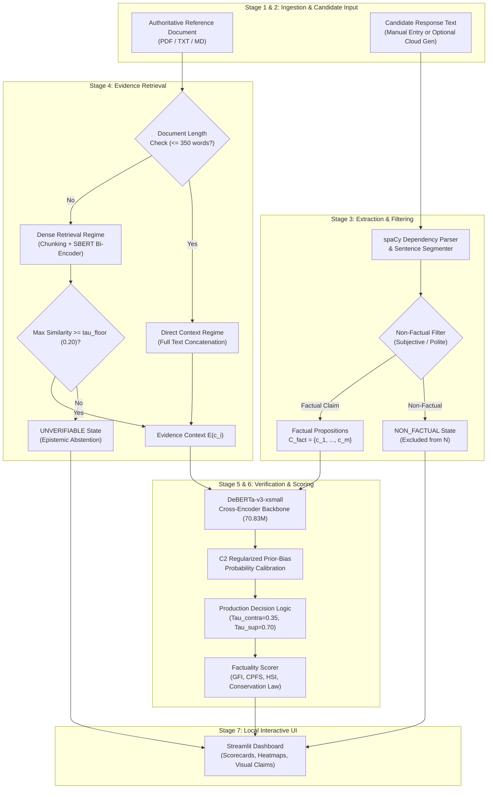

# Chapter 1: Introduction and Problem Formulation

---

## 1.1 Background and Motivation

### 1.1.1 The Emergence of Generative Language Models and the Hallucination Problem
The introduction of the Transformer architecture (Vaswani et al., 2017) and the subsequent scaling of autoregressive Large Language Models (LLMs)—including GPT-4 (Brown et al., 2020), LLaMA (Touvron et al., 2023), and Gemini—has fundamentally transformed natural language processing. These foundation models demonstrate remarkable proficiency in generating syntactically fluent, semantically cohesive, and stylistically sophisticated text across diverse applications such as document summarization, information extraction, open-domain question answering, and computer-assisted reasoning.

Despite these capabilities, generative LLMs suffer from a pervasive, well-documented vulnerability: **factual hallucination** (Ji et al., 2023; Maynez et al., 2020). Autoregressive language models are trained via maximum likelihood estimation to minimize cross-entropy loss over large-scale web text corpora:

$$\mathcal{L}_{\text{LM}}(\theta) = -\sum_{t=1}^T \log P_\theta(x_t \mid x_{<t}) \tag{1.1}$$

This objective explicitly optimizes for *statistical typicality* and *conditional linguistic probability*, rather than empirical, historical, or logical truth (Bender et al., 2021). The model learns to select tokens that maximize the conditional likelihood of the sequence given the preceding context, irrespective of whether the synthesized assertions correspond to physical reality or logically follow from provided premises.

As a consequence, LLMs routinely generate statements that appear authoritative, grammatically flawless, and superficially convincing, but contain critical factual inaccuracies, fabricated citations, ungrounded extrapolations, or direct contradictions of verified data (Huang et al., 2023; Zhang et al., 2023). This disconnect between *linguistic fluency* and *factual consistency* represents a major impediment to the safe, reliable deployment of generative artificial intelligence in high-stakes domains—such as legal compliance, clinical healthcare, financial auditing, and engineering operations—where unverified falsehoods carry substantial operational, financial, and ethical liability.

### 1.1.2 Retrieval-Augmented Generation and its Failure Modes
To mitigate the tendency of parametric language models to fabricate facts from their internal training weights, researchers and industry practitioners have widely adopted **Retrieval-Augmented Generation (RAG)** (Lewis et al., 2020; Guu et al., 2020). In a RAG pipeline, the generative model is provided with relevant passages retrieved from an external, authoritative document repository as part of its prompt context. The LLM is conditioned to synthesize its response strictly on the basis of this retrieved evidence:

$$P(R \mid Q) = \sum_{k=1}^K P(D_k \mid Q) \cdot P(R \mid Q, D_k) \tag{1.2}$$

While RAG provides a strong grounding mechanism, empirical studies demonstrate that RAG architectures do not eliminate hallucinations (Barnett et al., 2024; Yuan et al., 2024). In practice, generative models in RAG systems fail in two distinct ways:
1. **Intrinsic Hallucinations**: The generator misinterprets, distorts, or directly contradicts explicit factual assertions contained within the retrieved context (e.g., inverting numerical quantities, swapping named entities, or misattributing causal relationships).
2. **Extrinsic Hallucinations**: The generator introduces external facts, speculative details, or background entities that are completely uncorroborated by the supplied reference material, drawing upon dormant parametric memory rather than adhering to the retrieved prompt.

Furthermore, retrieval mechanisms themselves introduce errors: passages may be partially relevant, truncated, or noisy. Confronted with imperfect context, LLMs frequently fabricate connective explanations to bridge evidentiary gaps, producing responses that blend verified facts with ungrounded confabulations.

### 1.1.3 The Necessity of Document-Grounded Factual Verification
In organizational and compliance-driven settings, the operational requirement is rarely open-ended, internet-scale fact-checking. Rather, enterprise workflows operate under an explicit contractual mandate: **document-grounded compliance**. An automated system or human analyst must verify whether a candidate text—whether drafted by a human employee, summarized by an LLM, or produced by a RAG agent—is strictly corroborated by a specific, authoritative reference document (e.g., an enterprise policy manual, an engineering specification, a clinical trial report, or a financial disclosure).

Document-grounded verification transforms the intractable challenge of verifying universal real-world truth into a well-defined, closed-world natural language inference (NLI) problem (Dagan et al., 2006). The task is to establish whether the propositions in the candidate response are logically entailed by, contradicted by, or absent from the supplied reference context.

### 1.1.4 Why Fine-Grained, Claim-Level Analysis is Essential
Early approaches to factual consistency evaluation attempted to score generated responses holistically, assigning a single continuous scalar score or binary pass/fail label to an entire multi-paragraph document (Kryscinski et al., 2020; Honovich et al., 2022). Empirical research has demonstrated that coarse response-level evaluation exhibits fundamental deficiencies:
1. **Error Dilution**: A 500-word summary may contain fifteen accurate sentences and a single catastrophic contradiction (e.g., misstating a financial revenue figure by a factor of ten or reversing a clinical contraindication). A holistic metric that averages token similarities across the entire text will assign a high overall score (e.g., 90%), completely obscuring the localized factual violation.
2. **Lack of Root Cause Attribution**: A single document-level score provides no actionable diagnostic information. A human auditor cannot determine *which* sentence is erroneous, *why* the model failed, or *where* in the reference text the conflict occurred.
3. **Inability to Distinguish Failure Types**: Coarse metrics collapse the vital epistemic distinction between an active contradiction (a statement refuted by evidence) and an uncorroborated claim (a statement lacking evidence). In risk-critical auditing, these two failure modes carry vastly different operational consequences.

Consequently, modern verification frameworks must operate at the level of **fine-grained, atomic factual claims** (Min et al., 2023; Tang et al., 2024). By decomposing a candidate response into discrete propositional assertions, verifying each claim independently against retrieved reference evidence, and synthesizing the resulting verdicts into an interpretable factuality scorecard, an auditing framework can achieve both high diagnostic sensitivity and transparent root-cause traceability.

---

## 1.2 Problem Statement

### 1.2.1 Formal Mathematical Formulation
Let a verification task be defined by a tuple:

$$\mathcal{T} = (D, R, Q)$$

where:
- $D$ is an authoritative reference document (or collection of document passages) provided as the ground truth context;
- $R$ is a natural language candidate response generated by an LLM or provided by a human user;
- $Q$ is an optional user query or instruction that prompted the generation of $R$.

The objective of the verification framework is to execute a multi-stage transformation:

```
Reference Document (D) ──┐
Candidate Response (R)  ──┼──► [VeriLLM Pipeline] ──► { (c_i, E_i, y_i, p_i) } ──► (GFI, CPFS, HSI)
User Query (Q, optional)─┘
```

1. **Proposition Extraction**: Decompose the candidate response $R$ into an ordered sequence of $m$ discrete propositional units (factual claims and subjective statements):
   $$\mathcal{C} = \{c_1, c_2, \dots, c_m\}$$
2. **Non-Factual Filtering**: Partition $\mathcal{C}$ into factual propositions $\mathcal{C}_{\text{fact}}$ and non-factual discourse markers $\mathcal{C}_{\text{non\_fact}}$ (such as rhetorical framing, polite greetings, and subjective opinions lacking truth-conditional content):
   $$\mathcal{C} = \mathcal{C}_{\text{fact}} \cup \mathcal{C}_{\text{non\_fact}}, \quad \mathcal{C}_{\text{fact}} \cap \mathcal{C}_{\text{non\_fact}} = \emptyset$$
3. **Evidence Retrieval**: For each factual proposition $c_i \in \mathcal{C}_{\text{fact}}$, retrieve a relevant evidence context $E(c_i) \subseteq D$ comprising the most semantically aligned textual passages within $D$:
   $$E(c_i) = \text{Retrieve}(c_i, D)$$
4. **Calibrated Verification**: Determine the semantic entailment relationship between evidence $E(c_i)$ and proposition $c_i$, producing a predicted class assignment $\hat{y}_i$ and a well-calibrated posterior probability distribution $\mathbf{p}_i \in \Delta^2$:
   $$\mathbf{p}_i = \text{CalibratedInfer}(E(c_i), c_i), \quad \hat{y}_i = \text{DecisionRule}(\mathbf{p}_i, E(c_i))$$
5. **Response-Level Factuality Quantification**: Aggregate the individual claim classifications into bounded, normalized factuality indices that characterize the overall factual reliability, contradiction severity, and evidentiary completeness of the candidate response $R$.

### 1.2.2 The Five Production Categorization Outcomes
In production verification, VeriLLM assigns each extracted proposition $c_i$ to exactly one of five mutually exclusive operational categories:

$$\mathcal{Y}_{\text{prod}} = \{\text{SUPPORTED}, \text{CONTRADICTED}, \text{UNSUPPORTED}, \text{UNVERIFIABLE}, \text{NON\_FACTUAL}\}$$

To ensure complete conceptual clarity, the exact semantic definition and operational handling of each state are established in Table 1.1:

#### Table 1.1: Formal Definitions and Operational Semantics of VeriLLM Production Outcomes
| Production Label | Semantic Definition | Epistemic Significance & Operational Handling |
| :--- | :--- | :--- |
| **`SUPPORTED`** | The proposition is logically entailed by the explicit statements or valid deductive inferences of retrieved reference evidence $E(c_i)$. | **Document-Grounded Proxy**: Validates that the claim is faithful to the provided text. It does *not* certify absolute ontological truth if the source document contains errors. |
| **`CONTRADICTED`** | The proposition asserts a statement that is semantically incompatible with, directly negated by, or mutually exclusive to explicit facts in $E(c_i)$. | **Severe Failure Mode**: Represents an active, confirmed hallucination that directly misinforms the reader. Penalized heavily in factuality scoring. |
| **`UNSUPPORTED`** | The proposition introduces entities, attributes, or claims that are entirely unmentioned in $E(c_i)$, without directly contradicting explicit text. | **Extrinsic Hallucination**: Represents uncorroborated content. Crucially, `UNSUPPORTED` does *not* imply the claim is false in reality, only that the supplied text cannot corroborate it. |
| **`UNVERIFIABLE`** | The retrieval module failed to identify sufficiently relevant passage evidence within $D$ to permit a defensible cross-encoder judgment ($\text{sim} < \tau_{\text{floor}}$). | **Defensive Epistemic Abstention**: Represents an explicit decision not to guess under evidentiary absence. It indicates an evidentiary blind spot, *not* an assertion of hallucination. |
| **`NON_FACTUAL`** | The proposition expresses subjective sentiment, conversational pleasantries, procedural greetings, or rhetorical questions. | **Non-Truth-Conditional Framing**: Excluded from the factual verification denominator ($N = S + C + U + V$) to prevent non-verifiable discourse from distorting factuality metrics. |

### 1.2.3 Factuality Metric Denominators and Conservation Law
Let the counts of factual propositions classified under each category for response $R$ be denoted by $S$ (`SUPPORTED`), $C$ (`CONTRADICTED`), $U$ (`UNSUPPORTED`), and $V$ (`UNVERIFIABLE`). Let non-factual propositions be denoted by $NF$.

The total factual verification denominator is strictly defined as:

$$N = S + C + U + V \tag{1.3}$$

Non-factual statements ($NF$) are partitioned out of all rate calculations. The system computes four mutually exclusive percentage rates:
- **Evidence Support Rate ($ESR$)**: $\frac{S}{N} \times 100\%$
- **Confirmed Contradiction Rate ($CCR$)**: $\frac{C}{N} \times 100\%$
- **Unsupported Rate ($USR$)**: $\frac{U}{N} \times 100\%$
- **Unverifiable Rate ($UVR$)**: $\frac{V}{N} \times 100\%$

By mathematical construction, these rates satisfy the fundamental **Conservation Law of Factual Verification**:

$$ESR + CCR + USR + UVR \equiv 100.00\% \tag{1.4}$$

This conservation identity guarantees that every factual proposition is rigorously accounted for, preventing metric inflation or ungrounded omissions. From these components, VeriLLM derives three response-level indices:
- **Grounded Factuality Index ($GFI = ESR$)**: The primary metric measuring the percentage of factual claims backed by explicit reference evidence.
- **Contradiction-Penalized Factuality Score ($CPFS$)**: A risk-sensitive metric that penalizes contradictions:
  $$CPFS = \max\left(0, \frac{S - \lambda C}{N}\right) \times 100\% \quad (\lambda = 1.0) \tag{1.5}$$
- **Hallucination Severity Index ($HSI = CCR$)**: An explicit safety metric quantifying the prevalence of confirmed factual contradictions.

---

## 1.3 Research Gap and Need for the Proposed Framework

A critical review of the academic literature and existing industrial tools (conducted in Chapter 2) identifies four major structural research gaps that necessitate the development of VeriLLM:

```
┌────────────────────────────────────────────────────────────────────────────────────────┐
│                        Identified Structural Research Gaps                             │
└────────────────────────────────────────────────────────────────────────────────────────┘
  Gap 1: Coarse Granularity & Lack of Root-Cause Attribution
         └── Holistic document-level scores mask critical isolated contradictions.
  Gap 2: Severe Probability Miscalibration Under Class Imbalance
         └── Uncalibrated cross-encoders output severe overconfidence on rare errors (~3.8%).
  Gap 3: Penalization of Epistemic Abstention Under Retrieval Noise
         └── Benchmarks enforce static coverage floors, rewarding blind guessing on missing text.
  Gap 4: Resource-Prohibitive and Cloud-Dependent Architectures
         └── Heavy 7B-70B LLM judges require costly GPU clusters and leak private enterprise text.
```

### 1.3.1 Gap 1: Coarse Granularity & Lack of Root-Cause Attribution
Existing factual consistency evaluators—such as early NLI-based models (Kryscinski et al., 2020) and sentence-similarity heuristics (BLEU, ROUGE, BERTScore)—operate predominantly at the document or paragraph level. While recent frameworks like MiniCheck (Tang et al., 2024) introduce claim-level checking, they generally formulate verification as a binary decision (`Supported` vs. `Unsupported`). They fail to decompose the response into atomic propositions, do not provide sentence-level visual attribution against source chunks, and cannot differentiate between an outright factual contradiction and an unmentioned but plausible detail.

### 1.3.2 Gap 2: Severe Probability Miscalibration Under Class Imbalance
Modern deep neural networks trained with cross-entropy loss are notorious for outputting poorly calibrated confidence estimates (Guo et al., 2017). In factual verification datasets like RAGTruth (Yuan et al., 2024), class distributions are acutely skewed: over $87\%$ of generated sentences are factual, while contradictions account for less than $4\%$. Under such severe imbalance, raw softmax logits produce misleading, overconfident probabilities. 

Furthermore, standard isotropic temperature scaling ($C1$) scales all logits uniformly, which alters entropy but preserves class log-odds, leaving minority-class confidence distorted. Prior to VeriLLM, no document-grounded verification framework incorporated regularized prior-bias calibration ($C2$) to mathematically re-align class posteriors with true empirical baserates.

### 1.3.3 Gap 3: Penalization of Epistemic Abstention Under Retrieval Noise
In realistic enterprise RAG workflows, dense passage retrieval does not achieve perfect recall; approximately $34\%$ of extracted propositions lack corresponding passage evidence in the retrieved chunks. Standard verification benchmark protocols impose rigid coverage floors (e.g., requiring $\ge 90\%$ coverage) that penalize models for abstaining. 

This creates a perverse incentive: uncalibrated heuristic baselines that guess blindly on unretrieved text achieve high coverage but catastrophic accuracy ($47.81\%$), producing hundreds of false unsupported accusations. There is an urgent need for a verification framework that formalizes **selective epistemic abstention** (`UNVERIFIABLE`), allowing the system to decline judgment when evidence is insufficient without being unfairly penalized.

### 1.3.4 Gap 4: Resource-Prohibitive and Cloud-Dependent Architectures
Contemporary commercial approaches to hallucination detection increasingly rely on "LLM-as-a-Judge" paradigms (e.g., prompting GPT-4 or Claude 3.5 to verify text) or deploy massive cross-encoders with 355M to 435M parameters (Zheng et al., 2023; Liu et al., 2023). These approaches suffer from severe operational limitations:
- **High Financial Cost & Latency**: Running multi-turn LLM prompts for every extracted claim introduces unacceptable latency ($10\text{--}30\text{ s}$) and recurring API expenditure.
- **Hardware Inaccessibility**: Large open-source cross-encoders require dedicated, high-VRAM enterprise GPU clusters, rendering them unusable on standard edge workstations or developer laptops.
- **Data Sovereignty & Privacy Violations**: Transmitting proprietary internal documents, confidential patient medical records, or classified legal contracts to third-party commercial cloud APIs violates data protection regulations (such as GDPR, HIPAA, and internal corporate governance).

There is an acute need for a **local-first, edge-scale verification framework** that executes efficiently on commodity CPU hardware within a strict memory footprint ($< 1.2\text{ GB}$ RAM) while ensuring that sensitive reference documents never leave the local environment.

---

## 1.4 Aim and Research Objectives

### 1.4.1 Primary Research Aim
The primary aim of this research is to design, develop, empirically evaluate, and deploy **VeriLLM**: a lightweight, calibrated, model-agnostic, and document-grounded framework for fine-grained factual hallucination detection, quantification, and root-cause analysis that operates entirely locally on commodity consumer CPU hardware.

### 1.4.2 Specific Research Objectives
To realize this aim, the project was organized into seven concrete engineering and research objectives, strictly aligned with the implemented system:

1. **Objective 1 (Document-Grounded Claim Extraction Pipeline)**: Design and implement an automated natural language processing pipeline using spaCy dependency parsing to segment candidate responses into discrete propositional assertions, filter non-factual discourse markers, and format atomic claims for verification.
2. **Objective 2 (Evidence Retrieval Subsystem)**: Develop a dual-regime evidence retrieval architecture that supports Direct Context concatenation for concise documents ($\le 350$ words) and dense Sentence-BERT sliding-window retrieval (`all-MiniLM-L6-v2`) for multi-page documents.
3. **Objective 3 (Lightweight Cross-Encoder Fine-Tuning)**: Adapt, train, and optimize a compact, edge-scale cross-encoder architecture (`cross-encoder/nli-deberta-v3-xsmall`, 70.83 million parameters) on the RAGTruth benchmark using normalized inverse class weighting to detect fine-grained factual inconsistencies.
4. **Objective 4 (Probability Calibration and Epistemic Decision Optimization)**: Formulate, calibrate, and validate post-hoc probability calibration techniques—specifically isotropic temperature scaling ($C1$) and regularized prior-bias scaling ($C2$)—and optimize selective decision thresholds ($\tau_{\text{contra}}, \tau_{\text{sup}}, \tau_{\text{floor}}$) to support defensive epistemic abstention.
5. **Objective 5 (Conservation-Constrained Factuality Scoring)**: Formulate a mathematically sound scoring framework rooted in the Law of Total Probability, enforcing the conservation law ($ESR + CCR + USR + UVR \equiv 100.00\%$) and deriving bounded, interpretable response-level indices ($GFI, CPFS, HSI$).
6. **Objective 6 (Local-First Interactive Presentation Tier)**: Implement a pure-Python, local-first interactive user interface using Streamlit, providing real-time claim inspection, evidence highlighting, data sovereignty preservation, and optional candidate response generation with resilient error handling.
7. **Objective 7 (Rigorous Empirical Validation & Limitation Analysis)**: Execute an extensive, evidence-based experimental evaluation using the official RAGTruth test partition ($17,906$ sentences), an out-of-sample validation holdout (Val-Lock), and comprehensive CPU latency and regression test suites, critically analyzing the boundaries and limitations of the system.

---

## 1.5 Research Questions

To guide the scientific investigation and evaluate the success of the proposed framework, this thesis addresses four core research questions:

- **Research Question 1 (RQ1: Model Discriminative Capability)**:  
  *To what extent can a fine-tuned lightweight cross-encoder (70.83M parameters) accurately distinguish supported, contradicted, and unsupported propositions in RAG-generated text compared to zero-shot baselines on a standardized benchmark?*  
  *(Addressed in Chapters 4 and 7: Evaluated on 17,906 test sentences, achieving 92.86% accuracy and 69.99% Macro-F1, outperforming MiniCheck baselines by $+35.19\text{ pp}$ Macro-F1).*

- **Research Question 2 (RQ2: Probability Calibration and Class Imbalance)**:  
  *How does post-hoc probability calibration—specifically regularized prior-bias scaling versus isotropic temperature scaling—impact predictive uncertainty, expected calibration error, and decision reliability under severe minority-class imbalance?*  
  *(Addressed in Chapters 5 and 8: Evaluated on the Val-Lock holdout, demonstrating that $C2$ slashes NLL to 0.2647 and CW-ECE to 0.0236, resolving overconfidence while revealing the subtle trade-offs between calibration loss and discrete thresholded F1).*

- **Research Question 3 (RQ3: Retrieval Dynamics and Epistemic Abstention)**:  
  *What is the empirical impact of dense passage retrieval on verification accuracy, and why is explicit epistemic abstention (`UNVERIFIABLE`) necessary to prevent misleading confidence when evidence is missing?*  
  *(Addressed in Chapters 5, 7, and 8: Analyzed through the retrieval coverage-floor dilemma, proving that forced guessing collapses baseline accuracy to 47.81%, whereas calibrated abstention achieves 86.72% selective accuracy and reduces hallucination MAE by 69.3%).*

- **Research Question 4 (RQ4: Deployment Feasibility and Document Privacy)**:  
  *Can a complete document-grounded verification pipeline be deployed locally on commodity consumer CPU hardware within acceptable latency ($< 5\text{ s}$) and memory ($< 1.2\text{ GB}$) constraints while guaranteeing that proprietary reference documents remain strictly local?*  
  *(Addressed in Chapters 6 and 7: Validated across 275 regression tests, profiling an end-to-end CPU runtime of $1.45\text{--}4.50\text{ s}$ per document and enforcing a local-first data architecture).*

---

## 1.6 Scope and Boundaries of the Study

To maintain academic rigor and prevent over-claiming, the exact operational boundaries, technical assumptions, and empirical scope of this study are explicitly delineated:

### 1.6.1 Document-Grounded Verification vs. Universal Fact-Checking
VeriLLM performs **document-grounded textual consistency verification**, not universal open-domain fact-checking. The system evaluates whether candidate claims are corroborated by the supplied reference document. It does not query external knowledge bases, Wikipedia, or web search APIs. If an ingested document contains factual errors, claims conforming to those errors will be verified as supported.

### 1.6.2 Benchmark Corpus and Linguistic Boundaries
All model training, validation tuning, and benchmark testing were conducted strictly on the **RAGTruth benchmark corpus** (Yuan et al., 2024). Consequently, the empirical findings reflect the linguistic properties of RAGTruth's three source domains (CNN/DailyMail news, PubMed biomedical abstracts, and public question-answering) and its English-only text. Verification performance on other high-stakes domains (e.g., complex legal contracts, financial SEC 10-K filings, computer programming code) or non-English languages is not evaluated and remains unproven.

### 1.6.3 Nature of the Val-Lock Validation Holdout
The Val-Lock partition ($30$ source documents, $890$ sentences, $1,232$ evaluated pairs) utilized in Chapters 5 and 7 is an **in-distribution, source-disjoint validation holdout**. It guarantees that the model is evaluated on source documents completely unseen during training, preventing verbatim document memorization. However, it does *not* constitute an external out-of-distribution benchmark.

### 1.6.4 Classifier Head vs. Production Categorization States
The neural classifier head trained in Chapter 4 operates as a **three-class model** on canonical premise-hypothesis pairs: Class 0 (`CONTRADICTED`), Class 1 (`SUPPORTED_PROXY`), and Class 2 (`UNSUPPORTED`). The full **five-state production categorization** (`SUPPORTED`, `CONTRADICTED`, `UNSUPPORTED`, `UNVERIFIABLE`, `NON_FACTUAL`) is achieved by the complete VeriLLM pipeline, which integrates upstream spaCy non-factual filtering and downstream retrieval similarity gating ($\tau_{\text{floor}} = 0.20$).

### 1.6.5 Unimplemented Features
The scope of this undergraduate thesis explicitly excludes:
- Optical Character Recognition (OCR) for scanned, rasterized, or image-only PDF documents;
- Multilingual tokenization and cross-lingual factual alignment;
- Multi-hop graph retrieval or multi-document cross-attention;
- Real-time streaming verification of continuous LLM token output.

### 1.6.6 Optional Candidate Generator and External API Service Status
VeriLLM includes an optional candidate response generation workflow powered by the Google Gen AI SDK (`google-genai`), allowing users to query Google Gemini models (e.g., `gemini-3.8-flash` or `gemini-2.5-flash`). The boundaries of this integration are:
- **Data Privacy Terminology**: VeriLLM implements a **local-first** and **document-local processing** architecture. It is *not* entirely air-gapped because the optional generator transmits user prompt instructions over an external HTTPS connection to Google's API. However, **reference documents remain 100% local by default** and are never transmitted to external cloud providers.
- **Empirical Status of Live Gemini Generation**: During Phase 11 diagnostic testing, requests to developer preview endpoints encountered upstream **HTTP 503 UNAVAILABLE** and **HTTP 504 DEADLINE_EXCEEDED** errors on Google's serving infrastructure. While a robust bounded retry state machine was implemented, **live end-to-end Gemini candidate generation was not successfully validated due to these upstream capacity limits**. Manual verification of user-pasted text was 100% operational and served as the primary, fully validated workflow.

---

## 1.7 Overview of the Proposed VeriLLM Framework

VeriLLM integrates document ingestion, NLP preprocessing, dense retrieval, calibrated neural inference, and interactive visualization into a unified, local-first pipeline. Figure 1.1 illustrates the conceptual architecture and data flow across the seven core processing stages:



### 1.7.1 Stage-by-Stage Functional Summary
1. **Document Ingestion (Stage 1)**: Ingests digital PDF, TXT, or Markdown documents, extracts raw text streams using `pdfplumber` and `PyPDF2`, performs whitespace normalization, and validates digital content presence.
2. **Candidate Response Acquisition (Stage 2)**: Acquires candidate responses through two decoupled workflows: direct manual pasting into the interface, or optional generation via Google Gemini API prompts.
3. **Claim Extraction and Filtering (Stage 3)**: Segments text into grammatical propositions using spaCy. Identifies and isolates non-truth-conditional discourse markers (`NON_FACTUAL`), passing only testable factual assertions into the verification queue.
4. **Evidence Retrieval (Stage 4)**: Evaluates reference document length. Concise documents ($\le 350$ words) are routed to Direct Context mode. Multi-page documents are segmented into $150$-word sliding chunks ($30$-word overlap) and indexed via `all-MiniLM-L6-v2`. Propositions lacking evidence ($\text{sim} < 0.20$) are safely routed to `UNVERIFIABLE`.
5. **Calibrated Neural Verification (Stage 5)**: Evaluates premise-claim pairs using the fine-tuned `cross-encoder/nli-deberta-v3-xsmall` backbone. Applies regularized prior-bias calibration ($C2$) and optimized decision thresholds ($\tau_{\text{contra}}, \tau_{\text{sup}}$) to produce definitive verdicts (`SUPPORTED`, `CONTRADICTED`, `UNSUPPORTED`).
6. **Response-Level Factuality Scoring (Stage 6)**: Computes mutually exclusive rates ($ESR, CCR, USR, UVR$) satisfying the 100% conservation law, deriving overall factuality indices ($GFI, CPFS, HSI$).
7. **Interactive Dashboard Inspection (Stage 7)**: Renders an interactive Streamlit results interface featuring high-level KPI metric cards, conservation rate pills, and detailed visual claim inspection panels with supporting passage attribution.

*(A comprehensive architectural specification is provided in Chapter 3, with machine learning and implementation details detailed in Chapters 4, 5, and 6).*

---

## 1.8 Summary of Research Contributions

The principal theoretical, empirical, and engineering contributions of this thesis are summarized below:

1. **Lightweight, Edge-Scale Verification Backbone**: Demonstrated that a compact, 70.83-million parameter cross-encoder (`cross-encoder/nli-deberta-v3-xsmall`) fine-tuned on RAGTruth achieves **92.86% overall accuracy** and **69.99% Macro-F1** on 17,906 unseen test sentences, outperforming zero-shot MiniCheck baselines (+35.19 pp Macro-F1) while executing in $110\text{--}240\text{ ms}$ per claim on commodity CPU hardware.
2. **Regularized Prior-Bias Probability Calibration ($C2$)**: Proved that standard isotropic temperature scaling ($C1$) is insufficient under severe minority-class imbalance. Established that regularized prior-bias calibration ($\mathbf{z}' = \mathbf{z}/T + \mathbf{b}, \lambda_{\text{reg}} = 0.001$) slashes Negative Log-Likelihood from $0.6272$ to **$0.2647$** and Classwise Expected Calibration Error from $0.0892$ to **$0.0236$** on an out-of-sample holdout (Val-Lock).
3. **Dual Operational Regimes with Principled Epistemic Abstention**: Designed a dual-regime architecture that decouples direct document evaluation from dense retrieval. Diagnosed the retrieval coverage-floor dilemma, proving that forced guessing degrades baseline accuracy to 47.81%, whereas calibrated epistemic abstention (`UNVERIFIABLE`) achieves **86.72% selective accuracy** on covered claims, reducing response hallucination MAE by **69.3%** (from 37.96 pp to 11.66 pp).
4. **Conservation-Constrained Factuality Scoring Model**: Formulated a mathematically closed scoring framework enforcing the identity $ESR + CCR + USR + UVR \equiv 100.00\%$, establishing normalized, interpretable indices ($GFI, CPFS, HSI$) that explicitly penalize severe contradictions without conflating missing evidence with falsehood.
5. **Local-First, Privacy-Preserving Application Architecture**: Implemented a complete, pure-Python interactive dashboard in Streamlit operating within a $< 1.2\text{ GB}$ RAM footprint. Guaranteed document privacy by enforcing that all reference texts, chunk embeddings, and neural inference remain strictly local to the user's workstation.
6. **Rigorous Empirical and Statistical Methodology**: Audited all performance claims using source-clustered permutation tests with Holm-Bonferroni corrections and clustered bootstrap confidence intervals ($B = 2,000$). Transparently disclosed non-significant retrieval metrics and identified the task-specific contradiction recall disparity between structured Data2txt (75.76%) and unstructured Summarization/QA (0.00%).

---

## 1.9 Organization of the Thesis

The remainder of this academic thesis is structured into eight subsequent chapters, logically organized as follows:

- **Chapter 2: Literature Review and Theoretical Foundations**  
  Surveys the theoretical and empirical literature underpinning large language model hallucinations, retrieval-augmented generation failure modes, natural language inference, cross-encoder architectures, probability calibration, selective prediction, and existing evaluation benchmarks. Formalizes the specific research gaps addressed by VeriLLM.
- **Chapter 3: Proposed VeriLLM System Architecture**  
  Presents the complete architectural design of VeriLLM. Details document preprocessing, sliding-window chunking, spaCy proposition extraction, the dual operational regimes (Direct Context vs. Dense Retrieval), the 5-way categorization taxonomy, and the mathematical derivation of all factuality scoring metrics.
- **Chapter 4: Machine Learning Model Design and Training**  
  Documents the selection, preprocessing, and fine-tuning of the `DeBERTa-v3-xsmall` cross-encoder backbone on the RAGTruth benchmark. Details source-disjoint partitioning, class-weighted cross-entropy loss, targeted 350-word context windowing, Google Colab GPU training dynamics, and official test split benchmark evaluation.
- **Chapter 5: Probability Calibration and Hybrid Decision Optimization**  
  Details the formulation and comparative evaluation of post-hoc probability calibration techniques ($C0, C1, C2, C3$) and hybrid decision strategies ($H0$ through $H6$). Documents the pre-registered two-stage experimental design, nested cross-validation, the frozen parameter bundle, and out-of-sample confirmation on the Val-Lock holdout.
- **Chapter 6: System Implementation and Interactive Interface**  
  Describes the software engineering implementation of VeriLLM. Documents the pure-Python technology stack, backend package modularity, Streamlit frontend hierarchy, session state management, caching optimizations, data sovereignty boundary, and the resilient Google Gemini provider adapter.
- **Chapter 7: Experimental Results and Comprehensive Evaluation**  
  Presents the consolidated empirical evaluation of VeriLLM. Reports the official RAGTruth test benchmark results, hardware latency and memory profiling on commodity CPU hardware, the complete validation suite across Scenarios A through I, and the manifest of 275 automated regression tests.
- **Chapter 8: Discussion, Limitations and Future Work**  
  Critically interprets the empirical findings, examines the 92.86% accuracy imbalance illusion, dissects the 1.57 pp Val-Lock Macro-F1 gap, analyzes the retrieval coverage dilemma and task-specific contradiction recall disparities, formalizes threats to validity, and outlines a prioritized 10-point roadmap for future research.
- **Chapter 9: Conclusion**  
  Synthesizes the primary conclusions of the research, reflects upon the engineering accomplishments of the thesis, and offers concluding remarks on the future of calibrated, privacy-preserving factual verification for trustworthy artificial intelligence.

---

## 1.10 Chapter Summary

This introductory chapter has established the intellectual foundation, practical motivation, and formal scope of this thesis:
1. **The Core Motivation**: Generative LLMs optimize for syntactic fluency rather than factual truth, leading to fluent hallucinations that pose severe operational risks in high-stakes environments. Retrieval-Augmented Generation mitigates but does not resolve these failures.
2. **The Problem Formulation**: Factual verification is formulated as a closed-world, document-grounded task: decomposing a candidate response into discrete propositions, retrieving relevant reference evidence, performing calibrated NLI classification across five production states (`SUPPORTED`, `CONTRADICTED`, `UNSUPPORTED`, `UNVERIFIABLE`, `NON_FACTUAL`), and computing conservation-constrained factuality indices.
3. **The Research Gaps**: Existing methods suffer from coarse granularity, severe neural miscalibration under class imbalance, penalization of epistemic abstention under retrieval noise, and reliance on expensive, privacy-violating cloud LLM judges.
4. **The Proposed Solution**: VeriLLM addresses these gaps through an edge-scale 70.83M parameter DeBERTa cross-encoder, regularized prior-bias calibration ($C2$), selective epistemic abstention ($\tau_{\text{floor}}$), and a local-first pure-Python Streamlit deployment.
5. **Boundaries and Integrity**: The scope is strictly bounded to document-grounded verification on the RAGTruth benchmark. The Val-Lock partition is established as an in-distribution holdout, and live external Gemini generation is accurately characterized as unvalidated due to upstream HTTP 503/504 errors, with manual verification remaining 100% operational.

With the problem formally formulated and contextualized, Chapter 2 proceeds to examine the literature review and theoretical foundations underpinning this work.

