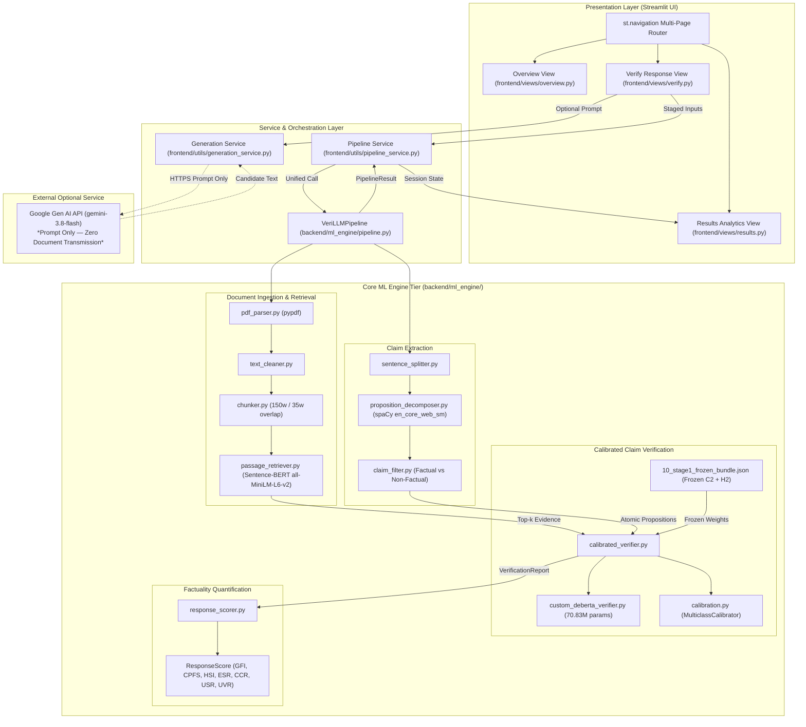
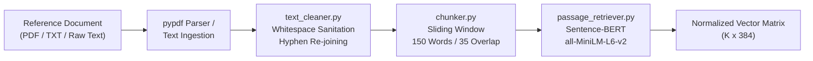
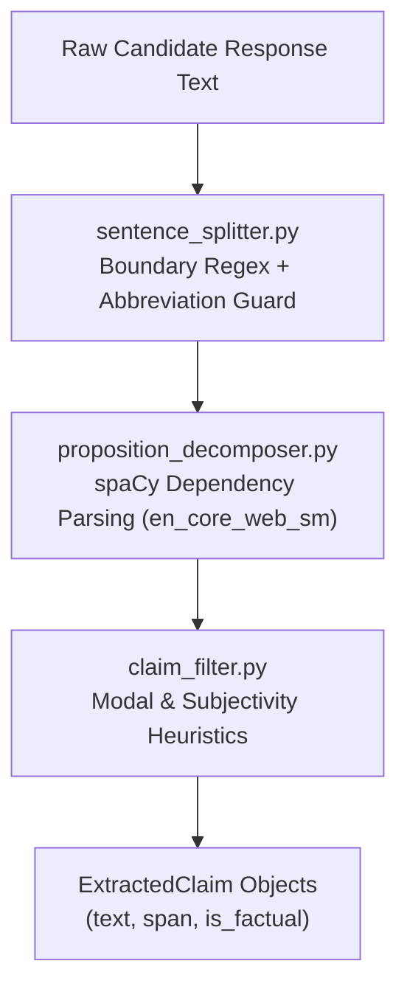

# VeriLLM — Complete Technical Documentation & Architectural Reference

**Version:** 1.0.0 (Production Frozen Release)  
**Date:** November 2026  
**Target Audience:** Machine Learning Engineers, Backend Developers, System Architects, and Academic Researchers  
**Canonical Repository Path:** `backend/` and `frontend/` under `D:\drive e\VeriLLM`  
**Authoritative Frozen Calibration Bundle:** [`backend/experiments/results/10_stage1_frozen_bundle.json`](file:///d:/drive%20e/VeriLLM/backend/experiments/results/10_stage1_frozen_bundle.json)  
**Primary Academic Thesis Reference:** [`backend/experiments/results/25_verillm_final_thesis.md`](file:///d:/drive%20e/VeriLLM/backend/experiments/results/25_verillm_final_thesis.md) / [`27_verillm_final_thesis.pdf`](file:///d:/drive%20e/VeriLLM/backend/experiments/results/27_verillm_final_thesis.pdf)

---

## Table of Contents

- [1. Project Overview](#1-project-overview)
- [2. System Architecture](#2-system-architecture)
- [3. Repository Structure](#3-repository-structure)
- [4. Technology Stack and Dependencies](#4-technology-stack-and-dependencies)
- [5. Document Processing Pipeline](#5-document-processing-pipeline)
- [6. Claim Extraction](#6-claim-extraction)
- [7. Verification Engine](#7-verification-engine)
- [8. Machine Learning Model](#8-machine-learning-model)
- [9. Calibration and Decision Strategy](#9-calibration-and-decision-strategy)
- [10. Scoring and Analytics](#10-scoring-and-analytics)
- [11. Application and Interface](#11-application-and-interface)
- [12. Configuration and Environment Setup](#12-configuration-and-environment-setup)
- [13. Running the Application](#13-running-the-application)
- [14. Testing and Validation](#14-testing-and-validation)
- [15. Performance and Resource Requirements](#15-performance-and-resource-requirements)
- [16. Privacy and Security](#16-privacy-and-security)
- [17. Troubleshooting](#17-troubleshooting)
- [18. Known Limitations and Future Maintenance](#18-known-limitations-and-future-maintenance)
- [19. References](#19-references)

---

## 1. Project Overview

### 1.1 Problem Statement
Autoregressive Large Language Models (LLMs) optimize for surface conditional linguistic likelihood rather than empirical or logical truth. As a consequence, state-of-the-art generative models routinely produce factual hallucinations—assertions that are syntactically polished, authoritative, and coherent, yet diverge from or directly contradict verified source material. In enterprise knowledge workflows, Retrieval-Augmented Generation (RAG) mitigates parametric memory fabrications but introduces grounding failures:
1. **Contradictory Hallucinations:** The generative model asserts statements that directly conflict with provided reference text.
2. **Ungrounded Extrapolations:** The model invents plausible-sounding details unsupported by the evidence.
3. **Retrieval Misses & Forced Guesses:** When external passage retrieval fails to retrieve relevant evidence, models frequently hallucinate rather than abstaining.

Existing evaluation paradigms exhibit severe shortcomings:
- **LLM-as-a-Judge prompting:** High latency, prohibitive API operational costs, non-deterministic token sampling, and self-preference bias.
- **Off-the-shelf Natural Language Inference (NLI) classifiers:** Suffer from extreme overconfidence on rare failure classes (such as contradiction rates $\approx 3.8\%$) and lack the ability to express epistemic uncertainty when evidence is missing.

### 1.2 Project Objectives
VeriLLM is engineered to solve these challenges through four primary technical objectives:
1. **Fine-Grained Propositional Verification:** Deconstruct compound LLM responses into atomic, truth-conditional propositions with exact character-level citation provenance.
2. **Probability Calibration:** Correct severe post-hoc miscalibration on minority hallucination classes using regularized prior-bias transformation ($C2$) without retraining backbone neural weights.
3. **Selective Epistemic Abstention:** Introduce defensive evidence-sufficiency gating ($\tau_{\text{floor}} = 0.20$) to eliminate forced misclassifications when retrieved evidence is absent or semantically disconnected.
4. **Local Data Sovereignty:** Deliver high-throughput, low-latency CPU verification locally without transmitting sensitive enterprise documents to external cloud APIs.

### 1.3 Scope and Operational Boundaries
- **Document-Grounded Consistency:** VeriLLM verifies *consistency relative to the supplied reference document*. It does not establish universal real-world truth or verify assertions against open-web knowledge.
- **Language Scope:** The current production pipeline is optimized and validated for English text corpora.
- **Retrieval Scope:** Implements single-hop dense passage retrieval. Multi-hop inductive reasoning across distributed enterprise knowledge graphs is outside the current release scope.
- **OCR Boundary:** Ingests digital PDFs containing extractable text streams and UTF-8 plain-text files. Scanned bitmap PDFs without embedded OCR text layers require external optical pre-processing.

### 1.4 Key Features
- **Dual Operational Regimes:** Seamlessly executes *Direct Context Concatenation* for concise texts ($\le 350$ words) and *Dense Evidence Retrieval* for multi-page documents.
- **5-Way Classification Framework:** Categorizes propositions into mutually exclusive states: `SUPPORTED`, `CONTRADICTED`, `UNSUPPORTED`, `UNVERIFIABLE`, and `NON_FACTUAL`.
- **Conservation-Constrained Scoring:** Formulates response factuality under an exact sum invariant ($ESR + CCR + USR + UVR \equiv 100.00\%$), deriving the Grounded Factuality Index ($GFI$) and Contradiction-Penalized Factuality Score ($CPFS$).
- **Pure-Local Execution:** Complete verification pipeline executes in $100\text{--}250\text{ ms}$ per proposition on commodity host CPUs within $< 1.2\text{ GB}$ of RAM.

---

## 2. System Architecture

VeriLLM is structured as a decoupled, three-tier modular architecture designed for high maintainability, state isolation, and deterministic testability.



### 2.1 Layer Responsibilities

1. **Presentation Layer (`frontend/`):**
   - Implemented in Streamlit using the official `st.navigation` and `st.Page` routing architecture.
   - Manages UI session state (`st.session_state`), input validation, asynchronous spinner rendering, Altair chart layouts, and interactive claim filtering.
   - Enforces the strict data-sovereignty invariant: document bytes are ingested exclusively into local memory and never transmitted to external APIs.

2. **Service & Orchestration Layer (`frontend/utils/` & `backend/ml_engine/pipeline.py`):**
   - `pipeline_service.py`: Staging adapter validating uploaded file objects, bytes, and manual text inputs before invoking the backend.
   - `generation_service.py`: Provider adapter wrapping the optional Gemini candidate generation workflow with bounded retries and graceful fallback.
   - `VeriLLMPipeline`: Canonical orchestration class unifying document parsing, sliding-window chunking, proposition extraction, dense retrieval, neural inference, calibration, and scoring.

3. **Core Machine Learning Engine (`backend/ml_engine/`):**
   - Pure Python / PyTorch / Transformers / spaCy implementation executing fully locally on CPU.
   - Decoupled into four specialized sub-packages: `evidence_retriever`, `claim_extractor`, `claim_verifier`, and `scorer`.

---

## 3. Repository Structure

The actual file tree of the VeriLLM codebase is organized as follows (excluding temporary build and cache artifacts):

```text
D:\drive e\VeriLLM
├── backend/
│   ├── .env.example                          # Template environment variable configuration
│   ├── requirements.txt                      # Pinned Python package dependencies
│   ├── data/                                 # Evaluation benchmark datasets (RAGTruth, MiniCheck)
│   ├── models/
│   │   └── verillm_deberta/                  # Production fine-tuned model checkpoint
│   │       ├── config.json                   # DeBERTa-v2 sequence classification config
│   │       ├── model.safetensors             # 70.83M parameter fine-tuned model weights
│   │       ├── tokenizer.json                # Fast byte-pair tokenizer vocabulary
│   │       └── tokenizer_config.json         # Tokenizer special tokens and padding rules
│   ├── ml_engine/
│   │   ├── __init__.py                       # Package export entrypoint
│   │   ├── pipeline.py                       # VeriLLMPipeline & PipelineResult orchestration
│   │   ├── evidence_retriever/               # Document ingestion & dense passage retrieval
│   │   │   ├── chunker.py                    # SlidingWindowChunker (150w/35w overlap)
│   │   │   ├── models.py                     # DocumentChunk, RetrievedPassage, ClaimEvidenceMatch
│   │   │   ├── passage_retriever.py          # Sentence-BERT embedding index & top-k retrieval
│   │   │   ├── pdf_parser.py                 # pypdf document ingestion & page-level tracking
│   │   │   └── text_cleaner.py               # Whitespace normalization & ASCII sanitation
│   │   ├── claim_extractor/                  # Proposition-level NLP extraction pipeline
│   │   │   ├── claim_filter.py               # Factual assertion vs subjective opinion filter
│   │   │   ├── extractor.py                  # ClaimExtractor unified extraction interface
│   │   │   ├── models.py                     # ExtractedClaim, ExtractionResult data models
│   │   │   ├── proposition_decomposer.py     # spaCy dependency parsing & clause unwrapping
│   │   │   └── sentence_splitter.py          # Punctuation & abbreviation-safe sentence splitter
│   │   ├── claim_verifier/                   # Multi-class neural inference & calibration
│   │   │   ├── calibrated_verifier.py        # CalibratedDebertaVerifier production verifier
│   │   │   ├── custom_deberta_verifier.py    # Cross-encoder inference wrapper
│   │   │   ├── decision_strategy.py          # Multi-verifier arbitration logic
│   │   │   ├── minicheck_verifier.py         # Baseline MiniCheck verifier wrapper
│   │   │   ├── models.py                     # VerifiedClaim, VerificationReport, Category enums
│   │   │   ├── nli_verifier.py               # Baseline RoBERTa NLI verifier wrapper
│   │   │   └── verifier.py                   # Multi-verifier comparative orchestrator
│   │   ├── custom_model/                     # Model training & offline calibration utilities
│   │   │   ├── calibration.py                # MulticlassCalibrator, logit reconstruction, ECE
│   │   │   ├── dataset_preprocessor.py       # RAGTruth JSONL parser & source-disjoint splitter
│   │   │   ├── hybrid_strategies.py          # H0 through H6 decision strategies & code mappings
│   │   │   ├── train.py                      # DeBERTa-v3 weighted cross-entropy training loop
│   │   │   └── validation_ablation.py        # Val-Lock partition audit & ablation utilities
│   │   ├── llm_generator/                    # Optional external candidate generator adapter
│   │   │   ├── client.py                     # Google Gen AI SDK client with retry resilience
│   │   │   └── models.py                     # GenerationRequest, GenerationResult, GenerationError
│   │   └── scorer/                           # Response-level factuality quantification
│   │       ├── dataset_scorer.py             # Macro/micro aggregation across test corpora
│   │       ├── models.py                     # ResponseScore, ResponseCounts, FactualityIndices
│   │       ├── response_scorer.py            # Conservation scoring & invariant verification
│   │       └── scorer.py                     # Standalone scoring utility functions
│   ├── experiments/
│   │   └── results/                          # Frozen research artifacts, reports & thesis
│   │       ├── 10_stage1_frozen_bundle.json  # Authoritative frozen production calibration bundle
│   │       ├── 25_verillm_final_thesis.md    # Master 51,442-word academic thesis manuscript
│   │       ├── 26_final_thesis_consistency_audit.md # Thesis-wide numerical audit report
│   │       ├── 27_verillm_final_thesis.html  # Paged Media HTML artifact
│   │       └── 27_verillm_final_thesis.pdf   # 116-page submission-quality thesis PDF
│   └── tests/                                # Comprehensive automated regression test suite (284 tests across 20 modules)
│       ├── test_calibrated_verifier.py       # 13 tests: bundle validation, parity, thresholds
│       ├── test_calibration_and_hybrid.py    # 20 tests: calibration, leakage guards, Val-Lock
│       ├── test_claim_extractor.py           # 14 tests: splitting, decomposition, offsets
│       ├── test_claim_verifier.py            # 12 tests: verification categories, invariants
│       ├── test_custom_deberta_download.py   # 9 tests: automatic HF download, cache reuse & offline gating
│       ├── test_custom_deberta_schemas.py    # 5 tests: schema compatibility & serialization
│       ├── test_custom_deberta_shadow.py     # 5 tests: shadow execution & state isolation
│       ├── test_custom_deberta_verifier.py   # 7 tests: cross-encoder logits & classification
│       ├── test_custom_model.py              # 12 tests: training loss weighting & evaluation
│       ├── test_evidence_retriever.py        # 16 tests: chunking, pypdf extraction, retrieval
│       ├── test_frontend_results.py          # 23 tests: results UI layout & data normalization
│       ├── test_frontend_verify.py           # 28 tests: verify view, uploads, validation states
│       ├── test_frontend_workflows.py        # 28 tests: manual & live workflow convergence
│       ├── test_gemini_client.py             # 34 tests: provider adapter, retries, degradation
│       ├── test_generation_service.py        # 16 tests: generation service wrappers & guards
│       ├── test_imports.py                   # 1 test: backend & frontend package importability
│       ├── test_pipeline.py                  # 21 tests: end-to-end VeriLLMPipeline contract
│       ├── test_pipeline_service.py          # 11 tests: staging adapters & pipeline execution
│       ├── test_scorer.py                    # 11 tests: factuality indices, conservation invariant
│       └── test_validation_ablation.py       # 11 tests: ablation methodology & statistical tests
├── frontend/
│   ├── app.py                                # Streamlit entrypoint & page navigation router
│   ├── components/
│   │   ├── __init__.py
│   │   └── header.py                         # Header branding, status badges, sidebar styling
│   ├── utils/
│   │   ├── __init__.py
│   │   ├── generation_service.py             # Client wrapper for optional candidate generation
│   │   ├── pipeline_service.py               # Input mapper & VeriLLMPipeline invoker
│   │   └── styles.py                         # Dark-theme SaaS custom CSS injection
│   └── views/
│       ├── __init__.py
│       ├── overview.py                       # System architecture, modes & model reference view
│       ├── verify.py                         # Dual-workflow document upload & execution view
│       └── results.py                        # KPI cards, distribution chart, probability bars
```

---

## 4. Technology Stack and Dependencies

The production software stack is formally pinned to guarantee offline deterministic behavior on standard commodity Windows workstations.

| Category | Component / Package | Pinned Version | Architectural Role |
| :--- | :--- | :--- | :--- |
| **Runtime Environment** | Python (Win32 x86-64) | `3.11.9` | Core runtime platform |
| **User Interface** | `streamlit` | `>=1.40.0` | Reactive multi-page web interface |
| **Deep Learning Framework** | `torch` (CPU wheel) | `>=2.2.0` | Local neural tensor execution |
| **Transformer Backbone** | `transformers` | `>=4.40.0` | DeBERTa-v3 model architecture and tokenizer |
| **Inference Acceleration** | `accelerate` | `>=0.28.0` | Efficient tensor dispatch and memory management |
| **Vector Embeddings** | `sentence-transformers` | `>=2.6.0` | Dense passage embedding (`all-MiniLM-L6-v2`) |
| **NLP & Linguistic Parsing** | `spacy` | `>=3.7.0` | Syntactic parsing, POS tagging, clause extraction |
| **Linguistic Model Data** | `en_core_web_sm` | `3.7.1` | Small English pipeline package for spaCy |
| **Document Ingestion** | `pypdf` | `>=4.1.0` | Pure-Python PDF text stream parsing |
| **Scientific Computing** | `numpy`, `scipy` | `>=2.0.0`, `>=1.13.0` | Matrix algebra, softmax, L-BFGS-B calibration |
| **DataFrames & Tables** | `pandas` | `>=2.2.0` | Tabular data structures and UI chart data preparation |
| **Visual Analytics** | `altair` | `>=5.3.0` | Declarative statistical charting in Streamlit |
| **Data Validation** | `pydantic` | `>=2.6.0` | Strict schema validation and JSON serialization |
| **Environment Config** | `python-dotenv` | `>=1.0.0` | `.env` variable loading for optional keys |
| **Optional LLM Integration** | `google-genai` | `>=1.0.0` | Official Google Gen AI SDK for candidate text generation |
| **Regression Testing** | `pytest` | `>=8.0.0` (`9.2.0`) | Automated test execution and assertions |

---

## 5. Document Processing Pipeline

The evidence ingestion subsystem converts unstructured reference documents into indexed semantic units while preserving exact provenance metadata.



### 5.1 Document Ingestion (`pdf_parser.py`)
- **PDF Extraction:** Utilizes `pypdf.PdfReader` to extract text streams page by page.
- **Provenance Association:** Every character sequence is tagged with its originating 1-indexed page number (`page_number`).
- **Safety Checks:** Inspects file headers (`%PDF`), catches encrypted/password-protected PDFs, and identifies image-only scanned PDFs (raising a descriptive warning if zero characters are extracted).
- **Plain Text Extraction:** Reads raw `.txt` files with standard UTF-8 decoding, falling back gracefully to `iso-8859-1` if decoding errors occur.

### 5.2 Text Cleaning (`text_cleaner.py`)
- Replaces non-standard whitespace characters (`\t`, `\r`, `\f`, non-breaking spaces `\u00a0`) with single ASCII spaces.
- Repairs word-break hyphenation across line breaks (e.g., `con-\ncurrence` $\to$ `concurrence`).
- Strips unprintable ASCII control codes while preserving standard punctuation, sentence terminators, and numerical values.

### 5.3 Sliding-Window Chunking (`chunker.py`)
To prevent truncation of long documents while maintaining cohesive discourse units:
- **Chunk Size ($W$):** 150 words per chunk ($\approx 200\text{--}225$ subword tokens).
- **Stride Overlap ($O$):** 35 words overlapping between consecutive chunks.
- **Boundary Invariant:** The step size is $S = W - O = 115$ words. A document of $M$ words produces:
  $$K = \max\left(1, \left\lceil \frac{M - O}{W - O} \right\rceil\right) \text{ chunks}$$
- Each chunk preserves `chunk_id` (`{doc_name}_chunk_{idx}`), character span (`start_char`, `end_char`), page number, and word count.

### 5.4 Dense Passage Retrieval (`passage_retriever.py`)
- **Backbone Embedder:** `sentence-transformers/all-MiniLM-L6-v2` (22.7M parameters, 384-dimensional vector space).
- **Indexing:** On document ingestion, all $K$ chunks are embedded in a single batch, and embedding vectors are $L_2$-normalized:
  $$\mathbf{e}_k = \frac{\text{SBERT}(c_k)}{\|\text{SBERT}(c_k)\|_2}$$
- **Query Retrieval:** Given an extracted claim proposition $q_i$, its embedding $\mathbf{q}_i$ is computed and scored against all chunks using dot product (cosine similarity):
  $$\text{sim}(q_i, c_k) = \mathbf{q}_i^\top \mathbf{e}_k$$
- **Top-k Selection:** Chunks are ranked descending; the top $k=3$ passages are returned alongside the maximum similarity score $\text{sim}_{\max}(q_i)$.
- **Memory Management:** Invoking `clear_index()` immediately unloads the chunk embedding tensor from RAM, preventing memory leaks during sequential document evaluations.

---

## 6. Claim Extraction

The proposition extraction subsystem decomposes unstructured LLM output into atomic, truth-conditional assertions.



### 6.1 Sentence Splitting (`sentence_splitter.py`)
- Preserves exact character offsets (`start_char`, `end_char`) within the parent response.
- Employs regex sentence boundary detection while guarding against 28 common English abbreviations (e.g., `Dr.`, `Prof.`, `U.S.`, `e.g.`, `i.e.`, `approx.`, `vs.`) to avoid erroneous splits.
- Preserves trailing whitespace and handles multi-paragraph text cleanly.

### 6.2 Proposition Decomposition (`proposition_decomposer.py`)
Complex sentences containing multiple independent factual assertions are decomposed using spaCy dependency grammar:
- **Coordinate Clauses:** Sentences joined by coordinating conjunctions (`and`, `but`, `whereas`) with distinct subject-verb pairs are split into independent propositions.
- **Relative Clauses:** Non-restrictive appositives and relative clauses (`which is...`, `who was...`) are unwrapped into standalone declarative assertions.
- **Rhetorical Questions:** Questions with embedded factual assertions (e.g., *"Did you know that Apollo 11 landed in 1969?"*) are normalized to declarative propositions (*"Apollo 11 landed in 1969"*).
- **Coreference Resolution:** Pronominal references (`he`, `she`, `it`, `they`) in secondary clauses are resolved to their explicit noun head, preventing ungrounded reference failures.

### 6.3 Factual Filtering (`claim_filter.py`)
Propositions are classified into two categories before verification:
1. **Empirical Factual Claims (`is_factual = True`):** Verifiable historical, numerical, scientific, or descriptive assertions (e.g., *"The turbine operates at 3,600 RPM"*).
2. **Non-Factual Claims (`is_factual = False`):**
   - Subjective opinions (*"I believe this is the best framework"*).
   - Conversational pleasantries and meta-text (*"Certainly! Here is the summary you requested"*).
   - Open-ended speculative questions without embedded facts.
- **Handling Invariant:** Non-factual claims are assigned the classification `NON_FACTUAL` with confidence 1.0, bypassing neural inference and being excluded from factual scoring denominators.

---

## 7. Verification Engine

The claim verification engine determines whether each factual proposition is supported, contradicted, or unsupported by reference evidence.

### 7.1 Architecture of Verifiers
- **`CustomDebertaVerifier` (`custom_deberta_verifier.py`):** The primary production neural backbone. Executes cross-encoder sequence classification over the concatenated premise-hypothesis pair:
  $$\text{Input} = \texttt{[CLS]} \circ \text{Evidence} \circ \texttt{[SEP]} \circ \text{Claim} \circ \texttt{[SEP]}$$
  - **Two-Tier Model Resolution & Loading:**
    - *Local-First Check:* Resolves model files from `backend/models/verillm_deberta/`. If all four required artifacts (`config.json`, `model.safetensors`, `tokenizer.json`, `tokenizer_config.json`) exist with non-zero size, the model is initialized directly from local disk with zero network communication.
    - *Automatic Fallback Download:* If the default directory is missing or incomplete, the verifier automatically downloads the four artifacts from the public Hugging Face repository [`Rabbit-Bull/verillm-deberta`](https://huggingface.co/Rabbit-Bull/verillm-deberta) at pinned revision `71259e48c794e89f92075ddf848813c93327461c`, caching them in `backend/models/verillm_deberta/`.
    - *Artifact Validation:* All four files are validated for presence and positive byte size prior to instantiating `AutoTokenizer` and `AutoModelForSequenceClassification`.
    - *Offline-Mode Gating:* Honors `HF_HUB_OFFLINE=1` and `TRANSFORMERS_OFFLINE=1`. When offline mode is set and local artifacts are missing, automatic network downloads are prevented and a `RuntimeError` is raised.
    - *Custom Path Isolation:* When a caller provides an explicit `model_path`, it is treated strictly as a local path and does not trigger automatic remote downloads.
- **`CalibratedDebertaVerifier` (`calibrated_verifier.py`):** The production operational verifier. Wraps `CustomDebertaVerifier`, applies frozen $C2$ probability calibration, enforces the $H2$ decision policy, and handles epistemic abstention.
- **Baseline Verifiers (Historical / Research Only):**
  - `MiniCheckVerifier` (`minicheck_verifier.py`): Baseline binary hallucination checker.
  - `NLIVerifier` (`nli_verifier.py`): Pretrained RoBERTa large cross-encoder (`roberta-large-mnli`).

### 7.2 Five-Way Production Classification Framework

| Category | Operational Definition | Production Decision Criteria |
| :--- | :--- | :--- |
| **`SUPPORTED`** | The proposition is directly confirmed by and entails from reference evidence. | $\hat{p}_{\text{contra}} < \tau_{\text{contra}}$ AND $\hat{p}_{\text{sup}} \ge \tau_{\text{sup}}$ AND evidence passed floor gating. |
| **`CONTRADICTED`** | The proposition directly conflicts with or states the opposite of reference evidence. | $\hat{p}_{\text{contra}} \ge \tau_{\text{contra}}$ (Highest priority evaluation). |
| **`UNSUPPORTED`** | The reference document mentions the entities but provides insufficient evidence to corroborate the claim. | $\hat{p}_{\text{contra}} < \tau_{\text{contra}}$ AND $\hat{p}_{\text{sup}} < \tau_{\text{sup}}$ (Model defaults to unsupported). |
| **`UNVERIFIABLE`** | Retrieved evidence is entirely missing or similarity falls below the defensive epistemic floor. | Retrieval mode only: $\text{len}(\text{chunks}) == 0$ OR $\text{sim}_{\max} < \tau_{\text{floor}} = 0.20$. |
| **`NON_FACTUAL`** | Proposition is a conversational greeting, subjective opinion, or rhetorical statement. | Tagged `is_factual = False` by syntactic claim filter. |

---

## 8. Machine Learning Model

### 8.1 Model Architecture and Parameter Count
- **Base Architecture:** `cross-encoder/nli-deberta-v3-xsmall` (He et al., 2023).
- **Core Mechanism:** Disentangled attention mechanism representing each token using separate content and relative position vectors, coupled with an enhanced mask decoder.
- **Model Geometry:**
  - Hidden Size: $384$
  - Hidden Layers: $12$
  - Attention Heads: $6$
  - Maximum Sequence Length: $512$ subword tokens
  - Classification Head: 2-layer MLP projecting from 384 to 3 output logits
- **Total Parameters:** **$70,831,107$** ($\approx 70.83$ million parameters). Disk storage size: **$283\text{ MB}$** (`model.safetensors`).

### 8.2 Training Dataset and Source-Disjoint Partitioning
The backbone was fine-tuned on the authoritative **RAGTruth** benchmark (Zhao et al., 2023), consisting of real-world responses generated by GPT-4, GPT-3.5, and LLaMA-2 across diverse tasks.

To prevent structural data leakage, all splits were strictly partitioned at the `source_id` level:
- **Training Set:** $16,770$ sentence-level examples across $1,550$ disjoint source documents.
- **Validation Set:** $2,500$ examples across $250$ disjoint source documents.
- **Test Set:** $4,500$ responses decomposed into **$17,906$** sentence-level pairs across $450$ disjoint source documents.

### 8.3 Class Imbalance and Weighted Learning
The RAGTruth training split exhibits severe class imbalance:
- `SUPPORTED_PROXY`: $13,124$ examples ($78.26\%$)
- `UNSUPPORTED`: $3,004$ examples ($17.91\%$)
- `CONTRADICTED`: $642$ examples ($3.83\%$)

To prevent the cross-entropy loss from collapsing the minority contradiction class, inverse-frequency class weights were computed:
$$w_c = \frac{N_{\text{total}}}{C \cdot N_c}$$
- $w_{\text{contra}} = \frac{16770}{3 \times 642} = \mathbf{8.707}$
- $w_{\text{sup}} = \frac{16770}{3 \times 13124} = \mathbf{0.426}$
- $w_{\text{unsup}} = \frac{16770}{3 \times 3004} = \mathbf{1.861}$

### 8.4 Training Hyperparameters
- Optimization: AdamW ($\beta_1 = 0.9$, $\beta_2 = 0.999$, $\epsilon = 10^{-8}$, weight decay $= 0.01$)
- Learning Rate: $2 \times 10^{-5}$ with linear warmup over the first $10\%$ of steps
- Effective Batch Size: $32$ (batch size 16 with gradient accumulation steps = 2)
- Epochs: 3 (Validation Macro-F1 peaked at **Epoch 1** with $70.99\%$; checkpoint 1 was frozen as `verillm_deberta`)

### 8.5 Test-Set Performance Profile
Evaluated on the official unseen RAGTruth test set ($17,906$ sentences across $450$ sources):
- **Overall Accuracy:** **$92.86\%$**
- **Macro-F1 Score:** **$69.99\%$**
- **Weighted-F1 Score:** **$92.76\%$**
- **Per-Class Breakdown:**
  - `CONTRADICTED`: Precision = $66.72\%$, Recall = $57.32\%$, **F1 = $61.67\%$**
  - `SUPPORTED_PROXY`: Precision = $95.92\%$, Recall = $96.49\%$, **F1 = $96.20\%$**
  - `UNSUPPORTED`: Precision = $52.57\%$, Recall = $51.61\%$, **F1 = $52.09\%$**

### 8.6 Critical Label Distinction
> [!IMPORTANT]
> **Distinction Between Training Labels and Production Labels:**
> In RAGTruth training annotations, sentences with zero annotated errors are labeled `SUPPORTED_PROXY`. This is a weak proxy label indicating absence of annotated defect in the benchmark. In contrast, VeriLLM production `SUPPORTED` denotes corroborated entailment confirmed under calibrated thresholding ($\hat{p}_{\text{sup}} \ge \tau_{\text{sup}}$).

---

## 9. Calibration and Decision Strategy

### 9.1 Authoritative Production Frozen Calibration Bundle
All production calibration parameters, threshold cutoffs, and evidence floors are loaded exclusively from:
`backend/experiments/results/10_stage1_frozen_bundle.json`

Under zero circumstances should these parameters be recalculated, refitted, or modified at runtime.

### 9.2 Mathematical Formulation of $C2$ Calibration
Uncalibrated neural networks outputting raw softmax probabilities $\mathbf{p} = \sigma_{\text{SM}}(\mathbf{z})$ suffer from overconfidence. VeriLLM implements **$C2$ Calibration** (L2-Regularized Prior-Bias + Temperature Scaling):
1. **Centered Logit Reconstruction:**
   Given raw probabilities $\mathbf{p}$, centered logits $\tilde{\mathbf{z}}$ are reconstructed:
   $$\tilde{z}_k = \log(p_k) - \frac{1}{K} \sum_{j=1}^K \log(p_j)$$
2. **Affine Transformation:**
   $$\hat{\mathbf{z}} = \frac{\tilde{\mathbf{z}}}{T} + \mathbf{b}$$
3. **Calibrated Posterior:**
   $$\hat{\mathbf{p}}_{\text{cal}} = \sigma_{\text{SM}}(\hat{\mathbf{z}}) = \frac{\exp\left(\frac{\tilde{z}_k}{T} + b_k\right)}{\sum_{j=1}^K \exp\left(\frac{\tilde{z}_j}{T} + b_j\right)}$$
   where $T > 0$ contracts logit variances and $\mathbf{b} \in \mathbb{R}^3$ shifts decision hyperplanes to account for class prevalence.

### 9.3 Frozen Production Parameters by Regime

```text
================================================================================
VERILLM FROZEN CALIBRATION BUNDLE SPECIFICATIONS (10_stage1_frozen_bundle.json)
================================================================================
Class Label Mapping:
  Index 0: CONTRADICTED
  Index 1: SUPPORTED_PROXY (Production SUPPORTED)
  Index 2: UNSUPPORTED

DIRECT CONTEXT REGIME ('direct'):
  Temperature (T):          1.76959203
  Prior Bias vector (b):    [-0.66788442,  0.71171648, -0.04383205]
  L2 Regularization lambda: 0.001
  Decision Strategy:        H2 (C2 Calibrated Thresholding)
  Contradiction Threshold:  tau_contra = 0.35
  Support Threshold:        tau_sup    = 0.70
  Evidence Floor:           tau_floor  = 0.00 (Unconstrained direct context)

RETRIEVAL REGIME ('retrieval'):
  Temperature (T):          2.50411010
  Prior Bias vector (b):    [-0.72845197,  1.22831149, -0.49985952]
  L2 Regularization lambda: 0.001
  Decision Strategy:        H2 (C2 Calibrated Thresholding + Epistemic Gating)
  Contradiction Threshold:  tau_contra = 0.30
  Support Threshold:        tau_sup    = 0.70
  Evidence Floor:           tau_floor  = 0.20 (Defensive epistemic abstention)
================================================================================
```

### 9.4 $H2$ Decision Execution Flow
For any factual proposition with calibrated probabilities $[\hat{p}_{\text{contra}}, \hat{p}_{\text{sup}}, \hat{p}_{\text{unsup}}]$:

```python
# Priority 1: Flag confirmed contradictions
if p_contra >= config.tau_contra:
    classification = VerificationCategory.CONTRADICTED
# Priority 2: Corroborate positive support
elif p_sup >= config.tau_sup:
    classification = VerificationCategory.SUPPORTED
# Priority 3: Default to unsupported
else:
    classification = VerificationCategory.UNSUPPORTED

# Epistemic Gating Override (Retrieval Regime Only)
if regime == "retrieval":
    if len(retrieved_passages) == 0 or best_similarity < config.tau_floor:
        classification = VerificationCategory.UNVERIFIABLE
```

### 9.5 Out-of-Sample Val-Lock Confirmation Results
On the strictly out-of-sample holdout partition (Val-Lock, $N = 1,232$ canonical sentence pairs across 30 unseen sources):
- Negative Log-Likelihood (NLL) was slashed from **$0.8659$** (uncalibrated) to **$0.2647$** ($C2$).
- Classwise Expected Calibration Error (CW-ECE) dropped from **$0.0912$** to **$0.0236$**.
- In retrieval mode, selective prediction achieved **$86.72\%$ selective accuracy** and **$11.66\text{ pp}$** response-level Confirmed Hallucination MAE, reducing error by **$69.3\%$** compared to forced uncalibrated guessing ($37.96\text{ pp}$).

---

## 10. Scoring and Analytics

The scoring subsystem evaluates verified propositions for a response and computes mathematically bounded factuality metrics.

### 10.1 Metric Definitions

1. **Evidence Support Rate ($ESR$):**
   Percentage of empirical factual claims corroborated by reference evidence:
   $$ESR = \left(\frac{N_{\text{supported}}}{N_{\text{factual}}}\right) \times 100\%$$

2. **Confirmed Contradiction Rate ($CCR$):**
   Percentage of empirical factual claims that directly contradict reference evidence:
   $$CCR = \left(\frac{N_{\text{contradicted}}}{N_{\text{factual}}}\right) \times 100\%$$

3. **Unsupported Rate ($USR$):**
   Percentage of empirical factual claims lacking sufficient corroborating evidence:
   $$USR = \left(\frac{N_{\text{unsupported}}}{N_{\text{factual}}}\right) \times 100\%$$

4. **Unverifiable Rate ($UVR$):**
   Percentage of empirical claims where evidence was missing or similarity fell below the epistemic floor:
   $$UVR = \left(\frac{N_{\text{unverifiable}}}{N_{\text{factual}}}\right) \times 100\%$$

5. **Grounded Factuality Index ($GFI$):**
   Direct measurement of response grounding, identical to $ESR$:
   $$GFI = ESR$$

6. **Contradiction-Penalized Factuality Score ($CPFS$):**
   Penalizes confirmed contradictions heavily ($\lambda = 2.0$), acknowledging that contradictions cause significantly greater harm in high-stakes settings than mere omission of proof:
   $$CPFS = \max\left(0.0, \frac{N_{\text{supported}} - 2.0 \cdot N_{\text{contradicted}}}{N_{\text{factual}}}\right) \times 100\%$$

7. **Hallucination Severity Index ($HSI$):**
   Equal to the Confirmed Contradiction Rate ($CCR$), quantifying active factual error density:
   $$HSI = CCR$$

### 10.2 The Conservation Invariant
The four factual rate components are mutually exclusive and collectively exhaustive over $N_{\text{factual}}$:
$$ESR + CCR + USR + UVR \equiv 100.00\% \quad (\pm 0.05\% \text{ rounding tolerance})$$
The scorer explicitly verifies this assertion for every response and flags `mathematical_invariants_verified = True`.

### 10.3 Denominator Handling
- **Non-Factual Claims:** Greetings, opinions, and conversational remarks are assigned `NON_FACTUAL` and are **excluded from $N_{\text{factual}}$**.
- **Zero Factual Claims ($N_{\text{factual}} = 0$):** When an LLM output contains only pleasantries or subjective statements, all percentage rates and factuality indices are assigned `None` (`N/A`), and `has_factual_claims = False` is recorded. The system never divides by zero or invents an arbitrary factuality score.

---

## 11. Application and Interface

The VeriLLM frontend is constructed as a modern, reactive web application in Streamlit (`frontend/app.py`).

### 11.1 Page Navigation Architecture
Uses Streamlit's official navigation API:
- **Overview (`frontend/views/overview.py`):** Executive architecture dashboard, operational mode selector, 5-way classification card reference, and empirical benchmark summary.
- **Verify Response (`frontend/views/verify.py`):** Functional input workspace supporting dual verification workflows:
  - *Tab 1: Manual Verification:* Upload PDF/TXT or paste text; provide question prompt and candidate response manually.
  - *Tab 2: Live Gemini Verification:* Upload reference document, provide prompt question, request live candidate generation from Gemini, edit candidate text, and execute local verification.
- **Results (`frontend/views/results.py`):** Comprehensive analytics dashboard rendering KPI cards, classification distribution charts, posterior probability breakdown bars, metric interpretation guides, claim cards with citation context, and raw JSON export.

### 11.2 Streamlit Session State Keys
All state is strictly maintained within `st.session_state`:
- `verification_result`: Holds the active `PipelineResult` object.
- `gemini_candidate`: Holds the text returned by Gemini.
- `generation_metadata`: Model name, token counts, and latency for candidate generation.
- `last_verified_text`: Guard against stale response submissions.
- `input_document_metadata`: Ingested file name, byte size, format type, and preview string.

---

## 12. Configuration and Environment Setup

### 12.1 Windows Prerequisites
- **Operating System:** Windows 10 or Windows 11 (64-bit).
- **Python:** Python `3.11.x` installed and added to the system `PATH`.
- **Shell:** Windows PowerShell 5.1+ or PowerShell 7+.

### 12.2 Installation Procedure

1. **Clone Repository & Navigate to Workspace:**
   ```powershell
   cd "D:\drive e\VeriLLM"
   ```

2. **Create and Activate Python Virtual Environment:**
   ```powershell
   python -m venv .venv
   .\.venv\Scripts\Activate.ps1
   ```

3. **Install Pinned Dependencies:**
   ```powershell
   python -m pip install --upgrade pip
   pip install -r backend/requirements.txt
   ```

4. **Download Required spaCy Linguistic Model:**
   ```powershell
   python -m spacy download en_core_web_sm
   ```

### 12.3 Environment Variable Configuration
Copy the provided template to configure local environment settings:
```powershell
cp backend/.env.example backend/.env
```

The application reads the following variables from `backend/.env` (or project root `.env`):
- `ENVIRONMENT`: Set to `development` or `production`.
- `LOG_LEVEL`: Logging verbosity (`INFO`, `DEBUG`, `WARNING`).
- `PORT`: Streamlit server port (default `8501`).
- `HOST`: Server host binding (default `127.0.0.1` or `0.0.0.0`).
- `GEMINI_API_KEY`: *(Optional)* API key from Google AI Studio. Required only if enabling live candidate generation in Tab 2. Not required for manual verification.

> [!CAUTION]
> Never commit `.env` or paste real API keys into version control. The repository `.gitignore` explicitly excludes `.env` and `*.key` files.

---

## 13. Running the Application

### 13.1 Launch Command
Activate the virtual environment and launch Streamlit from the project root:

```powershell
cd "D:\drive e\VeriLLM"
.\.venv\Scripts\Activate.ps1
streamlit run frontend/app.py
```

### 13.2 Expected Startup Output
```text
  You can now view your Streamlit app in your browser.

  Local URL: http://localhost:8501
  Network URL: http://192.168.1.X:8501
```

Open a modern web browser (Google Chrome, Microsoft Edge, Mozilla Firefox) and navigate to `http://localhost:8501`.

---

## 14. Testing and Validation

### 14.1 Test Organization
VeriLLM includes an extensive automated regression test suite located under `backend/tests/`. The suite contains **275 tests** across **19 test modules**, validating unit contracts, schemas, mathematical invariants, mock pipelines, and UI service integrations.

### 14.2 Executing the Test Suite
Run pytest using the virtual environment's Python interpreter:

```powershell
cd "D:\drive e\VeriLLM"
.\.venv\Scripts\python.exe -m pytest backend/tests -v
```

To run a specific module (e.g., pipeline end-to-end integration):
```powershell
.\.venv\Scripts\python.exe -m pytest backend/tests/test_pipeline.py -v
```

To verify the frozen calibration bundle and parity checks:
```powershell
.\.venv\Scripts\python.exe -m pytest backend/tests/test_calibrated_verifier.py -v
```

### 14.3 Distinguishing Tests from Empirical Research
- **Automated Regression Suite (`backend/tests/`):** Verifies software correctness, defensive exception handling, schema serialization, state isolation, and invariant preservation.
- **Empirical Research Evaluations (`backend/experiments/results/`):** Benchmark evaluations conducted on frozen partitions of RAGTruth ($17,906$ test sentences) and the Val-Lock holdout ($1,232$ sentences) to determine generalization metrics and calibration parameters.

---

## 15. Performance and Resource Requirements

### 15.1 Runtime Latency Profile
Measured on host CPU hardware (AMD Ryzen / Intel Core i7, single-threaded execution):
- **Document Chunking & SBERT Embedding (10 pages, ~3,000 words):** $0.35\text{--}0.65\text{ s}$
- **spaCy Proposition Extraction (4-sentence response):** $0.30\text{--}0.50\text{ s}$
- **Dense Passage Retrieval (Top-3 ranking per proposition):** $0.05\text{--}0.15\text{ s}$
- **DeBERTa Cross-Encoder Neural Inference:** $100\text{--}250\text{ ms}$ per proposition ($1.2\text{--}2.5\text{ s}$ total for 4 propositions)
- **Probability Calibration & Scoring:** $< 0.01\text{ s}$
- **Total End-to-End Turnaround:** **$1.45\text{--}4.50\text{ seconds}$**

### 15.2 Memory Footprint
- Model Weights Resident Set Size (RSS):
  - `verillm_deberta` (`DeBERTa-v3-xsmall`): $\approx 550\text{ MB}$ RAM
  - `all-MiniLM-L6-v2` (`Sentence-BERT`): $\approx 250\text{ MB}$ RAM
  - `en_core_web_sm` (`spaCy`): $\approx 45\text{ MB}$ RAM
  - Streamlit & Python Runtime: $\approx 220\text{ MB}$ RAM
- **Total System RAM Footprint:** **$< 1.2\text{ GB}$**
- Runs smoothly on commodity workstations with 8 GB or 16 GB of system RAM without requiring dedicated NVIDIA CUDA GPUs.

---

## 16. Privacy and Security

### 16.1 Local-First Architecture
- Reference documents ingested into VeriLLM are parsed, chunked, embedded, and verified strictly within local system memory on the host CPU.
- Document text, proposition strings, and verification results are **never logged to external cloud servers, transmitted across third-party networks, or stored in remote databases**.

### 16.2 Optional Gemini Generation Boundary
- When using Tab 2 (Live Gemini Verification), **only the user's prompt question is transmitted to Google's API**.
- The reference document is completely isolated and excluded from the API request payload.
- Note on System Classification: The system is **local-first** and privacy-preserving. However, when the optional Gemini feature is actively used, the host initiates an outbound HTTPS connection to `generativelanguage.googleapis.com`; thus, the setup is not described as physically air-gapped unless external network access is disabled and verification is restricted exclusively to Tab 1 (Manual Verification).

---

## 17. Troubleshooting

### 17.1 Missing spaCy Model
- **Symptom:** `OSError: [E050] Can't find model 'en_core_web_sm'`.
- **Solution:** Activate `.venv` and execute:
  ```powershell
  python -m spacy download en_core_web_sm
  ```

### 17.2 Missing Model Checkpoint
- **Symptom:** `FileNotFoundError: Local model directory ... does not contain all required artifacts` or `RuntimeError: Offline mode is active ... but local model directory is missing or incomplete`.
- **Cause & Automatic Resolution:** VeriLLM automatically retrieves missing model artifacts from the public Hugging Face Hub repository ([`Rabbit-Bull/verillm-deberta`](https://huggingface.co/Rabbit-Bull/verillm-deberta) at pinned revision `71259e48c794e89f92075ddf848813c93327461c`) upon first launch. If initial download fails due to network disconnection or offline gating, an informative error is raised.
- **Solution:**
  1. *Connected First Run:* Ensure internet access is available on initial startup so VeriLLM can automatically download and cache the ~283 MB model into `backend/models/verillm_deberta/`.
  2. *Manual Offline Placement:* In strictly disconnected environments, manually copy all four required artifacts (`config.json`, `model.safetensors`, `tokenizer.json`, `tokenizer_config.json`) directly into `backend/models/verillm_deberta/` before execution. Once populated, core verification runs 100% offline.

### 17.3 Scanned Bitmap PDF Ingestion
- **Symptom:** Document uploads successfully, but warnings state *"Reference document contains 0 words"*.
- **Cause:** The PDF is a scanned bitmap image without an embedded digital text layer.
- **Solution:** Process the document through an OCR utility (e.g., Adobe Acrobat, Tesseract) before uploading to VeriLLM.

### 17.4 Upstream Google API HTTP 503 / 504
- **Symptom:** Generating candidate text in Tab 2 returns *"Google Gemini Service Temporarily Unavailable (HTTP 503)"*.
- **Cause:** Upstream Google preview endpoints for `gemini-3.8-flash` experience intermittent demand spikes.
- **Solution:** The adapter retries twice automatically. If the upstream service remains busy, use Tab 1 (Manual Verification) to paste text generated from any web chat interface; manual verification is 100% operational locally.

---

## 18. Known Limitations and Future Maintenance

1. **Document-Grounded Consistency Scope:** VeriLLM validates whether a statement follows logically from the reference document. It cannot detect falsehoods if the reference document itself contains inaccuracies.
2. **Single-Hop Passage Retrieval:** Complex multi-step reasoning requiring evidence synthesis across multiple non-contiguous pages may receive an `UNSUPPORTED` or `UNVERIFIABLE` rating. Future maintenance can integrate iterative multi-hop retrieval agents.
3. **Monolingual Support:** The fine-tuned DeBERTa model and spaCy decomposer are trained on English text. Multilingual extensions require training on cross-lingual benchmarks (e.g., X-Fact).
4. **OCR Integration:** Native scanned-document OCR is currently unsupported. A modular OCR pre-processor can be plugged into `backend/ml_engine/evidence_retriever/pdf_parser.py` without modifying the downstream verification engine.

---

## 19. References

1. **Academic Thesis Manuscript:** `backend/experiments/results/25_verillm_final_thesis.md`
2. **Thesis PDF Document:** `backend/experiments/results/27_verillm_final_thesis.pdf`
3. **Thesis Consistency Audit:** `backend/experiments/results/26_final_thesis_consistency_audit.md`
4. **Frozen Calibration Bundle:** `backend/experiments/results/10_stage1_frozen_bundle.json`
5. **Phase 8 Research Decision Report:** `backend/experiments/results/10_phase8_final_research_decision.md`
6. **Phase 9 Final Validation Report:** `backend/experiments/results/11_phase9_final_validation_report.md`
7. **Phase 11.2 Gemini Adapter Report:** `backend/experiments/results/14_phase11_2_gemini_adapter_report.md`
8. **Phase 11.4 Service Resilience Report:** `backend/experiments/results/18_phase11_4_service_resilience_report.md`

