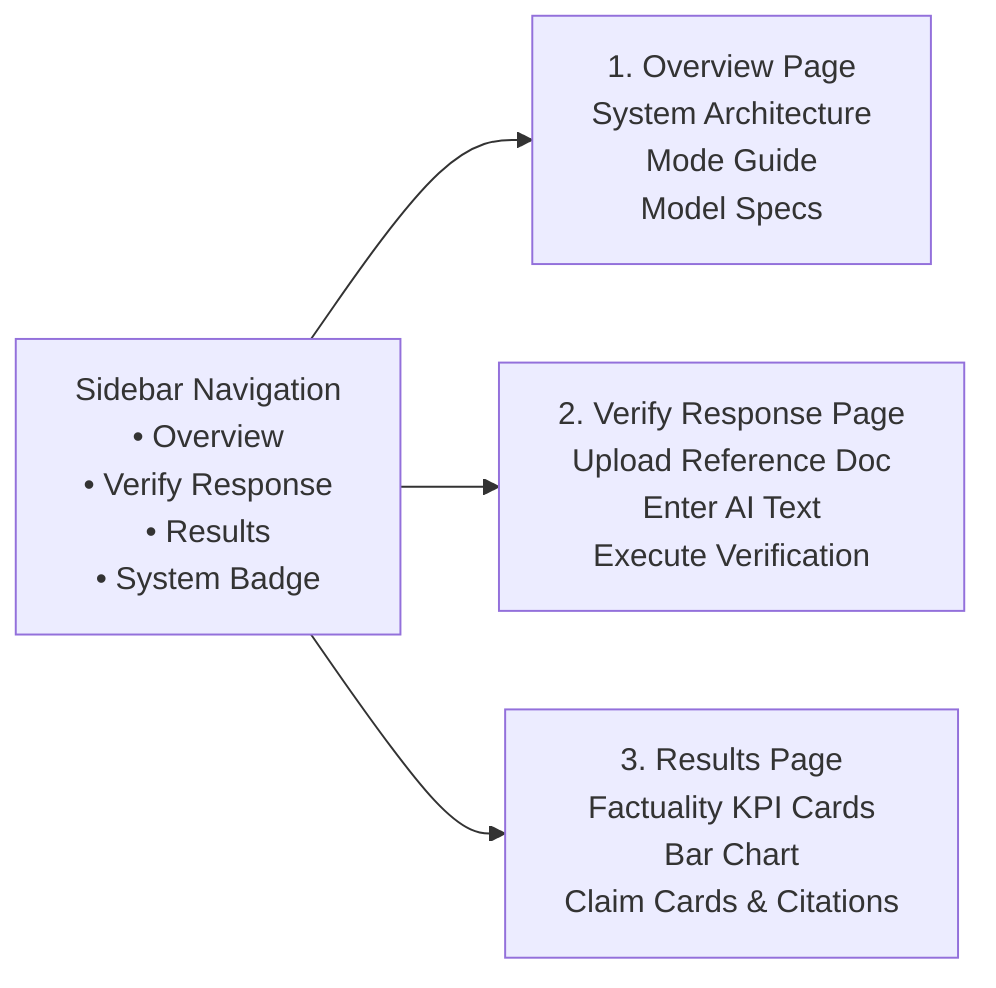

# VeriLLM User Guide: Practical Handbook for Hallucination Detection

**Version:** 1.0.0  
**Target Audience:** Researchers, Analysts, Students, Fact-Checkers, and Non-Technical Evaluators  
**System Type:** Local-First Document Consistency & Hallucination Verification System  
**Web Interface URL:** `http://localhost:8501` (when running locally)

---

## Table of Contents

- [1. Introduction to VeriLLM](#1-introduction-to-verillm)
- [2. What the Application Does and Does Not Do](#2-what-the-application-does-and-does-not-do)
- [3. Prerequisites](#3-prerequisites)
- [4. Installation and Environment Setup on Windows](#4-installation-and-environment-setup-on-windows)
- [5. How to Launch the Application](#5-how-to-launch-the-application)
- [6. Overview of the Application Interface](#6-overview-of-the-application-interface)
- [7. Step-by-Step Document Upload Instructions](#7-step-by-step-document-upload-instructions)
- [8. How to Provide a Question and Candidate Response](#8-how-to-provide-a-question-and-candidate-response)
- [9. How to Use the Optional Gemini Response-Generation Feature](#9-how-to-use-the-optional-gemini-response-generation-feature)
- [10. How to Execute Verification](#10-how-to-execute-verification)
- [11. How to Understand the Verification Results](#11-how-to-understand-the-verification-results)
- [12. Explanation of the Five Production Claim Categories](#12-explanation-of-the-five-production-claim-categories)
- [13. Explanation of Confidence Scores and Probability Visualizations](#13-explanation-of-confidence-scores-and-probability-visualizations)
- [14. Explanation of Response-Level Scoring Metrics](#14-explanation-of-response-level-scoring-metrics)
- [15. How to Interpret Evidence and Claim-Level Inspection Views](#15-how-to-interpret-evidence-and-claim-level-inspection-views)
- [16. Common Errors and Troubleshooting](#16-common-errors-and-troubleshooting)
- [17. Privacy and Data-Handling Explanation](#17-privacy-and-data-handling-explanation)
- [18. Known Limitations](#18-known-limitations)
- [19. Frequently Asked Questions (FAQ)](#19-frequently-asked-questions-faq)

---

## 1. Introduction to VeriLLM

Large Language Models (LLMs)—such as ChatGPT, Claude, and Gemini—are remarkably fluent and capable writers. However, they frequently generate statements that sound convincing, authoritative, and professional, but are factually incorrect or unsupported by the provided source material. In artificial intelligence research, this phenomenon is called **hallucination**.

**VeriLLM** (short for *Verification of Large Language Models*) is an engineering tool designed to detect, highlight, and quantify hallucinations in text generated by AI. 

Instead of asking another AI to "grade" the answer (which is often expensive, slow, and unreliable), VeriLLM uses a specialized, fine-tuned machine-learning model that runs entirely on your own computer. It breaks down an AI response into individual statements (called *propositions*), finds the most relevant passages in your uploaded reference document, and checks each statement to determine whether it is truly supported, contradicted, or ungrounded.

---

## 2. What the Application Does and Does Not Do

To get the most out of VeriLLM, it is important to understand its exact purpose and boundaries.

### What VeriLLM Does:
- **Verifies Document-Grounded Consistency:** VeriLLM checks whether the assertions in an AI-generated text are logically supported by the reference document you provide.
- **Pinpoints Specific Sentences and Phrases:** Rather than giving a vague "pass" or "fail" for the whole text, VeriLLM evaluates each proposition individually and shows you the exact sentences that are supported or contradicted.
- **Shows Reference Evidence:** For each statement, VeriLLM displays the exact page number and text chunk from your document that confirms or refutes the claim.
- **Calibrates Confidence:** It uses mathematical probability calibration so that reported confidence numbers actually match real-world accuracy, rather than being overly optimistic.
- **Protects Privacy (Local-First):** Your reference documents remain strictly on your own computer. They are never uploaded to cloud servers or shared with third parties. Once the model files are present locally, all core verification runs completely offline without internet connectivity (internet access is only required for the initial one-time model download or if you choose to use the optional Gemini generation feature).

### What VeriLLM Does Not Do:
- **Does Not Check Universal Real-World Truth:** VeriLLM does not search the public internet or consult an encyclopedia. It only knows what is in the document you upload. If your document contains an error, VeriLLM treats that document as the ground truth.
- **Does Not Grade Writing Style or Grammar:** VeriLLM ignores writing elegance, vocabulary richness, or formatting. Its sole focus is factual consistency.
- **Does Not Replace Human Oversight:** In critical legal, medical, or financial matters, VeriLLM is a high-speed verification assistant, not a final legal authority.

---

## 3. Prerequisites

Before setting up VeriLLM on a Windows computer, make sure your system meets the following standard requirements:

- **Operating System:** Windows 10 or Windows 11 (64-bit).
- **Python:** Python version `3.11` (specifically `3.11.x`, downloadable from [python.org](https://www.python.org/downloads/)).
- **Hardware:** 
  - Central Processing Unit (CPU): Any modern Intel Core or AMD Ryzen multi-core processor.
  - Memory (RAM): Minimum 8 GB (16 GB recommended).
  - Storage: At least 2.5 GB of free hard disk space (for Python packages and model weights).
  - **No GPU Required:** VeriLLM runs entirely on standard computer processors without needing expensive graphics cards.
- **Web Browser:** Google Chrome, Microsoft Edge, Mozilla Firefox, or Brave.

---

## 4. Installation and Environment Setup on Windows

Setting up VeriLLM takes just a few minutes using Windows PowerShell.

### Step 1: Open Windows PowerShell
Click the Start Menu, type `PowerShell`, and open **Windows PowerShell**.

### Step 2: Navigate to the VeriLLM Directory
Change directory to where VeriLLM is located on your machine:
```powershell
cd "D:\drive e\VeriLLM"
```

### Step 3: Create and Activate a Python Virtual Environment
A virtual environment keeps VeriLLM's libraries organized and separate from any other software on your PC:
```powershell
python -m venv .venv
.\.venv\Scripts\Activate.ps1
```
*(If PowerShell displays a script execution policy restriction, you can enable local script running with `Set-ExecutionPolicy -ExecutionPolicy RemoteSigned -Scope CurrentUser`, then run the activate command again.)*

When activated, you will see `(.venv)` at the beginning of your command prompt line.

### Step 4: Install Dependencies
Install all required libraries using the project's requirements file:
```powershell
python -m pip install --upgrade pip
pip install -r backend/requirements.txt
```

### Step 5: Download the English Language Model
VeriLLM uses the spaCy library for sentence splitting and grammar parsing. Download its English language data:
```powershell
python -m spacy download en_core_web_sm
```

### Step 6: Model Weights Retrieval (Automatic on First Launch)
VeriLLM relies on a fine-tuned DeBERTa-v3 cross-encoder model (~283 MB) hosted on the Hugging Face Hub (`Rabbit-Bull/verillm-deberta` at pinned revision `71259e48c794e89f92075ddf848813c93327461c`).
- **Automatic Retrieval:** On your very first run or verification, VeriLLM automatically downloads the model files (`config.json`, `model.safetensors`, `tokenizer.json`, `tokenizer_config.json`) and caches them under `backend/models/verillm_deberta/`. Internet access is required for this one-time step (the repository is public; no API key or Hugging Face account is needed).
- **Subsequent Offline Use:** Once the model files are cached locally, all future document verifications run **100% offline** on your local CPU.
- **Offline / Air-Gapped Setup:** If your machine lacks internet access, simply copy the four model files into `backend/models/verillm_deberta/` before running the app.

Installation is now complete!

---

## 5. How to Launch the Application

Whenever you want to use VeriLLM:

1. Open PowerShell and navigate to the project directory:
   ```powershell
   cd "D:\drive e\VeriLLM"
   ```
2. Activate your virtual environment:
   ```powershell
   .\.venv\Scripts\Activate.ps1
   ```
3. Launch the Streamlit web interface:
   ```powershell
   streamlit run frontend/app.py
   ```

Within a few seconds, your default web browser will automatically open to:
```text
http://localhost:8501
```

If it does not open automatically, simply copy that link and paste it into your browser's address bar.

---

## 6. Overview of the Application Interface

VeriLLM features a clean, modern dark-theme dashboard.



The application has three primary pages accessible from the left-hand sidebar:

1. **Overview (`Dashboard` icon):**
   - Introduces the system architecture and operational modes.
   - Summarizes the fine-tuned DeBERTa model and its official benchmark scores.
   - Explains the 5 claim categories with visual cards.

2. **Verify Response (`Fact Check` icon):**
   - The primary interactive workspace where you upload documents, enter candidate AI responses, and trigger the verification engine.

3. **Results (`Analytics` icon):**
   - The results dashboard displayed after verification completes.
   - Shows high-level factuality scores, category distribution charts, probability breakdowns, and detailed claim-by-claim evidence citations.

---

## 7. Step-by-Step Document Upload Instructions

In the **Verify Response** page, your first step is providing the reference document that serves as the ground truth.

### How to Upload:
1. Locate the **Step 1: Reference Document** card.
2. Select your preferred input method using the radio buttons:
   - **Upload File (PDF / TXT):** Drag and drop a document from your computer into the upload box, or click "Browse files". Supported formats are `.pdf` (digital PDF with text) and `.txt` (plain text).
   - **Direct Text Entry:** Paste or type reference text directly into the multi-line text box.
3. Once uploaded, VeriLLM displays a validation badge confirming:
   - File name and format type.
   - File size (in KB or MB).
   - Cleaned text preview showing the first few lines of the document.

> [!NOTE]
> **Digital PDFs vs. Scanned Documents:** VeriLLM reads digital PDFs that have selectable text. If you upload a scanned image PDF (a photocopy saved as a PDF without an OCR text layer), the system will alert you that zero characters could be extracted. For scanned files, please run OCR first.

---

## 8. How to Provide a Question and Candidate Response

In **Step 2: Candidate Generation & Input**, you specify the text you want to verify.

1. **User Question / Instruction (Prompt):**
   - Enter the question or prompt that the AI was asked to answer (e.g., *"What were the primary findings of the safety audit?"*).
   - In Manual Verification, this field is optional but recommended because it provides context in your final verification report.
2. **Candidate AI Response (Text to Verify):**
   - Paste the AI-generated text you wish to check into the **Candidate LLM Response** box.
   - This can be text generated by ChatGPT, Claude, Gemini, an internal enterprise model, or a colleague's draft summary.
   - You can edit or refine the text in this box at any time before running verification.

---

## 9. How to Use the Optional Gemini Response-Generation Feature

VeriLLM includes an optional live integration with Google's Gemini API for users who want to generate an AI response on the fly and immediately test it.

### How it works:
1. In the **Verify Response** page, click the **Live Gemini Verification** tab.
2. Ensure you have added your `GEMINI_API_KEY` to the `backend/.env` file. If the key is not configured, the interface will display an advisory banner guiding you.
3. Enter your question into the **User Question / Prompt** field (in this mode, the prompt is required).
4. Click **Generate Response with Gemini**.
5. When the response arrives, it appears in the text area below. You can read it, edit it if desired, and then proceed to verify it against your reference document.

### Important Privacy & Architectural Safeguards:
- **Zero Document Transmission:** Only your question prompt is sent to Google's servers. Your uploaded reference document is **never sent to Gemini**. It remains strictly on your local PC.
- **No Self-Grading:** Gemini is never asked whether its answer is true. The independent, local VeriLLM model performs the evaluation.

### Upstream Service Availability Note:
> [!WARNING]
> **High Demand Notice:** Google's preview endpoint for `gemini-3.8-flash` occasionally experiences temporary capacity spikes, returning an HTTP 503 "High Demand" notice. VeriLLM includes automatic retries. If Google's servers remain busy, the application will display a clear message suggesting you copy text from any web interface and use the **Manual Verification** tab, which operates 100% locally with zero internet dependency.

---

## 10. How to Execute Verification

Once your reference document and candidate response are ready:

### Choose Your Verification Regime:
In the verification settings panel, select between two operational modes:
- **Direct Context Mode:** Recommended for concise documents of up to 350 words (such as short articles, executive memos, or single paragraphs). The entire reference document is evaluated directly alongside the claim.
- **Dense Evidence Retrieval Mode (Recommended for Multi-Page Documents):** For multi-page PDFs, manuals, or contracts. VeriLLM automatically splits the document into 150-word chunks, indexes them with semantic embeddings, and retrieves the top-3 most relevant passages for each proposition.

### Run Verification:
Click the large blue button: **🛡️ Verify Response**.

A progress spinner will appear while VeriLLM extracts propositions, retrieves passages, runs neural inference, and calculates factuality scores. Typical execution takes **$1.5\text{--}4.5\text{ seconds}$**.

Once finished, the application will automatically navigate you to the **Results** dashboard!

---

## 11. How to Understand the Verification Results

The **Results** page provides an executive summary at the top, followed by visual analytics and claim-level details.

```text
================================================================================
EXECUTIVE KPI BANNER
================================================================================
[ 83.3% ]                  [ 50.0% ]                     [ 16.7% ]
Grounded Factuality Index  Contradiction-Penalized Score  Hallucination Severity
================================================================================
```

### The Three Headline KPI Cards:
1. **Grounded Factuality Index (GFI):** The overall percentage of factual claims that were successfully corroborated by your document. Higher is better (100% is perfect).
2. **Contradiction-Penalized Factuality Score (CPFS):** A strict score that heavily penalizes direct contradictions ($\lambda = 2.0$). If an AI gets 5 facts right but directly contradicts the document on 2 critical facts, this score will reflect that serious defect.
3. **Hallucination Severity Index (HSI):** The percentage of claims that actively contradict the reference document. Lower is better (0% means zero confirmed contradictions).

Below the KPI cards is the **Execution Time** card, showing the exact elapsed processing time down to hundredths of a second.

---

## 12. Explanation of the Five Production Claim Categories

VeriLLM assigns every extracted statement to one of five mutually exclusive categories:

| Category Badge | What It Means in Plain English | Practical Example |
| :--- | :--- | :--- |
| **`SUPPORTED`** (Green) | The statement is directly confirmed by and logically entails from the reference document. | *Document:* "The reactor operated at 450°C."<br>*Claim:* "The reactor reached 450 degrees Celsius." $\to$ **SUPPORTED** |
| **`CONTRADICTED`** (Red) | The statement directly conflicts with or states the opposite of what the reference document says. | *Document:* "Operating profit declined by 12%."<br>*Claim:* "Operating profit grew by 12%." $\to$ **CONTRADICTED** |
| **`UNSUPPORTED`** (Orange) | The reference document mentions the topic or entities, but does not provide enough evidence to corroborate the specific claim. | *Document:* "Dr. Smith joined the research team in 2021."<br>*Claim:* "Dr. Smith holds a patent on quantum sensors." $\to$ **UNSUPPORTED** |
| **`UNVERIFIABLE`** (Purple) | The statement could not be checked because the reference document lacks relevant text, or the retrieved passages fell below the defensive similarity threshold ($\tau_{\text{floor}} = 0.20$). | *Document:* (Document is about Apollo 11 moon landing).<br>*Claim:* "The recipe requires two cups of unbleached flour." $\to$ **UNVERIFIABLE** |
| **`NON_FACTUAL`** (Gray) | The statement is a greeting, conversational pleasantry, or subjective opinion that cannot be evaluated as an empirical fact. | *Claim:* "I hope you find this helpful!" or "In my opinion, this was a great decision." $\to$ **NON_FACTUAL** |

### Crucial Distinction: Unsupported vs. Contradicted
- **Unsupported** means: *"The document does not say this is true, but it doesn't say it's false either. Proof is missing."*
- **Contradicted** means: *"The document explicitly refutes this. The AI made an active, provable error."*

---

## 13. Explanation of Confidence Scores and Probability Visualizations

In the **Results** view, every factual claim card displays a 3-class probability breakdown:
- **Support Probability ($\hat{p}_{\text{sup}}$)**
- **Contradiction Probability ($\hat{p}_{\text{contra}}$)**
- **Unsupported Probability ($\hat{p}_{\text{unsup}}$)**

```text
Support        [████████████████████████████            ]  78.4%
Contradiction  [██                                      ]   4.2%
Unsupported    [███████                                 ]  17.4%
```

### Why Calibrated Probabilities Matter:
Standard deep neural networks tend to be "overconfident"—they might report 99% certainty even on rare errors where their real-world accuracy is only 60%. 

VeriLLM implements **$C2$ Probability Calibration**. This mathematical transformation adjusts the raw model outputs so that a stated 80% confidence actually corresponds to an 80% empirical probability of being correct. This makes the confidence scores trustworthy for real decision-making.

---

## 14. Explanation of Response-Level Scoring Metrics

VeriLLM uses mathematically rigorous scoring based on the four factual rates:

1. **Evidence Support Rate ($ESR$):** $\frac{\text{Supported Claims}}{\text{Total Factual Claims}} \times 100\%$
2. **Confirmed Contradiction Rate ($CCR$):** $\frac{\text{Contradicted Claims}}{\text{Total Factual Claims}} \times 100\%$
3. **Unsupported Rate ($USR$):** $\frac{\text{Unsupported Claims}}{\text{Total Factual Claims}} \times 100\%$
4. **Unverifiable Rate ($UVR$):** $\frac{\text{Unverifiable Claims}}{\text{Total Factual Claims}} \times 100\%$

### The 100% Conservation Rule:
These four rates always add up to exactly 100%:
$$ESR + CCR + USR + UVR = 100.00\%$$
This guarantees that no proposition is double-counted and no proposition is lost.

### Why Non-Factual Claims Don't Affect the Score:
If an AI starts its response with *"Hello! I am happy to help you today,"* that sentence is classified as `NON_FACTUAL`. It is excluded from the denominator so that pleasantries do not artificially inflate or deflate the factuality score of the actual information.

---

## 15. How to Interpret Evidence and Claim-Level Inspection Views

Scroll down on the **Results** page to the **Detailed Claim-by-Claim Inspection** section.

### Features of the Claim Inspection View:
- **Filter Tabs:** Use the dropdown menu to view `All Claims`, or filter specifically to inspect `Contradicted`, `Unsupported`, `Supported`, or `Unverifiable` claims.
- **Proposition Statement:** Displays the exact atomic claim extracted from the AI's response.
- **Category Badge:** Clearly colored badge showing the verdict.
- **Citation & Evidence Box:** Shows the exact document snippet that was retrieved to verify the claim, including:
  - Reference document name.
  - Page number where the passage was found.
  - Chunk ID.
  - Semantic similarity score (e.g., `0.84`).
- **Reasoning Trace:** Explains the decision rule applied (e.g., *"Calibrated support probability (78.4%) met support threshold (70.0%)"*).

---

## 16. Common Errors and Troubleshooting

| Message / Issue | What It Means | How to Fix It |
| :--- | :--- | :--- |
| **"Uploaded file is empty (0 bytes)"** | The selected file contains no data. | Check the file on your computer to ensure it saved properly and re-upload. |
| **"Reference document contains 0 words"** | The PDF uploaded is a scanned image without a digital text layer. | Run the PDF through an OCR tool (like Adobe Acrobat or an online scanner) to add text, then re-upload. |
| **"Candidate LLM response is empty"** | No text was provided in the response box. | Type or paste the AI response text you want to evaluate into Step 2. |
| **"Direct mode document length exceeds DeBERTa limit"** | Your document is longer than 350 words in Direct mode. | Switch the verification mode to **Dense Evidence Retrieval Mode** in the settings dropdown. |
| **"Google Gemini Service Temporarily Unavailable (503)"** | Google's external API endpoint is experiencing high peak demand. | The system retries automatically. If busy, copy text from ChatGPT or Gemini web chat and paste into the **Manual Verification** tab. |
| **"All factuality rates and indices are N/A"** | The response contained only greetings or subjective opinions (0 factual claims). | This is expected behavior. If you want a factual score, verify text that makes factual assertions. |

---

## 17. Privacy and Data-Handling Explanation

If you are working with proprietary business plans, clinical records, confidential legal filings, or internal software code, data privacy is critical.

### VeriLLM's Privacy Guarantees:
1. **Local-Only Document Processing:** When you upload a PDF or text file, it is parsed and stored exclusively in your computer's temporary memory (RAM).
2. **Zero Cloud Upload of Documents:** VeriLLM **never** sends your reference documents to Google, OpenAI, Hugging Face, or any external cloud server.
3. **Local Neural Inference:** The fine-tuned DeBERTa model and Sentence-BERT embedding models execute locally on your machine's CPU.
4. **Transparent Codebase:** VeriLLM is open and inspectable; there are no background telemetry trackers or third-party advertising scripts.

*(Note: If you choose to use the optional Gemini feature in Tab 2, only your question prompt is sent to Google's API to fetch candidate text; your reference document remains 100% on your local machine.)*

---

## 18. Known Limitations

While VeriLLM is highly effective, users should keep the following scientific and technical limitations in mind:

1. **Document-Grounded Consistency vs. Real-World Truth:** VeriLLM tests whether the AI's claims agree with *your document*. If your document states that the Moon is made of green cheese, VeriLLM will mark *"The moon is composed of cheese"* as `SUPPORTED`.
2. **Single-Hop vs. Multi-Hop Retrieval:** VeriLLM retrieves passages based on direct semantic similarity. If a claim requires combining clue A on page 3 with clue B on page 87 through complex multi-step deductive logic, it may be marked `UNSUPPORTED`.
3. **Language:** VeriLLM is trained and evaluated on English language text. Text in other languages is not currently supported.
4. **Mathematical and Symbolic Proofs:** The model evaluates natural language assertions. It is not an algebraic theorem prover or code execution sandbox.

---

## 19. Frequently Asked Questions (FAQ)

### Q1: Why is an obviously true fact marked as "Unsupported"?
**Answer:** VeriLLM only knows what is written in your uploaded reference document. If you ask about Mount Everest and the AI correctly states it is 8,848 meters tall, but your uploaded document is about the Roman Empire, VeriLLM will correctly classify the claim as `UNVERIFIABLE` or `UNSUPPORTED` because the reference document provided no evidence for it.

### Q2: What is the difference between "Unsupported" and "Unverifiable"?
**Answer:** Both mean evidence is lacking, but for different reasons:
- `UNSUPPORTED`: The system found relevant passages mentioning the subject, but they did not provide enough details to confirm the specific assertion.
- `UNVERIFIABLE`: No relevant passages could be found at all (the similarity was below the safety floor of 0.20), so the system safely abstained from guessing.

### Q3: Can I verify large books or 100-page manuals?
**Answer:** Yes! Use **Dense Evidence Retrieval Mode**. VeriLLM will automatically break the document into 150-word chunks and search across all pages to find the most relevant evidence for each statement.

### Q4: Does VeriLLM require an internet connection?
**Answer:** A fresh installation requires an internet connection during its very first launch to automatically download the ~283 MB fine-tuned DeBERTa model from Hugging Face (unless the model files are already placed locally in `backend/models/verillm_deberta/`). Once the model files are present, the entire core verification pipeline—including document parsing, proposition extraction, DeBERTa neural inference, probability calibration, and factuality scoring—operates **100% offline** on your computer. Ongoing internet connectivity is only required if you choose to use the optional Gemini candidate generation feature on Tab 2.

### Q5: Why does the Contradiction-Penalized Score (CPFS) drop so quickly?
**Answer:** In critical business and technical applications, an active contradiction (stating something that is false) is much more dangerous than simply omitting a detail. CPFS applies a double penalty ($\lambda = 2.0$) to confirmed contradictions to give you a realistic picture of risk.

### Q6: Can I use VeriLLM with responses from other AI models?
**Answer:** Absolutely. You can paste text generated by any AI (ChatGPT, Claude, LLaMA, Mistral, internal company chatbots) into the candidate text area on the Manual Verification tab.

### Q7: Where are the verification results saved?
**Answer:** Results are stored in your active browser session state. On the Results page, you can expand the **Raw Pipeline Payload Inspector** at the bottom to view or copy the complete structured JSON result for reporting or archiving.

### Q8: What should I do if the AI response mixes true and false facts in one sentence?
**Answer:** VeriLLM's proposition decomposer automatically splits compound sentences (e.g., sentences joined by "and" or "but") into individual propositions, so it can mark the first part as `SUPPORTED` and the second part as `CONTRADICTED`!

